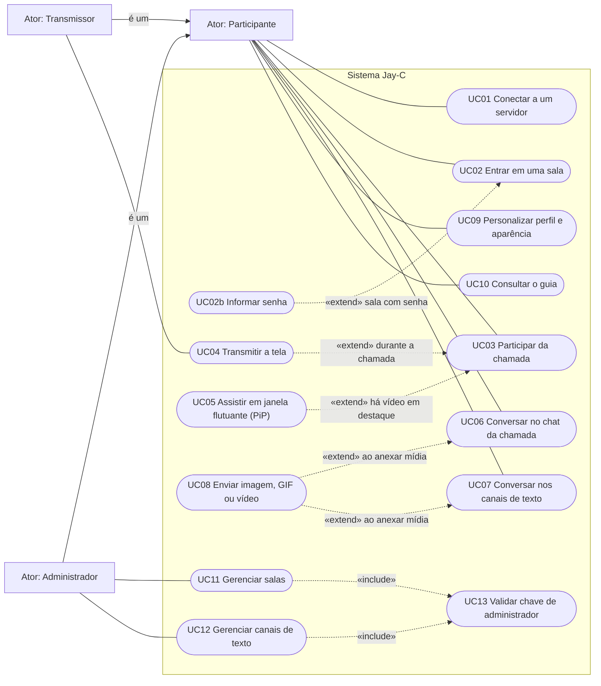
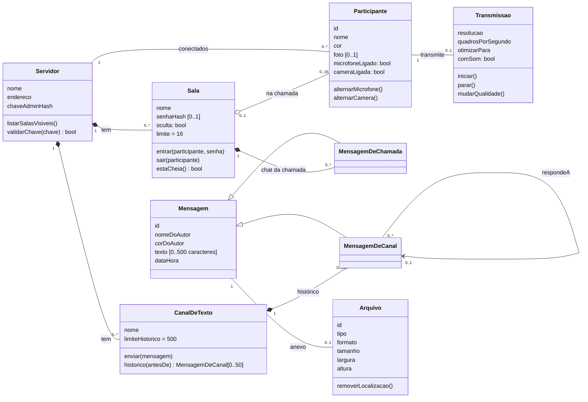
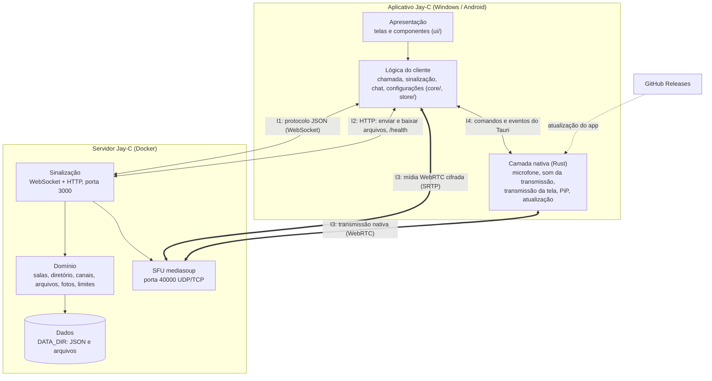
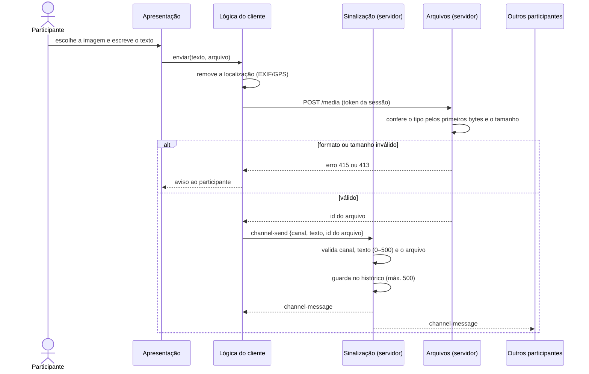
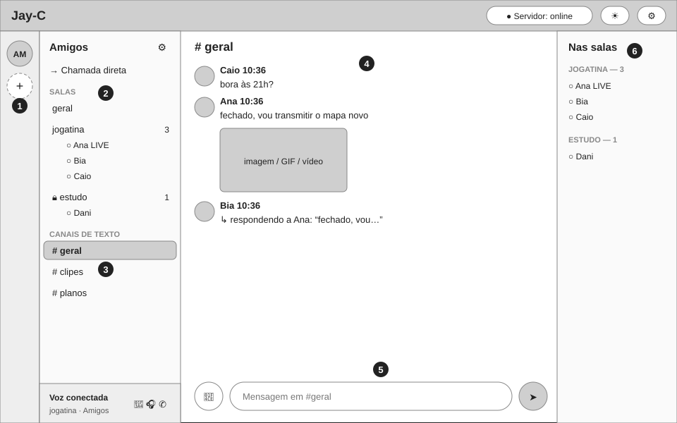
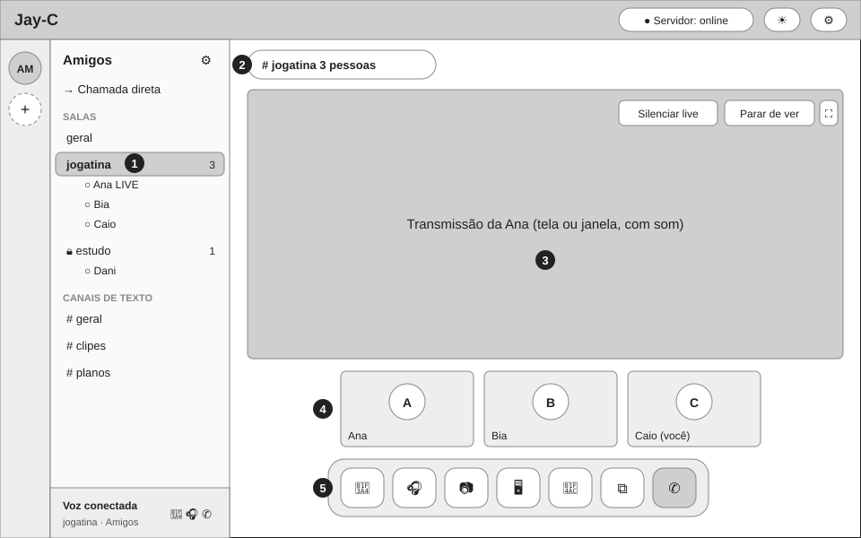
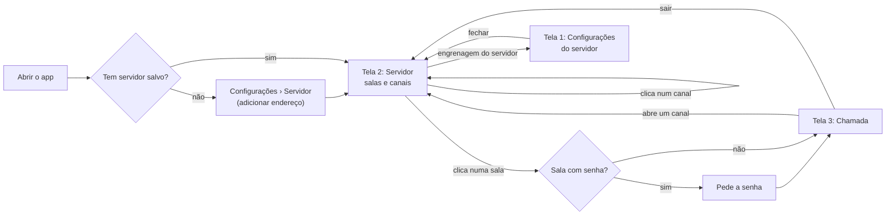
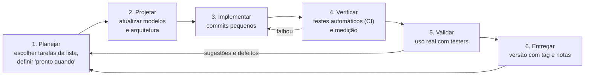
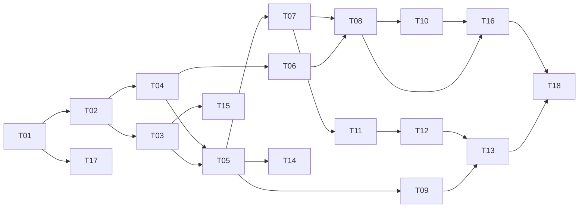
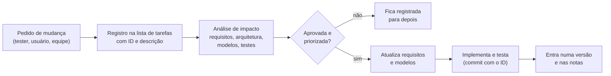

# Jay-C — Dossiê técnico

> Rascunho completo do PDF final (seções 4.1 a 4.8), para revisão da equipe.
> Trechos marcados **[preencher]** dependem da equipe.

---

## Capa

- **Instituição:** Universidade Estadual de Ponta Grossa (UEPG)
- **Disciplina:** Fundamentos de Engenharia de Software
- **Título:** Jay-C — comunicação por voz, vídeo e tela, simples, gratuita e local
- **Turma:** 1º Ano A
- **Integrantes:** Augusto do Amarante, Cristofer Dvorecky Oliveira, Guilherme Perpétuo, Henrique Augusto, Mateus Valenga
- **Data:** 19/11/2026

## Sumário

**[4.1 Identificação e contextualização](#41-identificação-e-contextualização)**
1. [Introdução](#1-introdução)
2. [Problema](#2-problema)
3. [Público-alvo](#3-público-alvo)
4. [Objetivos](#4-objetivos)
5. [Limites do sistema](#5-limites-do-sistema)
6. [Justificativa](#6-justificativa)

**[4.2 Stakeholders e levantamento de requisitos](#42-stakeholders-e-levantamento-de-requisitos)**
7. [Stakeholders](#7-stakeholders)
8. [Levantamento de requisitos](#8-levantamento-de-requisitos)
9. [Requisitos funcionais](#9-requisitos-funcionais)
10. [Requisitos não funcionais](#10-requisitos-não-funcionais)
11. [Regras de negócio](#11-regras-de-negócio)
12. [Conflitos, ambiguidades e restrições](#12-conflitos-ambiguidades-e-restrições)

**[4.3 Modelagem de análise](#43-modelagem-de-análise)**
13. [Diagrama de casos de uso](#13-diagrama-de-casos-de-uso)
14. [Descrição dos casos de uso](#14-descrição-dos-casos-de-uso)
15. [Diagrama de classes de domínio](#15-diagrama-de-classes-de-domínio)
16. [Como os modelos representam os requisitos e as regras](#16-como-os-modelos-representam-os-requisitos-e-as-regras)

**[4.4 Projeto e arquitetura](#44-projeto-e-arquitetura)**
17. [Visão arquitetural](#17-visão-arquitetural)
18. [Princípios de projeto](#18-princípios-de-projeto)
19. [Coesão e acoplamento](#19-coesão-e-acoplamento)
20. [Refinamento de uma funcionalidade](#20-refinamento-de-uma-funcionalidade)
21. [Refatoração futura proposta](#21-refatoração-futura-proposta)
22. [Telas e navegação](#22-telas-e-navegação)

**[4.5 Processo e organização do desenvolvimento](#45-processo-e-organização-do-desenvolvimento)**
23. [Abordagem de processo: incremental, com protótipos de risco](#23-abordagem-de-processo-incremental-com-protótipos-de-risco)
24. [Plano simplificado de execução](#24-plano-simplificado-de-execução)
25. [Controle de versões, mudanças e rastreabilidade](#25-controle-de-versões-mudanças-e-rastreabilidade)

**[4.6 Qualidade, verificação e validação](#46-qualidade-verificação-e-validação)**
26. [Atributos de qualidade](#26-atributos-de-qualidade)
27. [Casos de teste](#27-casos-de-teste)
28. [Verificação e validação](#28-verificação-e-validação)
29. [Matriz de rastreabilidade](#29-matriz-de-rastreabilidade)

**[4.7 Manutenção e evolução](#47-manutenção-e-evolução)**
30. [Mudanças futuras por tipo de manutenção](#30-mudanças-futuras-por-tipo-de-manutenção)
31. [Análise de impacto](#31-análise-de-impacto)
32. [Riscos técnicos e mitigação](#32-riscos-técnicos-e-mitigação)

**[4.8 Conclusão e referências](#48-conclusão-e-referências)**
33. [Conclusão](#33-conclusão)
34. [Referências](#34-referências)
35. [Quadro de contribuição individual](#35-quadro-de-contribuição-individual)
36. [Declaração de participação](#36-declaração-de-participação)

---

# 4.1 Identificação e contextualização

## 1. Introdução

O Jay-C é um app de call de voz, vídeo e transmissão de tela pensado pra grupos pequenos, dividido em duas pontas: o aplicativo que roda no Windows e no Android e o servidor que a própria galera sobe num PC ou numa VPS usando Docker. Sem cadastro, sem login e sem propaganda — se você tem o endereço do servidor, bota um nome e já cai dentro, com o código todo aberto na licença MIT.

Aqui nesse dossiê a gente amarra o Jay-C com o que viu na disciplina, puxando desde o problema inicial e os requisitos até modelagem, arquitetura, processo, testes e manutenção.

## 2. Problema

Hoje em dia qualquer grupinho de amigos, turma de faculdade ou equipe pequena que só quer trocar ideia por voz e mostrar a tela acaba refém de plataforma gigante e centralizada, onde todo mundo tem que criar conta com e-mail ou celular só pra entrar numa call. E não para aí: várias delas ficam empurrando plano pago ou entupindo de anúncio, guardam conversa e arquivo em servidor de terceiros e ainda derrubam a qualidade da live ou o limite de upload se ninguém pagar.

Falta uma saída simples, de graça e local, em que o próprio grupo roda o servidor na mão, decide quem entra e fica dono das próprias conversas sem empresa nenhuma fuçando no meio.

## 3. Público-alvo

Na prática a gente mirou em quatro perfis bem do nosso dia a dia, começando pelos amigos que jogam ou assistem coisa juntos e querem transmitir a tela levando o som do jogo sem dor de cabeça. Tambem entra turma e grupo de estudo que precisa de call junto dum chat onde texto e arquivo não somem, além de equipes pequenas ou comunidades que não querem depender de servidor de fora. Por último tem quem vai subir e segurar o servidor do grupo — que não precisa manjar tudo de infraestrutura, só saber instalar o Docker e abrir duas portas no firewall.

## 4. Objetivos

No fim das contas, o Jay-C quer resolver uma coisa simples: chamada de voz e vídeo, transmissão de tela e chat pra grupos pequenos num servidor que o próprio grupo controla, sem conta, sem anúncio e sem pagar licença pra ninguém.

Botando no chão, o sistema precisa dar conta disso:

1. Aguentar call de voz e vídeo com até 16 pessoas juntas numa sala só.
2. Na hora de mostrar a tela (seja inteira ou uma janela só), mandar o áudio do app junto no Windows e segurar pelo menos 1080p a 60 qps, podendo subir até 1440p ou pra resolução nativa do monitor.
3. Deixar o servidor arrumado em salas de voz — abertas, com senha ou escondidas — junto com canais de texto onde o histórico fica salvo.
4. O pessoal poder mandar imagem, GIF e vídeo no chat sem medo de vazar onde a foto ou o vídeo foi gravado, limpando a localização antes de subir.
5. Quem cuida do servidor conseguir criar, renomear e apagar salas e canais usando uma chave de admin.
6. Rodar direto no Windows e no Android com instalação simples, sem ter que ficar mexendo em mil configs.

## 5. Limites do sistema

O que entra no Jay-C é chamada, live de tela, chat dentro da call, canais de texto com histórico, envio de imagens e vídeos, administração de salas e canais, janelinha flutuante (PiP), troca de temas e um perfil básico com nome, cor e foto.

Já o que ficou de fora foi cortado de propósito mesmo: não tem conta, senha de usuário nem lista de amigos, então quem entra é só o nome que digitou na hora, e também não existe DM privada fora das salas. Entre o app e o servidor a mídia já anda cifrada porque o WebRTC faz isso sozinho, só que não rola criptografia de ponta a ponta já que o servidor do grupo precisa receber e repassar os pacotes de vídeo — entao quem usa tem que confiar em quem tá hospedando aquele servidor. A gente também não mantém nenhum servidor central (cada grupo sobe o seu), e nessa versão o app roda só em Windows e Android, sem iOS, macOS ou Linux.

Lá no servidor tem alguns tetos numéricos que o administrador consegue mudar na configuração se quiser: 16 pessoas por sala, mensagem de até 500 caracteres, 500 mensagens guardadas em cada canal, imagem e GIF até 8 MB e vídeo até 50 MB.

## 6. Justificativa

Vale a pena fazer o Jay-C porque essas plataformas gigantes cobram a "gratuidade" em cima dos seus dados e da sua atenção, e uma turma de faculdade ou grupo de amigos não precisa daquele trambolho inteiro pra conversar.

Aqui as conversas, os arquivos e quem pode entrar ficam tudo na máquina do grupo, e como o app e o servidor são de graça e open-source o único gasto real acaba sendo o PC ou VPS que hospeda — que muitas vezes já é o computador de alguém da galera. Pra entrar ninguém perde tempo criando conta, só bota o endereço do servidor e um nome, e no Windows o microfone não derruba o volume dos jogos enquanto a transmissão pega pelo menos 1080p60 (batendo até 1440p) com som. De quebra o app ficou bem enxuto: em vez de enfiar um navegador inteiro dentro do executável, ele aproveita a WebView do próprio sistema (WebView2 no Windows), deixando o instalador lá pelos 5,4 MB.

---

# 4.2 Stakeholders e levantamento de requisitos

## 7. Stakeholders

| # | Stakeholder | Interesses |
|---|---|---|
| S1 | Participante (usuário comum) | Entrar sem burocracia de cadastro, ouvir limpo sem engasgar e ter um app leve e de graça. |
| S2 | Transmissor (quem compartilha a tela) | Mostrar jogo ou janela com áudio junto e qualidade boa, sem derreter o PC nem vazar som de outros apps. |
| S3 | Administrador do servidor | Subir e manter o servidor sem sofrer, trancar ou esconder salas, controlar acesso e não deixar arquivo lotar o disco. |
| S4 | Usuário de celular | Entrar nas calls pelo Android, continuar vendo a live na janelinha (PiP) e não derreter bateria nem 4G. |
| S5 | Equipe de desenvolvimento e mantenedores | Código separado e testável, release segura, auto-update funcionando pro pessoal e facilidade pra caçar bug depois. |

## 8. Levantamento de requisitos

Pra descobrir o que o sistema precisava fazer mesmo, a gente pensou em três frentes rodando em ciclos curtos: bater papo em entrevista com quem já vive em call e live (S1, S2 e S4) e com quem toparia hospedar (S3), rodar um formulário rápido online pra ter noção de quantas pessoas entram juntas e observar gente real usando as builds de teste. Essa terceira parte já aconteceu na prática faz tempo — várias coisas que os testers pediram viraram requisito direto, tipo o chat da call do lado do vídeo e responder mensagem nos canais.

As perguntas pra guiar essas conversas seriam mais ou menos essas:

1. Quantas pessoas costumam ficar na call de vocês ao mesmo tempo, e qual foi o pico máximo que já juntou?
2. O que vocês usam hoje pra chamada e live, e o que mais dá raiva neles — pedir conta, anúncio, limitar bitrate ou privacidade?
3. Quando alguém abre live na call, costuma mostrar o monitor todo, uma janela ou um jogo? E o som desse app precisa ir junto?
4. Faz falta guardar histórico de mensagem e arquivo nos canais, ou pode ir sumindo? Quem deveria conseguir abrir isso?
5. Tem alguém no grupo que toparia deixar um PC ou VPS ligada pro servidor, e quanto essa pessoa manja de rede e Docker?
6. Pelo celular, o que não pode parar de jeito nenhum se você sair do app — continuar ouvindo a call ou ver a transmissão também?
7. Vocês precisam de sala trancada com senha, ou até sala que fica invisível na lista pra ninguém ficar clicando?

## 9. Requisitos funcionais

Prioridade: Alta (obrigatório pra primeira versão sair), Média (faz diferença, mas o app roda sem), Baixa (bom ter). No MoSCoW lá da apostila da disciplina, Alta vira *Must have*, Média vira *Should have* e Baixa vira *Could have*, enquanto tudo que ficou de fora ([seção 5](#5-limites-do-sistema)) cai como *Won't have now*.

| ID | Descrição | Ator | Prioridade | Critério de aceitação |
|---|---|---|---|---|
| RF001 | O sistema deve permitir que o usuário configure o endereço de um servidor para estabelecer uma conexão. | Participante | Alta | Botou endereço válido de servidor ligado, o app conecta e já mostra o nome dele; se o endereço for inválido ou o servidor tiver caído, avisa o erro na tela sem congelar o app. |
| RF002 | O sistema deve permitir que o usuário visualize os servidores, as salas disponíveis e os canais de texto. | Participante | Alta | Conectou no servidor, a barra lateral já lista as salas visíveis (com cadeado nas que pedem senha), os canais de texto e quem tá em cada sala — sala oculta não dá as caras ali. |
| RF003 | O sistema deve permitir que o usuário entre em uma sala de comunicação utilizando seu nome e as informações necessárias de acesso. | Participante | Alta | Com o nome preenchido, clicou na sala já entra na call e em até 2 segundos o nome aparece pro resto do pessoal; sem nome o app nem deixa tentar. |
| RF004 | O sistema deve permitir que o usuário entre em salas protegidas mediante o fornecimento de uma senha válida. | Participante | Alta | Acertou a senha, entra normal; errou, volta o aviso "senha incorreta" e a pessoa continua do lado de fora. |
| RF005 | O sistema deve permitir que os participantes realizem chamadas de voz e vídeo em tempo real. | Participante | Alta | Com duas pessoas na mesma sala, uma escuta a outra e vê a câmera quando tiver ligada. |
| RF006 | O sistema deve permitir que o usuário ative ou desative seu microfone e sua câmera durante uma chamada. | Participante | Alta | Mutou o mic, o pessoal para de ouvir e aparece o ícone de mudo; desligou a câmera, o vídeo some e entra a foto ou as iniciais. |
| RF007 | O sistema deve permitir que o usuário compartilhe a tela inteira ou uma janela específica de um aplicativo. | Transmissor | Alta | O transmissor escolhe o monitor ou uma janela e quem tá na sala já assiste levando o som junto do que tá sendo transmitido (no Windows). |
| RF008 | O sistema deve permitir que o usuário configure a qualidade das transmissões, selecionando resolução, taxa de quadros e otimização. | Transmissor | Média | O painel deixa mexer na resolução (360p até 1440p ou original), FPS (5 a 60 qps) e no modo de otimizar pra detalhe, movimento ou equilíbrio — e dá pra ver nas estatísticas da live que cada mudança altera o que tá sendo enviado. |
| RF009 | O sistema deve permitir que os participantes enviem e recebam mensagens de texto durante as chamadas. | Participante | Alta | Mandou texto no chat da call, cai pra todo mundo da sala junto com nome do autor e horário. |
| RF010 | O sistema deve permitir que os usuários enviem imagens, GIFs e vídeos nos chats das chamadas e nos canais de texto. | Participante | Alta | Arquivo PNG, JPEG, WebP, GIF, MP4 ou WebM dentro do peso permitido aparece no chat pro pessoal ver; se tentar mandar outro formato, é barrado com aviso. |
| RF011 | O sistema deve permitir que os usuários enviem mensagens nos canais de texto dos servidores e consultem o histórico de conversas. | Participante | Alta | Mensagem enviada num canal segue lá mesmo depois de fechar e abrir o servidor de novo, e puxando a barra pra cima carrega as mais antigas. |
| RF012 | O sistema deve permitir que o usuário responda a mensagens anteriores nos canais de texto. | Participante | Média | A resposta sai com um pedaço da mensagem original em cima, e clicar ali rola direto pra ela. |
| RF013 | O sistema deve permitir que o usuário personalize seu perfil por meio de uma imagem ou cor de identificação. | Participante | Média | A foto ou cor que a pessoa escolheu aparece pro resto do grupo tanto no card da call quanto nas mensagens. |
| RF014 | O sistema deve permitir que o administrador crie, edite e exclua salas de comunicação. | Administrador | Alta | Com a chave certa, criar, renomear ou apagar uma sala já atualiza a lista na tela de todo mundo que tá conectado. |
| RF015 | O sistema deve permitir que o administrador crie, edite e exclua canais de texto. | Administrador | Alta | Com a chave certa, criar, renomear ou apagar um canal já atualiza a lista na tela de todo mundo conectado. |
| RF016 | O sistema deve permitir que o administrador configure salas protegidas por senha e salas ocultas. | Administrador | Alta | Marcou senha, a sala passa a exigir ela na entrada; marcou como oculta, some da lista pública e só entra digitando nome e senha. |
| RF017 | O sistema deve permitir que o usuário visualize uma transmissão de vídeo em uma janela flutuante por meio do recurso Picture-in-Picture. | Participante | Média | Ligou o PiP, a live continua numa janelinha solta por cima dos outros programas no Windows ou por cima do sistema no Android. |
| RF018 | O sistema deve permitir que o usuário personalize as configurações visuais do aplicativo, incluindo a seleção de temas. | Participante | Baixa | Trocou tema (claro/escuro) ou estilo (Calmo, Neon, Suave), a cara do app muda na hora e continua assim quando abre de novo. |
| RF019 | O sistema deve permitir que o usuário consulte um guia de instruções para configurar e utilizar o aplicativo e seu servidor. | Participante, Administrador | Média | Na primeira vez que abre já sobe o tour de boas-vindas, e dá pra abrir de novo em Configurações › Ajuda junto do guia pra subir servidor. |
| RF020 | O sistema deve permitir que o usuário saia de uma sala ou encerre sua participação em uma chamada. | Participante | Alta | Clicou em "sair", fecha a chamada, corta mic e câmera na hora e em até 2 segundos você já some da sala pros outros. |

## 10. Requisitos não funcionais

| ID | Categoria | Descrição | Prioridade | Critério de verificação |
|---|---|---|---|---|
| RNF001 | Desempenho | O sistema deve suportar chamadas com até 16 participantes simultâneos em uma mesma sala. | Alta | Botar 16 participantes ligados juntos na mesma sala (gente real ou bots simulados) e todo mundo conseguir se ouvir e se ver. |
| RNF002 | Segurança | O sistema deve restringir o acesso às funções administrativas por meio de uma chave de administrador. | Alta | Mandou comando de admin sem chave ou com chave errada, o servidor devolve `not-admin`; acertou a chave, passa. |
| RNF003 | Segurança | O sistema deve proteger o acesso aos arquivos compartilhados, permitindo sua visualização somente aos participantes autorizados da chamada ou da sessão do servidor. | Alta | Tentar puxar um arquivo sem o token da sessão, ou usando token de outra sala/sessão, volta erro no lugar do arquivo. |
| RNF004 | Segurança | O sistema deve validar os tipos e tamanhos dos arquivos enviados, impedindo o recebimento de formatos não permitidos. | Alta | Arquivo válido passa; tipo proibido volta HTTP 415; passou do peso máximo volta HTTP 413. |
| RNF005 | Privacidade | O sistema deve remover informações de localização e metadados de fotos (JPEG, PNG, WebP) e vídeos MP4 antes do envio. | Média | Subir uma foto JPEG com GPS no EXIF e um MP4 com tag de localização e checar num leitor de metadados que chegaram no servidor zerados disso. |
| RNF006 | Disponibilidade | O servidor deve disponibilizar um mecanismo de verificação de funcionamento por meio de um endpoint de saúde. | Média | Bater em `GET /health` e voltar HTTP 200 enquanto o servidor tá de pé. |
| RNF007 | Confiabilidade | O aplicativo deve tentar restabelecer automaticamente a conexão com o servidor em caso de interrupção. | Alta | Derrubar e ligar o servidor de novo no meio da call: o app mostra "reconectando", vai tentando (1, 2, 4, 8 e depois de 10 em 10 s) e cai de volta na sala sozinho. |
| RNF008 | Compatibilidade | O aplicativo deve funcionar no Windows 10 e 11 (64 bits) e no Android 7.0 ou superior, respeitando as limitações de cada sistema. | Alta | Tanto o instalador quanto o APK instalam e entram numa call nos dois sistemas, com as diferenças (tipo áudio da live só no Windows) bem explicadas na doc. |
| RNF009 | Usabilidade | A interface deve manter contraste legível entre texto e fundo em todos os temas e estilos visuais disponíveis. | Baixa | Rodar o teste automático nos 6 combos de tema e estilo e bater contraste mínimo de 4,5:1 em todo texto. |
| RNF010 | Desempenho | O sistema deve permitir transmissões de tela com resolução configurável, chegando a pelo menos 1080p a 60 quadros por segundo. | Média | Com 1080p60 marcado e conteúdo mexendo na tela, as estatísticas da transmissão marcam 1920×1080 e batem perto dos 60 qps. |

## 11. Regras de negócio

| ID | Descrição | Requisitos relacionados |
|---|---|---|
| RN001 | Cada sala aguenta no máximo 16 pessoas juntas ao mesmo tempo; quem tentar entrar por 17º leva aviso de sala cheia. | RF003, RF005, RNF001 |
| RN002 | Sala trancada com senha só abre se informar a senha certa. | RF004, RF016 |
| RN003 | Sala oculta não entra na lista pública de salas e obrigatoriamente tem que ter senha. | RF002, RF016 |
| RN004 | Só quem passou a chave válida de administrador consegue criar, editar ou apagar salas e canais. | RF014, RF015, RF016, RNF002 |
| RN005 | Se a mensagem tiver texto, o limite é 500 caracteres (e se for sem anexo, não pode ir vazia — fica entre 1 e 500). | RF009, RF010, RF011 |
| RN006 | Cada canal de texto segura no máximo as últimas 500 mensagens enviadas. | RF011 |
| RN007 | Cada vez que puxa o histórico de um canal volta no máximo um bloco de 50 mensagens. | RF011 |
| RN008 | Imagens e GIFs podem ter até 8 MB e vídeos até 50 MB (dando pra trocar via `MAX_IMAGE_MB` e `MAX_VIDEO_MB`). | RF010, RNF004 |
| RN009 | Arquivo compartilhado só abre pra quem faz parte daquela chamada ou da sessão do servidor onde ele subiu. | RF010, RNF003 |
| RN010 | Sala fixa não pode trocar de nome enquanto tiver gente conectada dentro dela. | RF014 |
| RN011 | Foto de perfil tem que ser PNG, JPEG ou WebP e não pode passar de 32 000 caracteres na string mandada pro servidor (em base64 / data URL). | RF013 |
| RN012 | Resposta só pode citar uma mensagem que pertença ao mesmo canal de texto. | RF012 |

## 12. Conflitos, ambiguidades e restrições

| # | Tipo | Situação | Como foi resolvido |
|---|---|---|---|
| C1 | Conflito | Quem hospeda (S3) quer segurar quem entra, mas a galera (S1) não quer saber de criar conta nem senha pessoal. | Sem conta mesmo — a tranca fica por senha na sala, sala oculta e chave de admin (`RN002`–`RN004`). |
| C2 | Conflito | Quem transmite (S2) quer mandar live em 1080p60, só que isso não pode fritar o PC nem derrubar quem tá na internet ruim. | Encoding na GPU, qualidade configurável (`RF008`) e queda automática de resolução/FPS conforme a rede de cada um que assiste. |
| C3 | Conflito | Usuário (S1) queria histórico pra sempre, enquanto S3 muitas vezes roda o servidor num PC ou VPS simples. | Corte de 500 mensagens por canal (`RN006`) e teto de tamanho nos arquivos (`RN008`), tudo ajustável pelo admin. |
| A1 | Ambiguidade | "Aguentar 16 pessoas" (`RNF001`): todo mundo com câmera aberta ao mesmo tempo? | Fechamos como 16 pessoas na sala podendo ligar câmera; o servidor escolhe a camada de vídeo certa pra rede de cada espectador. |
| A2 | Ambiguidade | "Plataformas previstas" (`RNF008`) tava vago demais no começo. | Travado em Windows 10/11 64 bits e Android 7.0+. |
| A3 | Ambiguidade | No rascunho antigo, `RNF005` falava só "metadados de determinados arquivos" sem listar quais. | Fechou em localização e metadados de fotos (EXIF/XMP/blocos de texto em JPEG, PNG e WebP) mais localização em vídeos MP4. |
| R1 | Restrição | Capturar áudio só de um aplicativo depende de uma API própria do Windows. | Ficou assumido e documentado como recurso exclusivo do Windows (`RNF008`). |
| R2 | Restrição | O servidor precisa de duas portas abertas na rede (`3000/TCP` e `40000 UDP/TCP`). | Explicado no guia de instalação (`RF019`): quem hospeda abre as portas no roteador/firewall ou passa por VPN/túnel. |

---

# 4.3 Modelagem de análise

> Os diagramas estão em Mermaid (texto que vira desenho). Para o PDF, cada um será exportado como imagem, com título e legenda.

## 13. Diagrama de casos de uso

**Figura 1 — Casos de uso do Jay-C.** Atores à esquerda e elipses como casos de uso. Linhas sólidas ligam o ator ao caso de uso; setas `"é um"` indicam especialização de ator; setas tracejadas mostram `<<include>>` (sempre acontece dentro do caso base) e `<<extend>>` (acontece só sob certa condição).

O ator principal é o Participante, e tanto Transmissor quanto Administrador são especializações dele porque qualquer pessoa na sala pode abrir uma live (virando Transmissor) e qualquer um que tiver a chave certa pode administrar o servidor (virando Administrador). Como não existe conta no Jay-C ([seção 5](#5-limites-do-sistema)), administrar depende só de informar essa chave, então `UC11` e `UC12` sempre puxam `UC13` com `<<include>>`. Já conectar ao servidor (`UC01`) acontece uma vez só quando o app abre e funciona como pré-condição pro resto — tipo entrar numa sala no [`UC02`](#uc02--entrar-em-uma-sala), mandar msg em canal ou mexer nas configurações — por isso a gente não botou `<<include>>` nele. Os casos `UC02b` (informar senha) e `UC08` (anexar mídia) só disparam quando a sala tem senha ou quando alguém anexa arquivo, então entram como `<<extend>>`.

| Caso de uso | Requisitos |
|---|---|
| UC01 Conectar a um servidor | RF001, RF002, RNF007 |
| [UC02 Entrar em uma sala](#uc02--entrar-em-uma-sala) | RF002, RF003, RF004 |
| UC02b Informar senha | RF004 |
| UC03 Participar da chamada | RF005, RF006, RF020 |
| [UC04 Transmitir a tela](#uc04--transmitir-a-tela) | RF007, RF008, RNF010 |
| UC05 Assistir em PiP | RF017 |
| UC06 Conversar no chat da chamada | RF009 |
| UC07 Conversar nos canais de texto | RF011, RF012 |
| UC08 Enviar imagem, GIF ou vídeo | RF010, RNF004, RNF005 |
| UC09 Personalizar perfil e aparência | RF013, RF018, RNF009 |
| UC10 Consultar o guia | RF019 |
| [UC11 Gerenciar salas](#uc11--gerenciar-salas) | RF014, RF016 |
| UC12 Gerenciar canais de texto | RF015 |
| UC13 Validar chave de administrador | RNF002 |

## 14. Descrição dos casos de uso

### UC02 — Entrar em uma sala

| Campo | Descrição |
|---|---|
| Objetivo | Entrar numa sala de chamada do servidor pra conversar e ver quem tá lá. |
| Ator | Participante |
| Requisitos e regras | RF002, RF003, RF004, RN001, RN002, RN003 |
| Pré-condições | O app já tá conectado num servidor (`UC01`) e a pessoa botou um nome. |
| Fluxo principal | 1. O participante olha a lista de salas com quem tá em cada uma e 2. clica numa delas. 3. O app manda o pedido pro servidor, 4. que checa se tem menos de 16 pessoas ali dentro (`RN001`). 5. Estando liberado, o servidor aceita e avisa todo mundo, e 6. o app abre a tela da chamada deixando mic e câmera do jeito que estavam na última vez. |
| Fluxo alternativo A — sala com senha | Se a sala tiver cadeado no passo 2, o app abre pedindo a senha (`UC02b`) e o servidor confere ela (`RN002`) — se bater errado, mostra aviso e joga de volta pra lista. |
| Fluxo alternativo B — sala oculta | Como a sala oculta nem aparece na lista (`RN003`), o participante digita o nome dela junto da senha lá no campo de entrada direta e segue pro passo 3. |
| Fluxo alternativo C — sala cheia | Bateu 16 pessoas no passo 4, o servidor barra com aviso de sala cheia e quem clicou fica de fora mesmo. |
| Fluxo alternativo D — sem conexão | Se o servidor cair ou não responder no passo 3, o app avisa que falhou e deixa tentar de novo. |
| Pós-condições | O participante cai dentro da sala e aparece na lista/chamada pro resto do pessoal (se der erro, não muda nada na sala). |

### UC04 — Transmitir a tela

| Campo | Descrição |
|---|---|
| Objetivo | Mostrar pro resto da sala a tela inteira ou uma janela específica, levando o som junto. |
| Ator | Transmissor |
| Requisitos e regras | RF007, RF008, RNF010 |
| Pré-condições | Quem vai transmitir já tá numa call (`UC03`). |
| Fluxo principal | 1. A pessoa clica em "Transmitir", 2. o app abre o painel pra escolher resolução, FPS e modo de otimização (detalhe, movimento ou equilíbrio), e 3. no seletor do sistema ela aponta a tela inteira ou uma janela só. 4. O app começa a mandar o vídeo e (no Windows) o áudio daquele programa, 5. os outros veem que subiu uma live e clicam pra assistir, até 6. o transmissor clicar em "Parar". |
| Fluxo alternativo A — cancelamento | Fechou o seletor do sistema sem escolher nada no passo 3? Não sobe transmissão nenhuma e a chamada segue igual. |
| Fluxo alternativo B — rede fraca | Quando a internet de quem assiste não aguenta o bitrate escolhido no passo 4, a transmissão reduz resolução ou FPS conforme o modo selecionado pra não cair. |
| Fluxo alternativo C — mudar a qualidade | Dá pra mexer nas opções do painel com a live já rodando — os valores novos entram na hora sem precisar reiniciar a transmissão. |
| Pós-condições | Enquanto tá no ar, a transmissão aparece no card de quem transmite; na hora que para, some da tela de todo mundo. |

### UC11 — Gerenciar salas

| Campo | Descrição |
|---|---|
| Objetivo | Criar, renomear e apagar as salas fixas do servidor, botando senha e escolhendo se fica oculta. |
| Ator | Administrador |
| Requisitos e regras | RF014, RF016, RNF002, RN002, RN003, RN004, RN010 |
| Pré-condições | O app tá conectado no servidor e o admin já destravou com a chave nas configurações. |
| Fluxo principal | 1. O admin abre as configurações do servidor, 2. escolhe criar uma sala e digita o nome, 3. podendo marcar uma senha e esconder a sala se quiser. 4. O app manda o pedido autenticado pela chave, 5. o servidor confere a permissão (`UC13`, `RN004`) junto dos dados e 6. salva em disco, atualizando a lista na tela de todo mundo. |
| Fluxo alternativo A — chave inválida | Se a chave não bater no passo 5, o servidor barra na hora e avisa que aquela chave não é do admin. |
| Fluxo alternativo B — sala oculta sem senha | Tentou marcar sala oculta sem botar senha junto? O servidor recusa por causa da `RN003`. |
| Fluxo alternativo C — nome repetido | Se já existir outra sala com aquele nome, não deixa duplicar e mostra erro. |
| Fluxo alternativo D — renomear sala ocupada | Se tiver gente em chamada dentro da sala na hora de renomear, o servidor barra até a sala esvaziar (`RN010`). |
| Fluxo alternativo E — excluir | Quando o admin apaga uma sala, ela sai da lista de todo mundo conectado. |
| Pós-condições | A lista atualizada fica gravada em disco e continua lá igualzinha mesmo se reiniciar o servidor. |

## 15. Diagrama de classes de domínio

**Figura 2 — Classes de domínio do Jay-C.** Mostra os conceitos do problema, não as classes do código. Os números nas pontas são as multiplicidades; losango cheio (`*--`) é composição, losango vazio (`o--`) é agregação e a seta aberta (`<|--`) marca herança.

Tem umas decisões nesse diagrama que vale explicar direto pra não parecer erro. Não tem classe Usuário nem Conta porque o sistema não tem cadastro, então o participante só existe enquanto tá conectado no servidor, e é exatamente por isso que `Mensagem` guarda `nomeDoAutor` e `corDoAutor` direto nela em vez de apontar pro `Participante` — senão o histórico dos canais ia perder o autor toda vez que a pessoa saísse da sala.

O Administrador tambem não virou uma classe separada. Administrar aqui é só ter a chave do servidor, e quem confere ela é `Servidor.validarChave()`, entao aquele ator dos casos de uso vira uma operação no servidor em vez de existir como objeto próprio.

A gente separou `Mensagem` em duas subclasses porque o comportameto delas muda bastante: a da chamada morre quando a sala esvazia ou a call acaba (por isso composição com `Sala`), enquanto a do canal fica salva no histórico (composição com `CanalDeTexto`) e pode citar outra mensagem do mesmo canal (`respondeA`). Cada mensagem leva no máximo 1 anexo (`0..1`), e o `texto` pode ir vazio se tiver mídia junto (sem anexo, precisa ter de 1 a 500 caracteres). Já a agregação (losango vazio) ficou só entre `Sala` e `Participante`, porque se o usuário sair de uma chamada ele continua conectado ao servidor mexendo nos canais de texto. Pra fechar, `Arquivo.tipo` pode ser imagem, GIF ou vídeo, e `formato` aceita PNG, JPEG, WebP, GIF, MP4 ou WebM.

## 16. Como os modelos representam os requisitos e as regras

| Elemento do modelo | Requisito ou regra |
|---|---|
| Multiplicidade `0..16` entre Sala e Participante; `Sala.limite` e `estaCheia()`; fluxo alternativo C do [UC02](#uc02--entrar-em-uma-sala) | RN001, RNF001 |
| `Sala.senhaHash [0..1]` e `entrar(participante, senha)`; UC02b `<<extend>>` | RF004, RN002 |
| `Sala.oculta` e `Servidor.listarSalasVisiveis()`; fluxo alternativo B do [UC02](#uc02--entrar-em-uma-sala) | RF016, RN003 |
| `Servidor.validarChave()`; UC13 incluído por [UC11](#uc11--gerenciar-salas) e UC12 | RF014, RF015, RNF002, RN004 |
| Atributo `texto [0..500 caracteres]` | RN005 |
| Composição `CanalDeTexto "1" *-- "0..500" MensagemDeCanal` | RF011, RN006 |
| `historico(antesDe)` devolvendo `MensagemDeCanal[0..50]` | RN007 |
| Auto-associação `respondeA`, só entre mensagens de canal | RF012, RN012 |
| Classe Arquivo com `tipo`, `tamanho` e `removerLocalizacao()`; UC08 | RF010, RNF004, RNF005, RN008 |
| Arquivo ligado a uma mensagem, que pertence a uma sala ou a um canal | RN009, RNF003 (o arquivo só é visível nesse escopo) |
| Associação Participante–Transmissão e seus atributos de qualidade; [UC04](#uc04--transmitir-a-tela) | RF007, RF008, RNF010 |
| Atributos `cor` e `foto` do Participante; UC09 | RF013, RN011 |
| Fluxo alternativo D do [UC11](#uc11--gerenciar-salas) (renomear sala ocupada) | RN010 |

---

# 4.4 Projeto e arquitetura

## 17. Visão arquitetural

O Jay-C funciona no modelo cliente-servidor, com o aplicativo rodando no PC ou no celular de cada participante e o servidor rodando na máquina do grupo dentro de um contêiner Docker. A mídia não vai direto de um participante pro outro: tudo passa por um **SFU** (*Selective Forwarding Unit*) no servidor, que recebe cada vídeo uma vez só e repassa pra quem tá assistindo sem precisar decodificar.

**Figura 3 — Componentes, camadas e interfaces.** Setas simples mostram dependência interna, setas duplas (`<-->`) são protocolo/HTTP na porta 3000 ou comandos/eventos entre JS e Rust (`I4`), setas grossas (`<==>`) são mídia WebRTC cifrada na porta 40000 (`I3`, tanto vinda do JS quanto da camada nativa), a seta tracejada indica busca de atualização externa e o cilindro representa os arquivos gravados em disco no servidor.

| Componente | Responsabilidade |
|---|---|
| Apresentação ([`frontend/src/ui`](../frontend/src/ui)) | Cuida só de desenhar as telas (lista de salas e canais, chat, call, configurações) e repassar o clique do usuário pra lógica, sem conversar direto com servidor nenhum. |
| Lógica do cliente ([`frontend/src/core`](../frontend/src/core), [`store`](../frontend/src/store)) | Aqui mora a classe `Call` coordenando a chamada, o `signaling` falando o protocolo e reconectando quando cai, `attachments` preparando arquivos e `settings` guardando preferências. |
| Camada nativa ([`src-tauri`](../frontend/src-tauri), [`plugins`](../plugins)) | Faz em Rust o que o navegador não dá conta direito: mic com cancelamento de eco sem abafar os jogos, captura de áudio por programa, live da tela codificando na placa de vídeo, janela de PiP e auto-update. |
| Sinalização ([`signaling-server/src/server.js`](../signaling-server/src/server.js)) | Recebe as mensagens JSON, confere se quem pediu pode fazer aquilo e avisa o resto dos participantes. |
| Domínio do servidor ([`rooms`](../signaling-server/src/rooms.js), [`directory`](../signaling-server/src/directory.js), [`channels`](../signaling-server/src/channels.js), [`media`](../signaling-server/src/media.js), [`avatars`](../signaling-server/src/avatars.js), [`rate-limit`](../signaling-server/src/rate-limit.js)) | Onde ficam as regras de negócio de verdade: lotação da sala, senhas, salas ocultas, histórico dos canais e checagem de arquivos. |
| SFU ([`sfu.js`](../signaling-server/src/sfu.js), [`sfu-room.js`](../signaling-server/src/sfu-room.js)) | Recebe áudio e vídeo de todo mundo e repassa escolhendo a camada certa de qualidade conforme a internet de quem tá assistindo. |
| Dados (`DATA_DIR`) | Salva salas, canais, histórico, fotos e arquivos direto em JSON e arquivos no disco, sem precisar subir banco de dados. |

| Interface | O que passa por ela |
|---|---|
| I1 Protocolo JSON sobre WebSocket | `join`, `leave`, `chat`, `channel-send`, `channel-history`, `admin`, `profile` junto das respostas e avisos do servidor — se alguma coisa falhar, volta código de erro (`room-full`, `wrong-password`, `not-admin`…). |
| I2 HTTP | Subida e download dos arquivos do chat (`/media`) sempre com token da sessão, alem da rota `/health`. |
| I3 WebRTC (SRTP) | Todo o tráfego de voz e vídeo já cifrado entre o app e o servidor numa porta só. |
| I4 Tauri (comandos e canais) | O JavaScript chama funções lá no Rust e recebe eventos de volta, tipo o nível do microfone e as estatísticas da live. |

**Figura 4 — Fluxo principal: enviar uma imagem num canal de texto** (RF010, RF011). Setas cheias são chamadas ou envios; setas tracejadas são respostas. O bloco `alt/else` separa quando o arquivo é recusado de quando passa.

Esse fluxo mostra por que o upload sobe primeiro por HTTP: antes de enviar qualquer coisa, o cliente já limpa os metadados de localização e manda o arquivo junto do token da sessão, e só depois que o servidor confere os primeiros bytes e devolve o ID é que a mensagem de texto vai pelo WebSocket ligando aquele arquivo ao canal e distribuindo pro resto do pessoal conectado.

## 18. Princípios de projeto

Lá na parte visual do app (`ui/`), as telas não sabem nada de WebRTC nem de como a rede funciona por baixo dos panos. A interface só dispara operações diretas, tipo `call.join()`, `call.toggleMic()`, `call.startScreenShare()` e `call.sendChat()`, enquanto como a mídia é negociada, quais transportes estão abertos ou se a live tá saindo pelo navegador ou pela camada nativa em Rust fica tudo escondido dentro da classe `Call` (abstração).

No servidor dá pra ver a modularidade direto na árvore de arquivos: cada assunto do domínio virou um módulo separado com sua própria suíte em [`signaling-server/test/`](../signaling-server/test/). O [`rooms.js`](../signaling-server/src/rooms.js) segura a lotação das salas, [`directory.js`](../signaling-server/src/directory.js) cuida das salas fixas e senhas, [`channels.js`](../signaling-server/src/channels.js) trata do histórico e [`media.js`](../signaling-server/src/media.js) valida os arquivos. E tudo que depende de um sistema só — tipo o microfone nativo e o som por janela no Windows — foi isolado em plugins próprios.

A gente também manteve separação de interesses em camadas, deixando interface, lógica do cliente e código nativo em pastas separadas (com a parte nativa escrita em Rust). No servidor, a sinalização das mensagens corre separada do SFU, que só repassa pacotes de áudio e vídeo sem nunca decodificar nada, e pro estado interno não virar bagunça usamos campos e métodos privados do próprio JS (`#closeTransports()` em `Call`, `#reconnectTimer` em `SignalingClient`), senhas guardadas só como *hash* com *salt* e acesso ao histórico passando apenas por `post()`, `history()` e `quote()` do módulo de canais (encapsulamento).

## 19. Coesão e acoplamento

Começando pela coesão, que mede o quanto as partes de um módulo pertencem ao mesmo assunto. Um exemplo bom é o [`frontend/src/core/attachments.js`](../frontend/src/core/attachments.js), onde tudo gira em torno de uma coisa só: descobrir o tipo real de um arquivo e arrancar os dados de localização antes de subir. As funções entram com bytes e devolvem bytes sem mexer na tela nem na rede, o que deixa fácil testar tudo isolado ([`frontend/test/attachments.test.js`](../frontend/test/attachments.test.js)). Outro caso é o [`signaling-server/src/channels.js`](../signaling-server/src/channels.js), que concentra tudo dos canais de texto — lista, histórico das últimas 500 mensagens, páginas de 50, citações nas respostas e gravação em disco — então se a regra do histórico mudar (`RN006`, `RN007`), é só nesse arquivo que a gente mexe.

Pra mostrar o outro lado, um exemplo de coesão mais baixa é o [`frontend/src/core/call.js`](../frontend/src/core/call.js). A classe `Call` já bate umas 1 100 linhas e segura entrada e saída de sala, microfone, câmera, transmissão, chat, estatísticas e reconexão da mídia — tá tudo ligado à chamada, claro, mas várias dessas frentes podiam viver em módulos próprios, que é justamente o que a refatoração da [seção 21](#21-refatoração-futura-proposta) propõe.

No acoplamento (o quanto um módulo fica preso no outro), o melhor exemplo aqui é a relação entre o app e o servidor: os dois só combinam o formato das mensagens JSON (`I1`) e não compartilham código. Fora isso, o servidor manda na resposta da entrada quais recursos suporta (`features`), e o app só usa o que ele oferece — então um app mais novo consegue rodar com um servidor um pouco mais velho (o limite aparece só quando entra uma mensagem nova tipo `profile`, que um servidor antigo recusa e aí obriga a atualizar o servidor junto). O segundo exemplo fica entre o domínio do servidor e a configuração: a classe `Rooms` recebe o limite de pessoas no construtor (`new Rooms({ maxPeersPerRoom })`) em vez de ler variável de ambiente direto lá dentro, e com isso os testes sobem salas com qualquer limite sem precisar mexer no ambiente.

O contraexemplo, de acoplamento alto, tá na transmissão nativa. O código em Rust que codifica a tela depende de detalhes do codificador da placa da NVIDIA, tipo a ordem em que as configurações entram e o tamanho dos quadros-chave, entao se trocar de fabricante de placa precisa revisar e medir esse código todo de novo.

## 20. Refinamento de uma funcionalidade

Destrinchando o `RF010` (enviar imagens, GIFs e vídeos nos chats), saindo do requisito lá em cima até encostar nos arquivos de código e teste:

| Nível | Descrição |
|---|---|
| Requisito | `RF010` (subir imagens, GIFs e vídeos nos chats das calls e canais) amarrado em `RNF004` (tipos e tamanhos), `RNF005` (arrancar localização), `RN008` (8 MB e 50 MB) e `RN009` (só vê quem tá no escopo). |
| Caso de uso | `UC08` (Enviar imagem, GIF ou vídeo), que entra estendendo `UC06` e `UC07`. |
| Passos | 1. A pessoa escolhe, arrasta ou cola o arquivo na janela. 2. O próprio app já checa tipo e tamanho pra barrar logo antes de perder tempo subindo. 3. Limpa os dados de localização ali mesmo no cliente. 4. Sobe por HTTP com o token da sessão mostrando progresso. 5. O servidor confere de novo o tipo (olhando os primeiros bytes, nunca só a extensão do nome) e o peso. 6. Manda a mensagem com o id do arquivo. 7. O servidor prende o arquivo naquele canal ou sala. 8. Quem tá no escopo baixa e vê; quem tentar de fora leva erro. |
| Componentes | Passo 1 fica em [`ui/attach.js`](../frontend/src/ui/attach.js); passos 2–3 rodam em [`core/attachments.js`](../frontend/src/core/attachments.js); passo 4 sobe por [`core/attachment-net.js`](../frontend/src/core/attachment-net.js); passos 5 e 7 moram em [`signaling-server/src/media.js`](../signaling-server/src/media.js); passo 6 passa no [`server.js`](../signaling-server/src/server.js) (`channel-send` ou `chat`); e o passo 8 fecha em [`ui/chat-media.js`](../frontend/src/ui/chat-media.js) batendo na rota `/media/<id>`. |
| Testes | [`frontend/test/attachments.test.js`](../frontend/test/attachments.test.js), [`frontend/test/media.test.js`](../frontend/test/media.test.js) e [`signaling-server/test/media.test.js`](../signaling-server/test/media.test.js). |

A gente checa duas vezes de propósito (nos passos 2 e 5): no app pra dar feedback rápido sem esperar upload à toa, e no servidor porque servidor nenhum pode confiar cegamente no que chega do cliente.

## 21. Refatoração futura proposta

Como vimos na [seção 19](#19-coesão-e-acoplamento), a classe `Call` ([`core/call.js`](../frontend/src/core/call.js), por volta de 1 100 linhas) junta responsabilidades demais. No servidor acontece algo parecido: o tratamento das mensagens em [`server.js`](../signaling-server/src/server.js) (umas 700 linhas) é uma sequência comprida de `if (msg.type === …) … else if …`.

A ideia é fatiar a `Call` em peças com menos reponsabilidade cada: um `MicController` só pro microfone e filtros, `ScreenShare` cuidando da transmissão (seja navegador ou nativa), `CallChat` pro chat dentro da call e `MediaSession` pra lidar com transportes, *producers* e *consumers*. Mesmo assim a `Call` continuaria lá como fachada (padrão *Facade*), entao a UI segue chamando `call.toggleMic()` normal e por baixo a chamada cai no `MicController`. No servidor, aquele bloco de `if/else` viraria um mapa direto de tratadores, tipo `const handlers = { join, chat, 'channel-send': channelSend, … }`, jogando cada tratador pro arquivo do seu assunto.

Com isso dá pra testar cada pedaço separado: mexer na live não arrisca quebrar o chat, e um tipo novo de mensagem vira só uma entrada nova no mapa sem encostar no resto. Como a fachada segura os mesmos métodos, a interface e os testes de `npm test` que já existem continuam valendo pra provar que nada mudou de comportamento.

## 22. Telas e navegação

Essas telas abaixo são protótipos de média fidelidade: tudo em tons de cinza, sem as cores finais do app, só pra mostrar onde fica cada bloco e o conteúdo de cada área (os números nos círculos pretos batem com a listinha logo embaixo de cada imagem, lá em [`03-arquitetura/telas/`](../03-arquitetura/telas/)).

**Figura 5 — Tela 1: Configurações do servidor (administrador).**

1. Campo pra digitar a chave de admin e o botão "Desbloquear" (`RF014`–`RF016`, `RNF002`).
2. Lista das salas com botões "Editar" e "Excluir" — sala com gente dentro não pode mudar de nome (`RN010`), e sala com senha ganha um cadeado do lado.
3. Caixinha de criar sala nova, botando nome, senha se quiser e a opção "Oculta" (que já trava se não tiver senha, pela `RN003`).
4. Parte de baixo com os canais de texto e o "+ Novo canal" (`RF015`).

**Figura 6 — Tela 2: Servidor, com um canal de texto aberto.**

1. Coluna da esquerda pros servidores salvos e um "+" pra cadastrar outro endereço (`RF001`).
2. Lista de salas do servidor mostrando quem tá em cada uma e o cadeado nas fechadas (`RF002`); clicou na sala já entra (`UC02`), e ali em cima tem "Chamada direta" pra cair pelo nome numa sala temporária ou escondida.
3. Os canais de texto logo abaixo (`RF011`).
4. Área central com as mensagens do canal, imagens/GIFs/vídeos (`RF010`) e as respostas puxando citação da original (`RF012`).
5. Barra de digitar embaixo com o clipe do lado pra anexar mídia.
6. Coluna da direita ("Nas salas") resumindo quem tá em call no servidor e quem tá ao vivo (`LIVE`).

**Figura 7 — Tela 3: Chamada com uma transmissão em destaque.**

1. A sala onde você tá fica marcada na barra lateral, mas ainda dá pra clicar num canal de texto sem sair da call.
2. Cabeçalho mostrando o nome da sala e quantas pessoas estão nela.
3. Tela da transmissão aberta grande no meio, com botões pra "Silenciar live", "Parar de ver" e tela cheia (`RF007`).
4. Fileira de cards dos participantes exibindo câmera ou iniciais (`RF005`, `RF013`).
5. Barra inferior com os controles principais: microfone, som, câmera, transmitir, chat da call, janelinha PiP e botão de sair (`RF006`, `RF007`, `RF009`, `RF017`, `RF020`).

**Figura 8 — Navegação entre as telas.** Retângulos mostram telas ou ações, losangos são decisões do fluxo e as setas indicam pra onde o usuário vai a partir de cada clique.

O participante fica quase o tempo todo na Tela 2. Quando clica numa sala vai pra Tela 3, e se abrir um canal de texto durante a call ele volta pra Tela 2 sem derrubar a chamada, que segue rodando por baixo e aparece no bloco "Voz conectada" no canto inferior esquerdo — enquanto a Tela 1 fica só pro administrador mexer.

---

# 4.5 Processo e organização do desenvolvimento

## 23. Abordagem de processo: incremental, com protótipos de risco

O Jay-C foi tocado de forma incremental, com cada etapa entregando alguma coisa funcionando e testável e um critério de "pronto quando…" combinado antes de começar. No meio do caminho a gente foi usando práticas ágeis simples: lista de tarefas priorizada, revisão toda vez que fecha uma fase e ajuste de rumo sempre que os testers acham algum problema ou pedem coisa nova.

Modelo em cascata com tudo travado desde o começo não ia rolar aqui nem a pau. Logo na partida tinha uns pontos de risco técnico alto — tipo capturar o som de um único app no Windows ou repassar vídeo pra 16 pessoas — que podiam simplesmente falhar na prática, então fizemos protótipos de risco (*spikes*) bem cedo antes de empilhar código em cima (os spikes estão guardados em [`docs/spikes/`](../docs/spikes/)). Também dava pra testar valor real rápido: em poucas etapas já tinha chamada rodando, e depois foram entrando transmissão, áudio do app, PiP e os canais. Vários requisitos inclusive surgiram só depois que gente de fora usou, como responder mensagens nos canais (`RF012`), e quebrar em ciclos curtos ajuda uma equipe pequena a ir entregando e conferindo sem empacar.

**Figura 9 — Ciclo de cada etapa.** As setas pra frente mostram a ordem normal de cada ciclo; as setas de volta mostram o que acontece quando um teste falha ou quando os testers pedem ajuste.

Cada incremento fecha uma entrega que dá pra testar de ponta a ponta: a gente pega o que vai entrar da lista, mexe na arquitetura ou nos modelos se precisar, vai subindo em commits pequenos, deixa o CI rodar tudo e só depois joga pros testers testarem no mundo real. Quebrou no CI, volta pro código na hora; apareceu bug ou pedido bom com os testers, entra no planejamento do ciclo seguinte.

**Etapas (fases) do projeto:**

| Fase | Etapas | Entregável |
|---|---|---|
| 1. Fundação | Ferramentas, repositório, servidor de sinalização já com testes, Docker do servidor e o app base com temas e configs | Servidor subindo com `docker compose up -d` respondendo no `/health`, e a janela do app abrindo |
| 2. Chamadas | Call de voz e vídeo, spike das lives e o SFU aguentando até 16 pessoas | Duas instâncias do app se enxergando e se ouvindo; sala com 16 pessoas juntas |
| 3. Transmissão | Live da tela ou janela com qualidade ajustável, captura do som por app e o PiP | Transmissão em pelo menos 1080p60 (chegando a 1440p) com som e vídeo solto em janela flutuante |
| 4. Servidores e chat | Salas fixas com senha e ocultas, tela de admin, canais com histórico, layout completo de servidores/canais/membros e envio de imagem/GIF/vídeo | Versão 0.5 rodando como servidor de comunidade completo |
| 5. Plataformas e entrega | Porta pro Android, instalador do Windows, APK assinado e auto-update | Instalador do Windows e APK publicados nas releases do GitHub |

**Papéis:**

| Papel | Responsabilidades | Entregáveis | Integrante |
|---|---|---|---|
| Requisitos | Levantar e escrever os RFs, RNFs e regras de negócio com prioridade | Planilha/tabela de requisitos e regras | Cristofer Dvorecky Oliveira |
| Modelagem | Casos de uso, descrições textuais e diagrama de classes de domínio | Diagramas e textos ([seção 4.3](#43-modelagem-de-análise)) | Guilherme Perpétuo |
| Verificação e validação | Conferir requisitos e modelos, separar verificação de validação com exemplos e analisar a suíte de testes | Análise dos testes e [seção 28](#28-verificação-e-validação) | Augusto do Amarante |
| Testes e manutenção | Atributos de qualidade, casos de teste base, matriz, mudanças futuras, impacto e riscos | Base das [seções 4.6](#46-qualidade-verificação-e-validação) e [4.7](#47-manutenção-e-evolução) | Henrique Augusto |
| Desenvolvimento e verificação final | Programar o app e o servidor e conferir se tudo que tá no dossiê bate com o código real | Jay-C (código, instalador, APK) e fechamento do dossiê | Mateus Valenga |

## 24. Plano simplificado de execução

| ID | Tarefa | Depende de | Requisitos | Responsável |
|---|---|---|---|---|
| T01 | Levantar requisitos e regras de negócio | — | todos | Cristofer Dvorecky Oliveira |
| T02 | Definir arquitetura, protocolo e modelos de análise | T01 | todos (base) | Mateus Valenga, Guilherme Perpétuo |
| T03 | Servidor de sinalização com testes, e Docker | T02 | RF001, RNF006, RNF007 | Mateus Valenga |
| T04 | App base: janela, temas, configurações | T02 | RF018, RNF009 | Mateus Valenga |
| T05 | Chamadas de voz e vídeo | T03, T04 | RF003, RF005, RF006, RF020 | Mateus Valenga |
| T06 | Spike: captura de tela e de som por aplicativo | T04 | RF007 | Mateus Valenga |
| T07 | SFU com até 16 pessoas | T05 | RNF001, RN001 | Mateus Valenga |
| T08 | Transmissão de tela com qualidade configurável | T06, T07 | RF007, RF008, RNF010 | Mateus Valenga |
| T09 | Chat da chamada | T05 | RF009 | Mateus Valenga |
| T10 | PiP | T08 | RF017 | Mateus Valenga |
| T11 | Salas fixas com senha, ocultas e administração | T07 | RF002, RF004, RF014, RF016, RNF002, RN002–RN004, RN010 | Mateus Valenga |
| T12 | Canais de texto com histórico e respostas | T11 | RF011, RF012, RF015, RN005–RN007, RN012 | Mateus Valenga |
| T13 | Imagens, GIFs e vídeos nos chats | T09, T12 | RF010, RNF003–RNF005, RN008, RN009 | Mateus Valenga |
| T14 | Perfil (cor e foto) | T05 | RF013, RN011 | Mateus Valenga |
| T15 | Guia de instalação e tour | T03 | RF019 | Mateus Valenga |
| T16 | Android | T08, T10 | RNF008 | Mateus Valenga |
| T17 | Casos de teste e matriz de rastreabilidade | T01 (começa cedo) | todos | Henrique Augusto, Augusto do Amarante |
| T18 | Instalador, APK e publicação | T13, T16 | RNF008 | Mateus Valenga |

**Figura 10 — Dependências entre as tarefas.** A seta vai da tarefa que precisa terminar antes para a que depende dela. O caminho mais longo (T01 → T02 → T03 → T05 → T07 → T08 → T10 → T16 → T18) define o prazo mínimo do projeto.

## 25. Controle de versões, mudanças e rastreabilidade

Pro controle de versões usamos Git e GitHub num repositório só (monorepo) juntando o app, o servidor, os plugins e a documentação, porque aí quando o protocolo muda o servidor e o app mudam juntos no mesmo commit. Os commits são pequenos, sempre com um assunto e um corpo explicando o que mudou, por quê e o que foi verificado, sem misturar duas coisas que não têm relação entre si.

O ramo principal (`main`) tem que estar sempre funcionando, então a cada push a integração contínua ([`.github/workflows/ci.yml`](../.github/workflows/ci.yml)) roda `npm test` (os testes em JavaScript do servidor e do app), os testes de Rust no Windows e o build da imagem Docker. Quando uma mudança é maior ou mais arriscada ela vai pra um ramo separado e só entra na `main` depois de testada. As versões seguem o versionamento semântico (`MAIOR.MENOR.CORREÇÃO`): da 0.5.4 pra 0.5.5 foi só uma correção de bug, já da 0.4 pra 0.5 entraram os servidores com canais. Cada versão leva uma tag (`v0.5.5`) que dispara o build do instalador num rascunho de release até alguém escrever as notas e publicar — e claro, tem coisa que nunca sobe pro repositório, tipo a chave que assina o APK, senhas e os dados reais de um servidor (salas, histórico e endereços de IP).

Para controlar as mudanças, seguimos o fluxo da Figura 11.

**Figura 11 — Fluxo de uma mudança.** Losango representa a decisão de aprovar ou adiar a mudança depois de ver o impacto nos artefatos.

Antes de sair codando qualquer pedido novo, ele passa pela lista de tarefas e pela análise do que vai mexer em requisitos, modelos e testes. Se não for prioridade na hora, fica lá anotado pra depois; se entrar, a documentação atualiza junto do código e o commit já carrega o ID da tarefa.

Um caso real disso: os testers da versão 0.5.1 pediram, entre outras coisas, pra conseguir responder mensagens nos canais. O pedido entrou na lista de tarefas (lá na parte "Sugestões dos testers", em [`tasks/todo.md`](../tasks/todo.md)), virou o requisito `RF012` junto com a regra `RN012`, saiu com testes e entrou na versão 0.5.2.

A rastreabilidade inteira se apoia nos IDs, já que todo requisito, regra, caso de uso e caso de teste tem um código único (`RF`, `RNF`, `RN`, `UC`, `CT`). Os casos de uso e os elementos dos modelos citam esses IDs ([seções 13](#13-diagrama-de-casos-de-uso) e [16](#16-como-os-modelos-representam-os-requisitos-e-as-regras)), o refinamento amarra componentes aos requisitos ([seção 20](#20-refinamento-de-uma-funcionalidade)) e cada tarefa do plano diz qual requisito entrega ([seção 24](#24-plano-simplificado-de-execução)). Até nos commits aparece o ID da tarefa — tipo em "APK de release assinado (14.B)" — ligando o código na tarefa e, por ela, no requisito. A matriz da [seção 29](#29-matriz-de-rastreabilidade) fecha a ponta indo do requisito ao componente e daí ao caso de teste, entao quando muda um requisito a gente já sabe direto o que precisa revisar.

---

# 4.6 Qualidade, verificação e validação

> Base de 4.6 e 4.7 escrita por Henrique Augusto. Na revisão final, alinhamos os testes, atributos, matriz e riscos com o comportamento real do Jay-C e incluímos os casos complementares CT09 a CT23.

## 26. Atributos de qualidade

Puxando quatro atributos do FURPS que realmente fazem diferença na pele de quem usa o Jay-C:

| Atributo | O que importa aqui | Como a gente avalia |
|---|---|---|
| Desempenho | Manter voz e vídeo correndo liso mesmo lotado com 16 pessoas na sala, alem da live em pelo menos 1080p60 sem travar a máquina de ninguém. | Botar 16 participantes juntos (`RNF001`) e olhar resolução e FPS batendo nas estatísticas `inbound-rtp`, conferindo também o peso na CPU durante a live nativa (`RNF010`). |
| Confiabilidade | Se a rede cair no meio ou o servidor reiniciar, o app tem que tentar voltar pra call sozinho e os JSON de salas e canais não podem corromper no disco. | Derrubar e levantar o servidor no meio de uma chamada pra testar a reconexão automática (`RNF007`), além de conferir se `rooms.json` e o histórico sobrevivem intactos depois do reinício. |
| Usabilidade | Interface direta tanto no PC quanto no celular, sem ficar caçando botão e mantendo texto bem legível em qualquer tema ou estilo. | Rodar a auditoria automática de contraste WCAG ≥ 4,5:1 no [`contrast-audit.js`](../scripts/contrast-audit.js) via `npm test` cobrindo os 6 combos (`RNF009`) junto dos testes com gente real. |
| Suportabilidade (Manutenibilidade) | Código dividido por assunto, fácil de testar separado e de mexer sem sair quebrando outra ponta do sistema. | Esteira no CI ([`.github/workflows/ci.yml`](../.github/workflows/ci.yml)) rodando `npm test` (app e servidor) e `cargo test` toda hora, em cima de módulos menores tipo [`rooms.js`](../signaling-server/src/rooms.js), [`channels.js`](../signaling-server/src/channels.js) e [`attachments.js`](../frontend/src/core/attachments.js). |

## 27. Casos de teste

Os casos base que cobrem os fluxos principais, regras e limites:

| ID | Requisito Alvo | Tipo | Dados de Entrada | Passos de Execução | Resultado Esperado |
|---|---|---|---|---|---|
| CT01 | RF001 / RF002 | Positivo | Endereço válido de servidor ligado e nome de usuário | 1. Abrir o app e botar um nome. 2. Jogar o IP ou URL do servidor. 3. Mandar conectar. | Entra no servidor mostrando o nome dele e já carrega na lateral as salas visíveis (cadeado nas fechadas) mais os canais de texto, deixando sala oculta escondida. |
| CT02 | RF003 / RF005 / RNF001 / RN001 | Positivo | 16 participantes ligados juntos (gente real ou simulada) | 1. Conectar 16 usuários ao mesmo tempo na mesma sala com áudio e câmera. | A sala segura os 16 dentro; em até 2 s o nome de cada um já aparece pros outros e todo mundo se vê e se escuta. |
| CT03 | RF003 / RN001 | Negativo (Limite) | 17 participantes (um acima do teto) | 1. Com a sala já batendo 16 pessoas, tentar enfiar a 17ª. | O servidor barra na hora voltando `room-full` e o app avisa que a sala tá cheia. |
| CT04 | RF004 / RN002 | Negativo | Senha errada ou em branco | 1. Tentar entrar numa sala trancada sem senha ou digitando uma errada. | Toma bloqueio (`wrong-password`), aparece o aviso "senha incorreta" na tela e a pessoa segue de fora. |
| CT05 | RF009 / RN005 | Positivo | Texto cravado com 500 caracteres | 1. Colar ou digitar exatos 500 caracteres no chat da call e 2. enviar. | A mensagem sobe inteira e aparece no chat da chamada pra todo mundo da sala com autor e hora. |
| CT06 | RF009 / RN005 | Negativo (Limite) | Texto estourando com 501 caracteres | 1. Tentar digitar 501 caracteres na caixa do chat. 2. Mandar um pacote com 501 direto pelo protocolo. | A caixinha da tela trava em 500; se for direto no WebSocket, o servidor recusa devolvendo `bad-message`. |
| CT07 | RF010 / RNF004 / RN008 | Negativo (Limite) | Imagem pesando 8,5 MB | 1. Tentar jogar uma imagem de 8,5 MB no chat. | O próprio app já barra antes de subir avisando do limite de 8 MB — e se bater direto no HTTP, o servidor corta com 413. |
| CT08 | RF014 / RNF002 / RN004 | Segurança | Tentativa sem chave; depois chave certa de admin e nome de sala | 1. Tentar criar ou apagar sala sem informar chave. 2. Repetir botando a chave certa. | Sem chave leva `not-admin`; com a chave válida cria/apaga e já atualiza a lista na tela de todo mundo. |

Casos complementares fechando o resto dos RNFs e fluxos importantes:

| ID | Requisito Alvo | Tipo | Dados de Entrada | Passos de Execução | Resultado Esperado |
|---|---|---|---|---|---|
| CT09 | RNF007 | Positivo | Servidor derrubado e ligado no meio da call | 1. Com duas pessoas em call, matar o processo do servidor. 2. Subir de novo depois de uns segundos. | O app avisa "reconectando", tenta em 1, 2, 4, 8 e depois de 10 em 10 s até voltar sozinho pra mesma sala. |
| CT10 | RF002 / RF004 / RF016 / RN003 | Negativo e positivo | Sala oculta sem senha e com senha | 1. Tentar criar sala oculta sem senha. 2. Criar de novo com senha. 3. Outro participante caça na lista e depois entra pelo nome + senha. | No 1 recusa; no 2 cria; no 3 não aparece na lista pública, mas digitando nome e senha ele entra normal. |
| CT11 | RNF003 / RN009 | Segurança | Link de arquivo mandado dentro de uma sala | 1. Tentar baixar o arquivo sem token da sessão. 2. Tentar de novo com token de outra sala. | Nos dois casos o servidor devolve 404 seco, sem nem entregar que aquele arquivo existe. |
| CT12 | RF010 / RNF005 | Positivo | Foto JPEG recheada com GPS no EXIF | 1. Mandar a foto num canal. 2. Baixar o arquivo recebido e abrir num leitor de metadados. | A imagem chega no canal intacta na visualização, mas totalmente limpa dos dados de localização. |
| CT13 | RF007 / RF008 / RNF010 | Positivo (Limite) | Transmissão em 1080p e 60 qps no Windows | 1. No Windows, setar 1080p e 60 qps. 2. Transmitir a tela com vídeo ou jogo mexendo. 3. Abrir as estatísticas de quem tá assistindo. | Quem assiste vê 1920×1080 batendo perto de 60 qps (≥ 55 qps) com o áudio do app chegando junto. |
| CT14 | RF011 / RF012 / RN012 | Positivo e negativo | Resposta normal; resposta apontando ID inexistente ou de outro canal | 1. Responder uma mensagem lá em `#papo`. 2. Desconectar e voltar pro servidor. 3. Mandar via protocolo um `replyTo` que não existe ou de outro canal. | No 1 sai com a citação; no 2 as duas seguem no histórico; no 3 não puxa citação de outro canal (IDs são separados por canal) e ID inexistente vira mensagem comum sem citação falsa. |
| CT15 | RF018 / RNF009 | Positivo | Todos os 6 combos de tema e estilo | 1. Rodar `npm test` pro teste de contraste. 2. Trocar tema e estilo no app, fechar e abrir de novo. | Contraste ≥ 4,5:1 em todo texto e a escolha continua salva depois que reabre. |
| CT16 | RNF006 | Positivo | Servidor rodando normal | 1. Bater em `http://<servidor>:3000/health`. | Volta HTTP 200. |
| CT17 | RF006 / RF020 | Positivo | Usuário dentro da chamada | 1. Ligar e desligar microfone e câmera. 2. Clicar no botão "Sair". | No passo 1 os outros veem o ícone de mudo ou as iniciais; ao sair, corta áudio/vídeo na hora e em até 2 s o participante some da sala. |
| CT18 | RF015 / RN004 | Positivo e negativo | Nome de canal de texto; chave errada/ausente vs chave válida | 1. Tentar criar canal sem chave de admin. 2. Repetir com a chave certa, renomear e apagar o canal. | Sem chave toma `not-admin`; com chave certa já atualiza na hora na tela de todo mundo conectado. |
| CT19 | RNF004 / RN008 | Negativo (Limite) | `.exe` ou `.html` disfarçado com nome `.png`; MP4 de 52 MB | 1. Tentar subir o arquivo falso. 2. Tentar subir o vídeo de 52 MB. | O servidor pega a fraude pelos primeiros bytes devolvendo HTTP 415 e corta o vídeo acima dos 50 MB com HTTP 413. |
| CT20 | RF013 / RN011 | Positivo e negativo | Foto PNG/JPEG/WebP até 32 000 chars vs payload passando de 32 000 | 1. Botar foto e cor no perfil e entrar numa sala. 2. Mandar foto acima de 32 000 chars ou um SVG direto pelo protocolo. | Foto e cor aparecem no card da call e nas mensagens do canal pros outros; acima do limite ou SVG volta `bad-message`. |
| CT21 | RF017 | Positivo | Live rolando na sala | 1. Ligar o PiP com a live em destaque. 2. Mudar de janela no Windows ou ir pra home no Android. | A live continua solta numa janelinha por cima dos outros apps (e se a transmissão parar, puxa alguma câmera ligada se tiver). |
| CT22 | RF019 | Positivo | App recém-instalado / menu Ajuda | 1. Abrir o app zerado sem ter visto o tour ainda. 2. Depois ir em Configurações › Ajuda. | O tour abre sozinho na primeira entrada; lá na Ajuda aparece o passo a passo pra subir o servidor e abrir as portas. |
| CT23 | RNF008 | Positivo | Instalador do Windows (x64) e APK do Android 7.0+ | 1. Instalar no Windows 10/11 e jogar o APK num celular Android. 2. Entrar os dois no mesmo servidor e na mesma sala. | Instala nos dois sem travar e a galera conversa normal — no Windows vai o áudio do app na live, no Android fica documentado que não tem. |

## 28. Verificação e validação

Pelo Pressman (2011), verificação e validação respondem coisas bem diferentes, e embolar as duas só atrapalha na hora de saber o que tá pronto de verdade:

- **Verificação** (*"Estamos construindo o produto do jeito certo?"*): é checar no osso se o código segue o que foi especificado nos requisitos, regras e arquitetura. No Jay-C isso roda tanto na inspeção do código quanto na suíte automática do CI — bater se o servidor barra o 17º na sala (`RN001`), recusa sala oculta sem senha (`RN003`), corta mensagem com mais de 500 caracteres (`RN005`), devolve 415/413 quando o arquivo fura a regra (`RNF004`) e garante contraste ≥ 4,5:1 nos temas (`RNF009`).
- **Validação** (*"Estamos construindo o produto certo?"*): é botar na mão de quem vai usar pra ver se resolve o problema de verdade. Aqui a gente fez isso em calls reais com testers jogando e transmitindo tela — e foi exatamente daí que saiu o pedido de responder mensagens nos canais (`RF012`) e onde estouraram bugs reais, tipo gente entrando numa sala já em andamento que às vezes não escutava quem tava falando lá dentro.

### Análise dos testes automatizados (verificação — versão 0.5.5)

Pra não ficar só no olhômetro nessa parte, o Augusto abriu os arquivos de teste e o workflow de CI lá do repositório do Jay-C (v0.5.5) e foi cruzando um por um com os requisitos e regras que a gente levantou.

No JS, quando roda `npm test` na raiz (`npm test --workspaces --if-present`), o Node 22+ dispara `node --test` nos dois workspaces e junta **47 arquivos de teste** (41 em `frontend/test/` e 6 em `signaling-server/test/`). Fora isso tem mais **45 testes unitários em Rust** divididos entre o plugin de áudio (`plugins/tauri-plugin-system-audio`) e o app (`frontend/src-tauri`). Toda vez que sobe código pro GitHub ([`.github/workflows/ci.yml`](../.github/workflows/ci.yml)), a esteira roda `npm test` no Linux, passa pro Windows pra rodar `cargo test --lib` (plugin) e `cargo test` (app) — já que captura WASAPI e live nativa dependem da API do Windows — e ainda builda a imagem Docker do servidor subindo um container de verdade pra ver se `GET /health` devolve 200.

Só vale deixar um pé no chão pra ninguém achar que isso prova tudo sozinho: o trabalho ali foi ler e mapear o que os testes cobrem no código, sem montar várias máquinas físicas pra testar áudio e vídeo ao vivo. Tanto que num clone limpo sem `npm install` ou `npm ci`, bater `npm test` direto só roda os testes puros (regras de canal, diretório, contraste, parser de endereço, limpeza de metadados), porque os testes de integração que puxam `ws` ou `@tauri-apps/api` quebram até baixar as dependências. Ou seja, isso conta como **verificação** de código, não substitui teste manual nem **validação** com o pessoal usando.

Olhando onde `npm test` e `cargo test` já seguram a barra e onde ainda falta mão na massa:

- **O que já tá bem coberto nos testes automáticos:** validar endereço do servidor (`server-address.test.js`, `RF001`), listar salas e canais e conferir senha (`directory.test.js`, `channels.test.js`, `server.test.js` pegando `RF002`, `RF004`, `RN002`), chat da call junto do histórico/paginação/respostas nos canais (`RF009`, `RF011`, `RF012`, `RN006`, `RN007`, `RN012` em `server.test.js`, `channels.test.js` e `text-channels.test.js`), subir mídia conferindo magic bytes e arrancando GPS de PNG, JPEG, WebP e MP4 (`RF010`, `RNF003`, `RNF004`, `RNF005`, `RN009` em `attachments.test.js` e `media.test.js` — WebM segue sem limpar metadado, mas esse formato ficou de fora do `RNF005` mesmo). Perfil (`RF013`) aparece em `avatar.test.js`, `profile-color.test.js` e `server.test.js`, enquanto as funções de admin, sala oculta e trava de renomear sala com gente dentro passam em `admin-key.test.js`, `directory.test.js`, `channels.test.js` e `server.test.js` (`RF014`–`RF016`, `RNF002`, `RN004`, `RN010`). Temas e contraste WCAG ≥ 4,5:1 rodam em `appearance.test.js` e `theme-contrast.test.js` (`RF018`, `RNF009`), alem de saída da sala (`RF020`), teto de 16 pessoas (`RNF001`, `RN001`), `/health` (`RNF006`) e reconexão automática (`RNF007` em `signaling.test.js`).
- **O que ficou pela metade e pede checagem manual ou de hardware:** toda a parte de áudio e vídeo ao vivo (`RF003`, `RF005`–`RF008`, `RNF010`) tem teste unitário pra sinalização, controle do microfone nativo, parâmetros RTP e curva de qualidade (`native-live.test.js`, `native-mic.test.js`, `sfu-room.test.js`), mas código em teste não pluga microfone físico, não captura tela real nem mede 1080p60 (até 1440p) numa rede de verdade. No PiP (`RF017`), `pip.test.js` confere a escolha da faixa de vídeo (`pickPipTrack`), só que a janela flutuante do Windows/Android só dá pra ver rodando o app. Pro guia (`RF019`), `welcome.test.js` cobre as telas do tour inicial, mas o modal do guia de instalação (`setup-guide-modal.js`) não tem teste unitário próprio. E pro `RNF008` (Windows 10/11 e Android 7.0+), `installer.test.js` só lê as flags do script NSIS e do workflow de release pra ver se batem, sem instalar nada de fato no Windows nem abrir APK no celular — lembrando que iOS, macOS e Linux não entram nessa conta por estarem fora de escopo na [seção 5](#5-limites-do-sistema).
- **Pontas soltas nos limites exatos (testes de borda):** na `RN005`, o `server.test.js` testa string vazia, só espaços, `501` caracteres e envio só com anexo, mas falta um teste cravado nos exatos `1` e `500` caracteres; na `RN008`, o `media.test.js` abaixa os limites no teste (`64 KB` e `256 KB`) pro CI não arrastar, entao os `8 MB` e `50 MB` reais em bytes não rodam lá; e na `RN011` o servidor barra uma foto de `40 000` caracteres, deixando sem teste a divisa exata entre `32 000` e `32 001`.

Resumindo: a suíte de `npm test` com `cargo test` garante muito bem a lógica do servidor, canais, chaves e arquivos, mas **ninguém pode dizer que o app inteiro tá validado só por causa dela** — hardware de áudio e vídeo, instalação nos dois sistemas e essas bordas numéricas ainda passam pelos testes manuais (`CT02`, `CT13`, `CT23`) e pelas chamadas reais com o pessoal testando.

## 29. Matriz de rastreabilidade

| Requisito | Regras de negócio | Caso de uso / Componente | Casos de Teste / Verificação |
|---|---|---|---|
| RF001 — Configuração de Servidor | — | UC01 / [`core/server-address.js`](../frontend/src/core/server-address.js), [`core/signaling.js`](../frontend/src/core/signaling.js) | CT01 (`server-address.test.js`) |
| RF002 — Visualizar salas e canais | RN003 | UC01, [UC02](#uc02--entrar-em-uma-sala) / [`ui/channel-list.js`](../frontend/src/ui/channel-list.js), [`directory.js`](../signaling-server/src/directory.js) | CT01, CT10 |
| RF003 — Entrada em Salas | RN001 | [UC02](#uc02--entrar-em-uma-sala) / [`core/call.js`](../frontend/src/core/call.js), [`rooms.js`](../signaling-server/src/rooms.js) | CT02, CT03 |
| RF004 — Salas Protegidas por Senha | RN002 | [UC02](#uc02--entrar-em-uma-sala), UC02b / [`ui/lobby.js`](../frontend/src/ui/lobby.js), [`directory.js`](../signaling-server/src/directory.js) | CT04, CT10 |
| RF005 — Chamadas de voz e vídeo | RN001 | UC03 / [`core/call.js`](../frontend/src/core/call.js), [`sfu-room.js`](../signaling-server/src/sfu-room.js) | CT02 |
| RF006 — Microfone e câmera | — | UC03 / [`core/call.js`](../frontend/src/core/call.js), [`ui/control-bar.js`](../frontend/src/ui/control-bar.js) | CT17 |
| RF007 — Transmissão de tela | — | [UC04](#uc04--transmitir-a-tela) / [`core/call.js`](../frontend/src/core/call.js), [`native_live`](../frontend/src-tauri/src/native_live/), [`system-audio`](../plugins/tauri-plugin-system-audio/) | CT13 |
| RF008 — Qualidade da transmissão | — | [UC04](#uc04--transmitir-a-tela) / [`ui/share-panel.js`](../frontend/src/ui/share-panel.js), [`core/media.js`](../frontend/src/core/media.js) | CT13 (`native-live.test.js`) |
| RF009 — Mensagens de Chat | RN005 | UC06 / [`ui/chat-panel.js`](../frontend/src/ui/chat-panel.js), [`server.js`](../signaling-server/src/server.js) | CT05, CT06 |
| RF010 — Envio de Mídia | RN005, RN008, RN009 | UC08 / [`ui/attach.js`](../frontend/src/ui/attach.js), [`core/attachments.js`](../frontend/src/core/attachments.js), [`media.js`](../signaling-server/src/media.js) | CT07, CT12, CT19 |
| RF011 — Canais com histórico | RN005, RN006, RN007 | UC07 / [`ui/text-channel.js`](../frontend/src/ui/text-channel.js), [`channels.js`](../signaling-server/src/channels.js) | CT14 (`channels.test.js`) |
| RF012 — Responder mensagens | RN012 | UC07 / [`ui/text-channel.js`](../frontend/src/ui/text-channel.js), [`channels.js`](../signaling-server/src/channels.js) | CT14 (`server.test.js`) |
| RF013 — Perfil | RN011 | UC09 / [`ui/avatar-editor.js`](../frontend/src/ui/avatar-editor.js), [`avatars.js`](../signaling-server/src/avatars.js) | CT20 (`avatar.test.js`, `profile-color.test.js`, `server.test.js`) |
| RF014 — Gestão Administrativa de salas | RN004, RN010 | [UC11](#uc11--gerenciar-salas) / [`ui/server-settings-modal.js`](../frontend/src/ui/server-settings-modal.js), [`directory.js`](../signaling-server/src/directory.js) | CT08 (`directory.test.js`, `server.test.js`) |
| RF015 — Gestão de canais | RN004 | UC12 / [`ui/server-settings-modal.js`](../frontend/src/ui/server-settings-modal.js), [`channels.js`](../signaling-server/src/channels.js) | CT18 |
| RF016 — Senha e sala oculta | RN002, RN003, RN004 | [UC11](#uc11--gerenciar-salas) / [`directory.js`](../signaling-server/src/directory.js) | CT10 |
| RF017 — PiP | — | UC05 / [`core/pip.js`](../frontend/src/core/pip.js), plugin [`pip`](../plugins/tauri-plugin-pip/) | CT21 (`pip.test.js` + manual) |
| RF018 — Temas | — | UC09 / [`core/style.js`](../frontend/src/core/style.js), [`ui/theme.js`](../frontend/src/ui/theme.js) | CT15 |
| RF019 — Guia | — | UC10 / [`ui/setup-guide-modal.js`](../frontend/src/ui/setup-guide-modal.js), [`ui/welcome-modal.js`](../frontend/src/ui/welcome-modal.js) | CT22 (`welcome.test.js` + manual) |
| RF020 — Sair da sala | — | UC03 / [`core/call.js`](../frontend/src/core/call.js) | CT17 |
| RNF001 — 16 participantes | RN001 | UC03 / [`rooms.js`](../signaling-server/src/rooms.js), [`sfu-room.js`](../signaling-server/src/sfu-room.js) | CT02 |
| RNF002 — Chave de administrador | RN004 | UC13 / [`server.js`](../signaling-server/src/server.js), [`ui/admin-key-field.js`](../frontend/src/ui/admin-key-field.js) | CT08, CT18 |
| RNF003 — Acesso aos arquivos | RN009 | UC08 / [`media.js`](../signaling-server/src/media.js) | CT11 |
| RNF004 — Tipos e tamanhos | RN008 | UC08 / [`media.js`](../signaling-server/src/media.js), [`ui/attach.js`](../frontend/src/ui/attach.js) | CT07, CT19 |
| RNF005 — Localização removida | — | UC08 / [`core/attachments.js`](../frontend/src/core/attachments.js) | CT12 (`attachments.test.js`) |
| RNF006 — `/health` | — | [`server.js`](../signaling-server/src/server.js) | CT16 |
| RNF007 — Reconexão | — | UC01 / [`core/signaling.js`](../frontend/src/core/signaling.js), [`core/call.js`](../frontend/src/core/call.js) | CT09 |
| RNF008 — Plataformas | — | Build Windows (instalador) e Android (APK) | CT23 (`installer.test.js` + manual) |
| RNF009 — Temas legíveis | — | UC09 / [`styles/theme.css`](../frontend/src/styles/theme.css) | CT15 |
| RNF010 — Pelo menos 1080p60 | — | [UC04](#uc04--transmitir-a-tela) / [`core/media.js`](../frontend/src/core/media.js), [`native_live`](../frontend/src-tauri/src/native_live/) | CT13 |

Cada regra de negócio (`RN001` a `RN012`) aparece na coluna ao lado dos requisitos que ela restringe: assim, mudar qualquer regra já aponta na hora quais módulos e testes precisam ser revisados.

---

# 4.7 Manutenção e evolução

## 30. Mudanças futuras por tipo de manutenção

Começando pela **Manutenção Corretiva**, o maior defeito ainda em aberto hoje acontece quando alguém entra numa sala que já tá rolando e, em alguns casos, não escuta quem já tava lá dentro antes. Isso quebra o `RF005` calado, sem dar nenhum aviso na tela pro usuário, então arrumar essa sincronização no começo da chamada entra na frente.

Na **Manutenção Adaptativa**, como o app depende do Tauri, WebView2, Android SDK e `mediasoup`, toda atualização grande do Windows ou do Android obriga a atualizar essas dependências e verifcar o build de novo. É mudança pra adaptar o sistema ao ambiente externo (`RNF008`) sem mexer nas funções do usuário.

Na **Manutenção Perfectiva**, hoje o Jay-C só toca alerta sonoro e notificação pra menções e respostas. A melhoria planejada é deixar cada pessoa escolher por canal se quer aviso pra toda mensagem, só pra menções e respostas ou nada, podendo até trocar o som. Melhora algo que já existe e deixa os canais bem mais práticos no dia a dia, deixando de fora notificação *push* com o app fechado porque isso pediria um servidor central.

Por fim, na **Manutenção Preventiva**, a ideia é botar em prática a refatoração da [seção 21](#21-refatoração-futura-proposta) antes que feature nova deixe os arquivos grandes demais pra mexer: quebrar a `Call` ([`core/call.js`](../frontend/src/core/call.js), ~1 100 linhas) em módulos menores atrás da fachada, trocar o `if/else` gigante de [`server.js`](../signaling-server/src/server.js) por um mapa de tratadores e isolar leitura/gravação de [`directory.js`](../signaling-server/src/directory.js) e [`channels.js`](../signaling-server/src/channels.js) numa camada única de disco. Abaixa o acoplamento e facilita manter os testes de `npm test` sem mudar nada na tela pra quem usa.

## 31. Análise de impacto

Botar os Alertas Configuráveis por Canal pra funcionar mexe nisso aqui:

- **Requisitos:** entra um Requisito Funcional novo (`RF021`, escolher o nível de alerta por canal e nunca tocar som pra mensagem sua) e um Não Funcional (`RNF011`, o alerta sonoro disparar em até 1 segundo depois que a mensagem chega).
- **Arquitetura:** altera o módulo que já cuida dos avisos ([`core/mention-alert.js`](../frontend/src/core/mention-alert.js)), onde ficam salvas as preferências ([`store/settings.js`](../frontend/src/store/settings.js)) e a tela do canal ([`ui/text-channel.js`](../frontend/src/ui/text-channel.js)). Como tudo fica salvo no dispostivo do usuário, nem o servidor nem o protocolo WebSocket mudam nada.
- **Diagramas:** no Diagrama de Classes de domínio, entra uma classe `PreferenciaDeAlerta` no lado do cliente ligada ao canal (`CanalDeTexto`, pelo nome do canal); nos Casos de Uso entra um caso novo estendendo `UC07`; e vale desenhar um Diagrama de Sequência mostrando a checagem da preferência quando chega uma mensagem.
- **Testes:** escrever casos pros três modos de alerta e conferir que mensagem da própria pessoa nunca toca som, deixando o `CT14` rodando junto como regressão.

## 32. Riscos técnicos e mitigação

| Risco Identificado | Impacto no Projeto | Ação de Mitigação |
|---|---|---|
| 1. Quebra ao atualizar dependências | O build pode explodir ou alguma coisa nativa (áudio do app, captura de tela, WebView) parar de funcionar depois de subir pacote de terceiro. | Travar versão exata no `package-lock.json` e no `Cargo.lock` e só aceitar PR de update se passar limpo no `npm test` + `cargo test` do CI. |
| 2. Arquivo local ou `DATA_DIR` corrompido | Se faltar luz ou mudar o formato do JSON sem cuidado, dá pra perder salas fixas, histórico dos canais ou preferências salvas. | Seguir gravando de forma atômica (escreve temporário e renomeia, do jeito que `directory.js` já faz) e versionar o formato dos JSON pra migrar sem dor quando o servidor sobe. |
| 3. Gargalo de upload ou PC fraco na live | Vídeo engasgando ou FPS despencando quando junta muita gente assistindo 1080p60 (15 pessoas já puxam uns 90 Mbps do servidor) ou quando a GPU do host é modesta. | Ligar simulcast e adaptação automática de bitrate pra internet de cada espectador, segurar o tamanho dos keyframes no codificador e avisar bem claro no guia quanto de upload o host precisa ter. |

---

# 4.8 Conclusão e referências

## 33. Conclusão

Se voltar pro problema que a gente abriu lá na [seção 2](#2-problema), dá pra ver que o Jay-C resolveu o grosso com poucas apostas bem diretas que foram se firmando ao longo do semestre. Cortar conta e deixar o servidor na mão do próprio grupo já tirou de cara a dependência de plataforma centralizada — quem entra ou não entra passa só por senha na sala, sala oculta e chave de administrador. Em vez de fazer todo mundo mandar vídeo pra todo mundo (que ia fritar o upload de quem hospeda), entrou o SFU no meio pra cada pessoa subir seu vídeo uma vez só e segurar 16 pessoas ou live de pelo menos 1080p60. E onde o navegador empacou — tipo o mic abaixando o volume do resto do PC ou tentar puxar som de uma janela só — a gente desceu pro Rust e foi testando cada ideia arriscada com protótipo rápido antes de construir o resto em cima.

Deu bastante trabalho fora do script também. Em vários notebooks o microfone do navegador jogava o Windows pro "modo chamada" e derrubava o som dos outros programas em uns 65 dB, aí não teve saída a não ser escrever um mic nativo com cancelamento de eco próprio ([`docs/spikes/09-som-abafado.md`](../docs/spikes/09-som-abafado.md)). Puxar o som de um programa só esbarrava numa API do Windows quase sem documentação que a gente só foi entender na marra testando e medindo ([`docs/spikes/06-transmissoes.md`](../docs/spikes/06-transmissoes.md)). Já na live nativa deu pra ver logo que deixar quadro-chave grande demais estourava a conexão de quem tava numa internet pior, então teve que segurar o codificador na mão e deixar a qualidade descer sozinha quando a rede aperta ([`docs/spikes/10-live-nativa.md`](../docs/spikes/10-live-nativa.md)). Tambem apareceu bucha que só estoura fora do PC de quem desenvolve, tipo notebook com duas GPUs falhando na live nativa e um enrosco de proxy segurando uma release antes de publicar.

Se tem uma lição que ficou marcada foi medir antes de bater o martelo. Um monte de coisa que parecia óbvia no papel — achar que o áudio tava saindo limpo ou que o codificador ia respeitar o teto — caiu por terra na hora que a gente foi olhar os números de verdade. Também ficou claro como rodar spike cedo poupa dor de cabeça lá na frente na arquitetura, que usuário real acha coisa que teste automático nenhum sonha em pegar (o `RF012` e o bug do áudio pra quem chega atrasado saíram direto deles) e que amarrar requisito, modelo e teste por ID evita sair mexendo às cegas quando muda alguma regra.

Mesmo rodando redondo no geral, o sistema tem limites bem claros. Não tem criptografia de ponta a ponta, então todo mundo na call precisa confiar em quem tá hospedando o servidor. Ainda não roda em iOS, macOS nem Linux, e pegar som por janela na live continua sendo coisa só do Windows. O instalador do Windows não leva certificado pago de assinatura de código, por isso o SmartScreen dá aviso na primeira vez que abre, e quem hospeda precisa de upload decente porque uma live em 1080p60 pra 15 pessoas pede uns 90 Mbps saindo do servidor — fora o defeito aberto da [seção 30](#30-mudanças-futuras-por-tipo-de-manutenção) e testes tipo o `CT02` com 16 pessoas ou o `CT23` nas duas plataformas, que ainda pedem gente testando na mão em várias máquinas.

## 34. Referências

**Livro-base:**
- PRESSMAN, Roger S. *Engenharia de Software: uma abordagem profissional*. 7. ed. Porto Alegre: AMGH, 2011.

**Material da disciplina** (Fundamentos de Engenharia de Software, UEPG, 2026):
- *Projeto Integrador Final: orientações oficiais para os estudantes*. 2º bimestre de 2026.
- *Introdução ao Projeto de Software: do requisito à organização da solução*. Slides de aula.
- *Validação, priorização e rastreabilidade de requisitos*. Material de estudo (base: Pressman, 2011).

**Normas e especificações:**
- W3C. *Web Content Accessibility Guidelines (WCAG) 2.1*. 2018. Disponível em: https://www.w3.org/TR/WCAG21/. Acesso em: 15 nov. 2026.
- W3C. *WebRTC: Real-Time Communication in Browsers*. Disponível em: https://www.w3.org/TR/webrtc/. Acesso em: 15 nov. 2026.
- FETTE, I.; MELNIKOV, A. *RFC 6455: The WebSocket Protocol*. IETF, 2011. Disponível em: https://www.rfc-editor.org/rfc/rfc6455. Acesso em: 15 nov. 2026.
- PRESTON-WERNER, Tom. *Versionamento Semântico 2.0.0*. Disponível em: https://semver.org/lang/pt-BR/. Acesso em: 15 nov. 2026.

**Tecnologias e documentação consultada:**
- TAURI. *Tauri 2.0*. Disponível em: https://tauri.app/. Acesso em: 15 nov. 2026.
- MEDIASOUP. *mediasoup: cutting edge WebRTC video conferencing*. Disponível em: https://mediasoup.org/. Acesso em: 15 nov. 2026.
- MERMAID. *Mermaid: diagramming and charting tool*. Disponível em: https://mermaid.js.org/. Acesso em: 15 nov. 2026.

**Fontes do próprio projeto:**
- VALENGA, Mateus. *Jay-C*. Repositório GitHub. Disponível em: https://github.com/TyxMatty/Jay-C (código, [`docs/ARQUITETURA.md`](../docs/ARQUITETURA.md), [`docs/spikes/`](../docs/spikes/), [`tasks/todo.md`](../tasks/todo.md) e notas das versões). Acesso em: 15 nov. 2026.

**Ferramentas:** Git e GitHub (versões e integração contínua), Mermaid (diagramas), [preencher: editor do documento e ferramenta usada para gerar o PDF].

**Uso de inteligência artificial.** A gente usou IA (Claude da Anthropic e Gemini/Antigravity) como apoio tanto no desenvolvimento do Jay-C quanto pra organizar e revisar este dossiê. A base de requisitos veio da planilha do Cristofer ([`TabelaRequisitos.xlsx`](../TabelaRequisitos.xlsx)), a modelagem saiu da parte do Guilherme, testes e manutenção vieram do Henrique, a verificação dos testes do repositório do Augusto e o app/servidor + documentação técnica do Mateus — com a IA ajudando a montar o Markdown, destravar código repetitivo, revisar o texto e checar se números e fluxos batiam com o código-fonte. Tudo que saiu dela foi conferido na mão pela equipe antes de fechar.

## 35. Quadro de contribuição individual

| Integrante | Atividades | Evidências |
|---|---|---|
| Augusto do Amarante (GitHub: @gusg543) | Verificação e validação: diferença entre verificação e validação com exemplos do sistema e análise dos testes automatizados do repositório ([seção 28](#28-verificação-e-validação)) | Relatório "Verificação e Validação — Análise dos Testes Automatizados" (integrado na [seção 28](#28-verificação-e-validação)) |
| Cristofer Dvorecky Oliveira (GitHub: @CristoferDOliveira) | Tabela de requisitos: requisitos funcionais, não funcionais e regras de negócio ([seções 9 a 11](#9-requisitos-funcionais)) | [`TabelaRequisitos.xlsx`](../TabelaRequisitos.xlsx) |
| Guilherme Perpétuo (GitHub: @Gui135-dev) | Modelagem: casos de uso, descrições e diagrama de classes ([seções 13 a 16](#13-diagrama-de-casos-de-uso)) | [preencher: diagramas entregues] |
| Henrique Augusto (GitHub: @Henrique_Dutr4) | Testes e manutenção: atributos de qualidade, CT01–CT08, matriz de rastreabilidade (base da [seção 4.6](#46-qualidade-verificação-e-validação)); tipos de manutenção, análise de impacto e riscos (base da [seção 4.7](#47-manutenção-e-evolução)) | Documentos "Testes do Sistema — JAY-C" e "Manutenção do Sistema e Mudanças Futuras" |
| Mateus Valenga (GitHub: @TyxMatty) | Desenvolvimento do Jay-C (aplicativo e servidor); contextualização, arquitetura, processo e conclusão ([seção 4.1](#41-identificação-e-contextualização), [seções 7](#7-stakeholders), [8](#8-levantamento-de-requisitos) e [12](#12-conflitos-ambiguidades-e-restrições), [seção 4.4](#44-projeto-e-arquitetura), [seção 4.5](#45-processo-e-organização-do-desenvolvimento) e [seção 4.8](#48-conclusão-e-referências)); verificação final de todos os artefatos contra o sistema real e complemento de [CT09–CT23](#27-casos-de-teste) | Histórico de commits e versões publicadas no repositório e desenvolvimento de todo produto "Jay-C" |

## 36. Declaração de participação

Declaramos que todos os integrantes listados na capa participaram da elaboração deste trabalho, nas atividades descritas no quadro de contribuição, e que revisamos o conteúdo final, incluindo os trechos produzidos com auxílio de inteligência artificial.

| Integrante                  | Assinatura            |
| --------------------------- | --------------------- |
| Augusto do Amarante         | Augusto A.            |
| Cristofer Dvorecky Oliveira | Cristofer D. Oliveira |
| Guilherme Perpétuo          | GuiP                  |
| Henrique Augusto            | Henrique A.           |
| Mateus Valenga              | MvSa                  |
