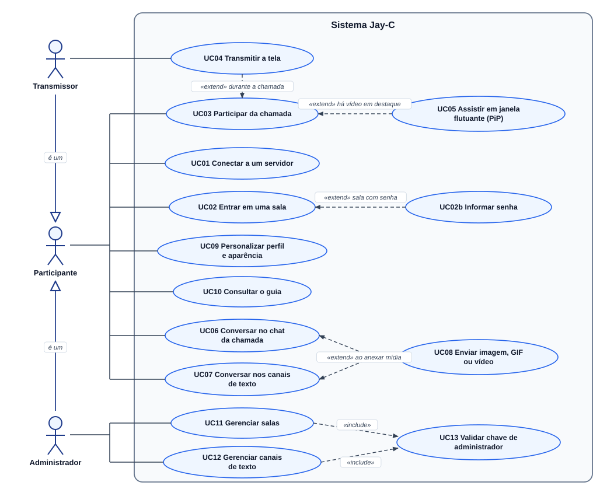
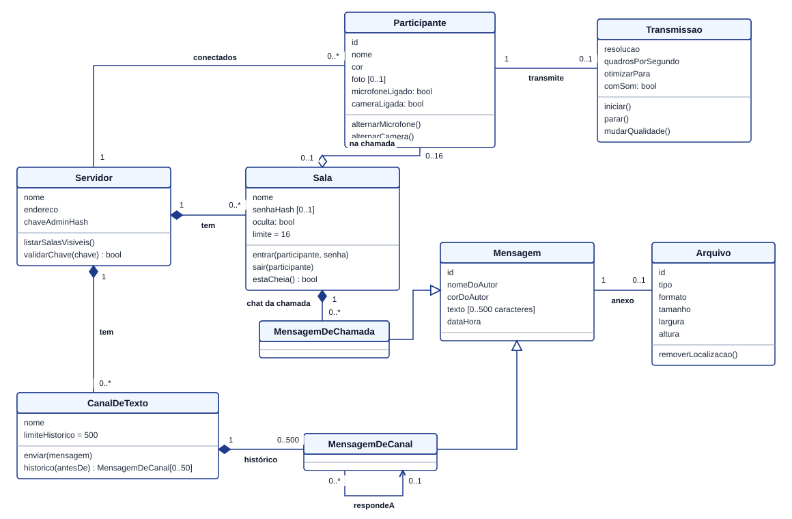
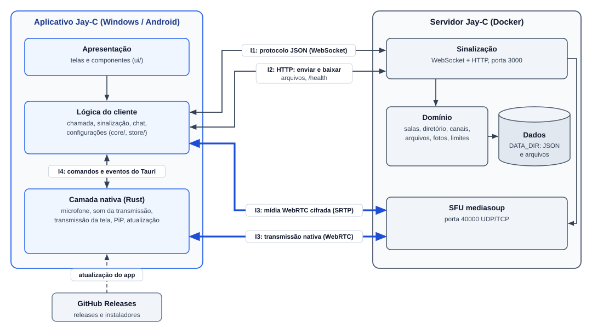
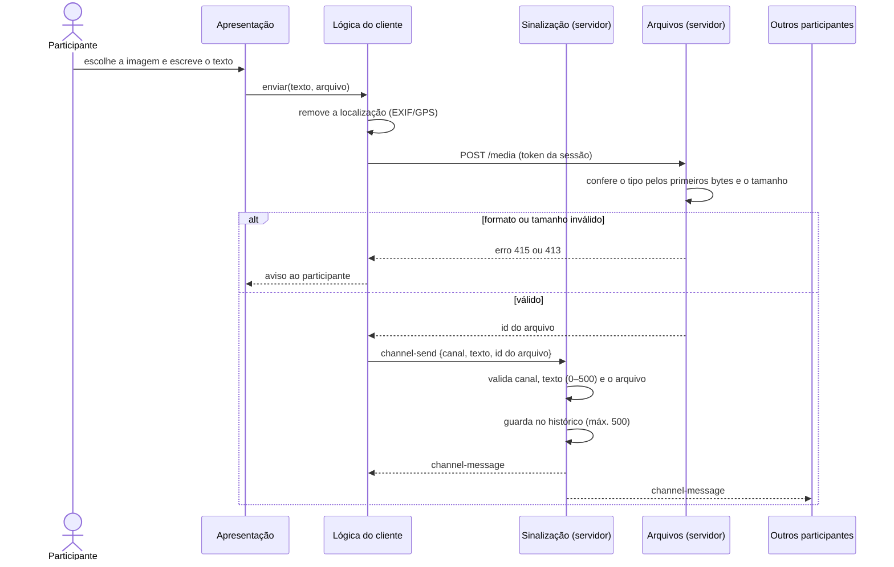
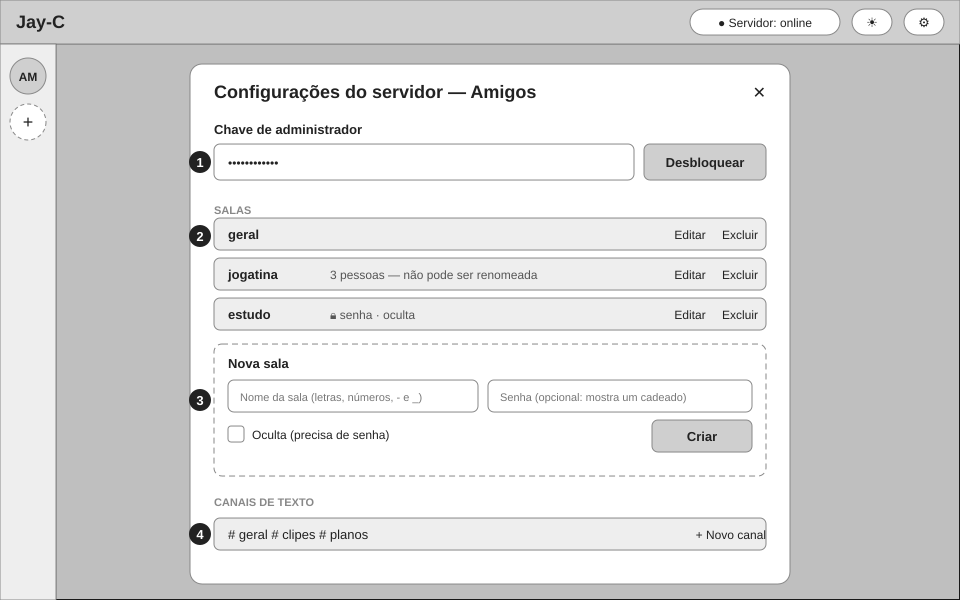
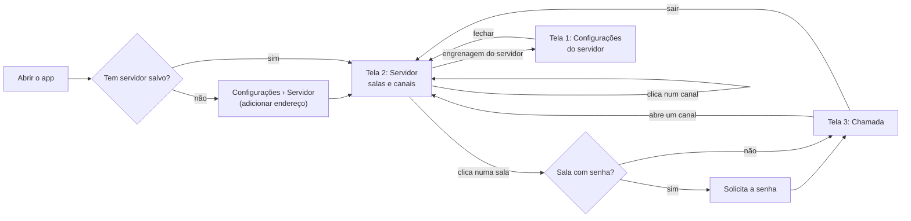
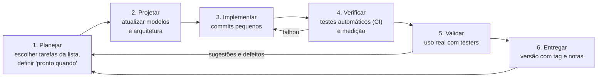
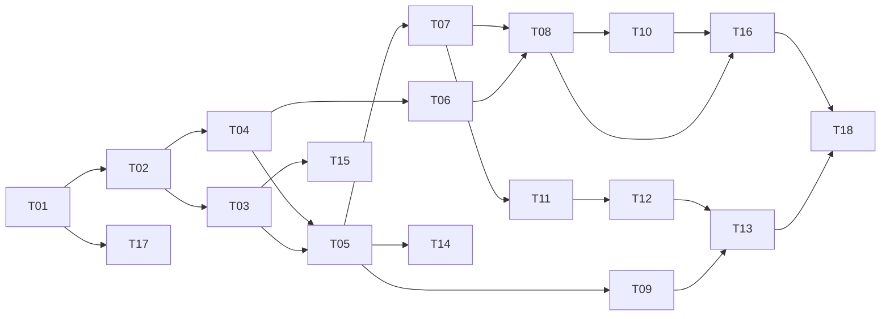
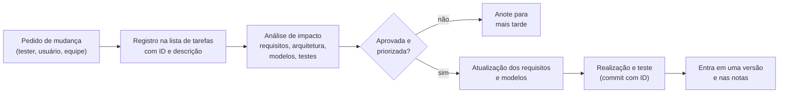

# Jay-C - Dossiê técnico 

> Versão final do PDF (seções 4.1 a 4.8).

---

## Capa

- **Instituição:** Universidade Estadual de Ponta Grossa (UEPG)
- **Disciplina:** Fundamentos de Engenharia de Software
- **Título:** Jay-C - comunicação de voz, vídeo e tela, simples, gratuita e local
- **Turma:** 1º Ano A
- **Integrantes:** Augusto do Amarante, Cristofer Dvorecky Oliveira, Guilherme Perpétuo, Henrique Augusto, Mateus Valenga
- **Data:** 19/11/2026

## Sumário

**[4.1 Identificação e contextualização](#41-identificação-e-contextualização)**
1. [Introdução](#1-introdução)
2. [Problema](#2-problema)
3. [Público-alvo](#3-público-alvo)
4. [Objetivos](#4-objetivos)
5. [Limites do sistema](#5-limites-do-sistema)
6. [Justificativa](#6-justificativa)

**[4.2 Stakeholders e levantamento de requisitos](#42-stakeholders-e-levantamento-de-requisitos)**
7. [Stakeholders](#7-stakeholders)
8. [Levantamento de requisitos](#8-levantamento-de-requisitos)
9. [Requisitos funcionais](#9-requisitos-funcionais)
10. [Requisitos não funcionais](#10-requisitos-não-funcionais)
11. [Regras de negócio](#11-regras-de-negócio)
12. [Conflitos, ambiguidades e restrições](#12-conflitos-ambiguidades-e-restrições)

**[4.3 Modelagem de análise](#43-modelagem-de-análise)**
13. [Diagrama de casos de uso](#13-diagrama-de-casos-de-uso)
14. [Descrição dos casos de uso](#14-descrição-dos-casos-de-uso)
15. [Diagrama de classes de domínio](#15-diagrama-de-classes-de-domínio)
16. [Como os modelos representam os requisitos e as regras](#16-como-os-modelos-representam-os-requisitos-e-as-regras)

**[4.4 Design e arquitetura](#44-design-e-arquitetura)**
17. [Visão arquitetural](#17-visão-arquitetural)
18. [Princípios de design](#18-princípios-de-design)
19. [Coesão e acoplamento](#19-coesão-e-acoplamento)
20. [Refinamento de uma funcionalidade](#20-refinamento-de-uma-funcionalidade)
21. [Refatoração futura proposta](#21-refatoração-futura-proposta)
22. [Telas e navegação](#22-telas-e-navegação)

**[4.5 Processo e organização do desenvolvimento](#45-processo-e-organização-do-desenvolvimento)**
23. [Abordagem de processo: incremental, com protótipos de risco](#23-abordagem-de-processo-incremental-com-protótipos-de-risco)
24. [Plano simplificado de execução](#24-plano-simplificado-de-execução)
25. [Controle de versões, mudanças e rastreabilidade](#25-controle-de-versões-mudanças-e-rastreabilidade)

**[4.6 Qualidade, verificação e validação](#46-qualidade-verificação-e-validação)**
26. [Atributos de qualidade](#26-atributos-de-qualidade)
27. [Casos de Teste](#27-casos-de-teste)
28. [Verificação e validação](#28-verificação-e-validação)
29. [Matriz de rastreabilidade](#29-matriz-de-rastreabilidade)

**[4.7 Manutenção e evolução](#47-manutenção-e-evolução)**
30. [Futuras alterações por tipo de manutenção](#30-futuras-alterações-por-tipo-de-manutenção)
31. [Impacto](#31-impacto)
32. [Riscos técnicos e mitigação](#32-riscos-técnicos-e-mitigação)

**[4.8 Conclusão e referências](#48-conclusão-e-referências)**
33. [Conclusão](#33-conclusão)
34. [Referências](#34-referências)
35. [Quadro de contribuição individual](#35-quadro-de-contribuição-individual)
36. [Declaração de participação](#36-declaração-de-participação)

---

# 4.1 Identificação e contextualização

## 1. Introdução

O Jay-C nasceu para ser um aplicativo de chamada de voz, vídeo e transmissão de tela fácil e direto para grupos pequenos. Ele funciona de forma distribuída entre duas partes que se comunicam: um aplicativo para Windows e Android, e um servidor que os próprios usuários podem rodar em um PC ou em uma VPS usando Docker. No Jay-C não existem contas e nem propagandas; é só ter o endereço do servidor, digitar um nome qualquer e entrar na sala. O código inteiro do projeto está disponível na licença MIT.

No presente documento, fazemos uma revisão do Jay-C com base nas coisas que aprendemos durante a disciplina. Começamos com a dor inicial que o projeto quer solucionar, os seus requisitos, até chegarmos em modelagem, arquitetura, processo, testes e planos de manutenção.

## 2. Problema

Todas as turmas de amigos, grupos de faculdade ou equipes pequenas que querem apenas conversar em call e mostrar a tela, acabam presos nas mesmas plataformas gigantes de sempre. É um problema porque todo mundo precisa se cadastrar com e-mail ou telefone antes de dizer "oi", além dos planos pagos, propagandas, conversas e arquivos hospedados em servidores de terceiros, e o limite que trava a qualidade da live ou o tamanho dos envios se ninguém assinar nada.

Falta justamente um caminho mais leve, gratuito e local — onde o próprio grupo instala o servidor, decide quem pode entrar e não entrega os próprios dados a nenhuma empresa.

## 3. Público-alvo

Quem usa um sistema como este no dia a dia geralmente se identifica com quatro perfis bem próximos da nossa realidade. Temos o grupo de amigos que joga ou assiste a algo juntos e quer abrir a tela com o som do jogo sem passar raiva; temos a turma e o grupo de estudo que precisa conversar em call, mas também quer guardar as mensagens e arquivos num chat; temos também a equipe pequena ou a comunidade que prefere não depender de servidor externo; e, claro, o integrante do grupo que topa instalar o servidor, que não precisa ser um especialista em redes, mas apenas saber instalar o Docker e abrir duas portas no firewall.

## 4. Objetivos

Sem inventar moda, o Jay-C busca resolver o básico bem feito: chamada de voz e vídeo, live de tela e chat para grupos pequenos em um servidor que o próprio grupo controla, sem conta, sem propaganda e sem cobrar licença.

Na prática mesmo, o sistema precisa suportar estas seis coisas:

1. Executar call de voz e vídeo com até 16 pessoas simultaneamente na mesma sala sem engasgar.
2. Abrir a tela inteira ou uma janela específica enviando o áudio do app junto (no Windows), alcançando pelo menos 1080p a 60 qps — e podendo subir até 1440p ou a resolução nativa do monitor.
3. Organizar o servidor entre salas de voz (abertas, com senha ou escondidas da lista) e canais de texto com histórico salvo.
4. Permitir enviar imagem, GIF e vídeo nos chats, mas removendo os dados de localização dos arquivos antes de enviá-los ao servidor.
5. Permitir que o administrador crie, renomeie e remova salas e canais usando apenas uma chave de admin.
6. Instalar no Windows e no Android diretamente, sem precisar procurar dependências manualmente.

## 5. Limites do sistema

No escopo estão incluídos chamada, transmissão de tela, chat dentro da call, canal de texto com histórico, envio de imagem e vídeo, administração de salas e canais, janela flutuante (PiP), mudança de temas e um perfil simples com nome, cor e foto.

O que ficou fora foi corte consciente mesmo para não fugir da proposta. Não há contas de usuários, senhas pessoais nem lista de amigos (sua identidade é apenas o nome escolhido ao entrar), e ninguém envia DM privada fora das salas. O WebRTC já cifra a mídia entre o app e o servidor sozinho, mas não há criptografia ponta a ponta porque o servidor do grupo precisa receber e encaminhar os pacotes de vídeo — ou seja, quem entra numa sala confia no dono daquele servidor. A equipe também não hospeda nenhum servidor central para os usuários (cada grupo instala o seu), e nesta entrega o aplicativo está disponível apenas para Windows e Android, sem suporte para iOS, macOS ou Linux.

Do lado do servidor existem alguns limites numéricos que o admin pode alterar na configuração se quiser: máximo de 16 pessoas por sala, texto de até 500 caracteres, 500 mensagens salvas por canal, imagens e GIFs até 8 MB e vídeos até 50 MB.

## 6. Justificativa

Faz sentido desenvolver Jay-C porque os apps grandes cobram o preço da "gratuidade" através de dados e atenção, quando um grupo pequeno não precisa nem de um décimo daquela estrutura pesada.

Com Jay-C, conversa, arquivo e controle de entrada não saem da máquina do grupo — e como tanto o aplicativo quanto o servidor são gratuitos e open-source, o único custo real é o PC ou VPS que hospeda (que muitas vezes já é o computador de alguém da turma). Ninguém perde tempo criando conta para entrar, basta o endereço e um nome, e no Windows o microfone não reduz o volume dos jogos enquanto a live mantém pelo menos 1080p60 (chegando a 1440p) com som. Além disso, o app ficou bem pequeno porque, em vez de empacotar um navegador inteiro junto, aproveita a WebView que já vem no sistema (WebView2 no Windows) — o instalador fica em torno de 5,4 MB.

---

# 4.2 Stakeholders e levantamento de requisitos

## 7. Stakeholders

| # | Stakeholder | Interesses |
|---|---|---|
| S1 | Participante (usuário comum) | Entrar rapidamente sem cadastro, ouvir todo mundo limpo sem travar e usar um app leve e gratuito. |
| S2 | Transmissor (quem compartilha a tela) | Mostrar o jogo ou a janela com o som junto em qualidade boa, sem derreter a máquina nem vazar áudio de outro programa. |
| S3 | Administrador do servidor | Instalar e cuidar do servidor sem sofrer, trancar ou esconder sala, controlar quem entra e evitar que arquivo estoure o disco. |
| S4 | Usuário de celular | Participar pelo Android, continuar assistindo à live na janelinha (PiP) e não consumir muita bateria nem internet móvel. |
| S5 | Equipe de desenvolvimento e mantenedores | Código dividido e testável, release segura, auto-update funcionando para os usuários e facilidade para rastrear bugs depois. |

## 8. Levantamento de requisitos

Para entendermos o que era realmente prioritário no produto, criamos três estratégias diferentes em intervalos curtos: conversar com pessoas que usam muito chamada e live (`S1`, `S2` e `S4`) e pessoas que estivessem interessadas em hospedar (`S3`), enviar um pequeno questionário na internet para sabermos quantas pessoas usam simultaneamente e ver pessoas usando as versões de testes. A última estratégia já foi utilizada há muito tempo - muitos itens sugeridos pelos testadores foram adicionados aos requisitos, por exemplo, o chat da chamada ao lado da câmera e poder responder às mensagens nos canais.

Nas conversas, as perguntas serão mais ou menos assim:

1. Quantas pessoas geralmente ficam juntas na chamada de vocês, e qual o pior problema que já aconteceu em uma sala?
2. Que app vocês usam agora para chamada e live, e o que mais chateia nele (precisar de conta, propaganda, bitrate reduzido, privacidade)?
3. Quando alguém faz live, geralmente é o monitor todo, uma janela ou um jogo? E o som desse app é muito importante junto?
4. É preciso salvar o histórico de mensagem e arquivo nos canais, ou pode ir embora? Quem deve ver isso?
5. Alguém do grupo consegue deixar um computador ou VPS ligado para o servidor, e quanto essa pessoa conhece de rede e Docker?
6. Pelo telefone, o que não pode parar se você sair do app - só ouvir a chamada ou assistir à live também?
7. Precisa de sala trancada com senha, ou até sala que nem aparece na lista pública?

## 9. Requisitos funcionais

Prioridade: Alta (obrigatório para a primeira versão sair), Média (faz diferença, mas o app roda sem), Baixa (bom ter). No MoSCoW da apostila da disciplina, Alta se torna *Must have*, Média se torna *Should have* e Baixa se torna *Could have*, enquanto tudo o que ficou de fora ([seção 5](#5-limites-do-sistema)) se torna *Won't have now*.

| ID | Nome | Papel | Importância | Condição de Aceite |
| :--- | :--- | :--- | :--- | :--- |
| RF001 | Configurar servidor | Usuário | Crítico | Digitar endereço válido de servidor ativo, o app conectar e exibir o nome do servidor; se o endereço for inválido ou o servidor estiver fora do ar, informar o erro na tela sem derrubar o app. |
| RF002 | Listar servidores, salas e canais de texto | Usuário | Crítico | Entrar no servidor, a barra lateral mostrar as salas visíveis (com cadeado nas que exigem senha), os canais de texto e quem está em cada sala — sala invisível não aparece ali. |
| RF003 | Entrar em sala de conversa usando seu nome e dados de acesso | Usuário | Crítico | Digitar o nome, clicar na sala já entra na call e em até 2 segundos o nome aparece para o resto do pessoal; se não colocar nome, o app nem deixa tentar. |
| RF004 | Entrar em salas protegidas informando uma senha válida | Usuário | Crítico | Digitar a senha correta, entra normalmente; se errar, volta o aviso "senha incorreta" e a pessoa continua do lado de fora. |
| RF005 | Chamadas de voz e vídeo em tempo real | Usuário | Crítico | Com duas pessoas na mesma sala, uma ouve a outra e vê a câmera quando estiver ligada. |
| RF006 | Ligar ou desligar microfone e câmera durante uma chamada | Usuário | Crítico | Mutar o mic, o pessoal deixa de ouvir e aparece o ícone de mudo; desligar a câmera, o vídeo some e entra a foto ou as iniciais. |
| RF007 | Compartilhar tela inteira ou janela específica de um aplicativo | Transmissor | Crítico | O transmissor escolhe o monitor ou uma janela e quem está na sala já assiste levando o som junto do que está sendo transmitido (no Windows). |
| RF008 | Configurar qualidade das transmissões, escolhendo resolução, taxa de quadros e otimização | Transmissor | Alto | O painel permite alterar a resolução (360p até 1440p ou original), FPS (5 a 60 qps) e no modo de otimizar para detalhe, movimento ou equilíbrio — e é possível ver nas estatísticas da live que cada alteração muda o que está sendo enviado. |
| RF009 | Enviar e receber mensagens de texto durante as chamadas | Usuário | Crítico | Mandar texto no chat da call, cai para todo mundo da sala junto com nome do autor e horário. |
| RF010 | Enviar imagens, GIFs e vídeos nos chats das chamadas e nos canais de texto | Usuário | Crítico | Arquivo PNG, JPEG, WebP, GIF, MP4 ou WebM dentro do peso permitido aparece no chat para o pessoal ver; se tentar mandar outro formato, é barrado com aviso. |
| RF011 | Enviar mensagens nos canais de texto dos servidores e consultar o histórico de conversas | Usuário | Crítico | Mensagem enviada num canal permanece lá mesmo depois de fechar e abrir o servidor novamente, e puxar a barra para cima carrega as mais antigas. |
| RF012 | Responder a mensagens anteriores em canais de texto | Usuário | Alto | O conteúdo da resposta aparece junto com uma parte da mensagem original acima, e clicando nessa parte o usuário é levado diretamente para a mensagem original. |
| RF013 | Personalizar o perfil usando uma imagem ou cor de identificação | Usuário | Alto | A foto ou cor escolhida pelo usuário é exibida para os demais membros do grupo tanto na foto do card da chamada quanto nas mensagens. |
| RF014 | Criar, editar e excluir salas de comunicação | Administrador | Crítico | Se a chave estiver correta, a criação, edição ou exclusão de uma sala atualizará imediatamente a lista de salas na tela de todos os usuários conectados. |
| RF015 | Criar, editar e excluir canais de texto | Administrador | Crítico | Se a chave estiver correta, a criação, edição ou exclusão de um canal atualizará imediatamente a lista de canais na tela de todos os usuários conectados. |
| RF016 | Configurar salas protegidas por senha e salas ocultas | Administrador | Crítico | Se uma senha for definida, a sala passa a exigir essa senha para entrar; se for marcada como oculta, ela é removida da lista pública de salas e o usuário só pode entrar nela digitando seu nome e senha. |
| RF017 | Ver uma transmissão de vídeo em uma janela flutuante usando o recurso Picture-in-Picture | Usuário | Alto | Ativar o PiP permite ver a transmissão de vídeo numa janelinha flutuante sobre outros programas no Windows ou sobre o sistema operacional no Android. |
| RF018 | Personalizar as configurações visuais do aplicativo, incluindo a seleção de temas | Usuário | Baixo | Trocar de tema (claro/escuro) ou estilo (Calmo, Neon, Suave) altera imediatamente a aparência do aplicativo, que continua assim quando aberto novamente. |
| RF019 | Consultar um guia de instruções para configurar e utilizar o aplicativo e seu servidor | Usuário, Administrador | Alto | Quando o aplicativo é aberto pela primeira vez, ele exibe um guia de boas-vindas; este guia pode ser aberto novamente indo em Configurações › Ajuda junto com o guia para subir o servidor. |
| RF020 | Sair de uma sala ou encerrar sua participação em uma chamada | Usuário | Crítico | Clicar em "sair" fecha a chamada, corta o microfone e a câmera imediatamente e o usuário some da sala em até 2 segundos para os outros usuários. |

## 10. Requisitos não funcionais

| ID | Categoria | Descrição | Importância | Condição de Aceite |
| :--- | :--- | :--- | :--- | :--- |
| RNF001 | Desempenho | O aplicativo deve suportar chamadas com até 16 participantes simultâneos em uma mesma sala. | Crítico | Se 16 participantes reais ou simulados forem colocados juntos numa mesma sala, todos conseguem se ouvir e se ver. |
| RNF002 | Segurança | O acesso às funções administrativas deve ser restrito através de uma chave de administrador. | Crítico | Se um comando de administrador for enviado sem a chave correta ou com a chave errada, o servidor responderá com `not-admin`; se a chave for correta, o comando será executado. |
| RNF003 | Segurança | Os arquivos compartilhados devem ser protegidos, permitindo sua visualização somente pelos participantes autorizados da chamada ou da sessão do servidor. | Crítico | Se um usuário tentar baixar um arquivo sem o token da sessão ou com o token de outra sala/sessão, ele receberá um erro ao invés do arquivo. |
| RNF004 | Segurança | Os tipos e tamanhos dos arquivos enviados devem ser validados, evitando o recebimento de formatos não permitidos. | Crítico | Arquivos válidos são aceitos; arquivos com tipo proibido recebem HTTP 415; arquivos com tamanho acima do limite recebem HTTP 413. |
| RNF005 | Privacidade | Informações de localização e metadados devem ser removidos de fotos (JPEG, PNG, WebP) e vídeos MP4 antes do envio. | Alto | Se uma foto JPEG com GPS no EXIF e um MP4 com tag de localização forem enviados, eles chegarão ao servidor sem essas informações, como verificado num leitor de metadados. |
| RNF006 | Disponibilidade | O servidor deve fornecer um mecanismo para verificar se está funcionando corretamente através de um endpoint de saúde. | Alto | O endpoint `GET /health` deve retornar HTTP 200 enquanto o servidor estiver funcionando. |
| RNF007 | Confiabilidade | O aplicativo deve tentar restabelecer automaticamente a conexão com o servidor em caso de interrupção. | Crítico | Se o servidor for desligado e ligado novamente durante uma chamada, o aplicativo mostrará "reconectando" e tentará se reconectar (em intervalos de 1, 2, 4, 8 segundos e depois de 10 em 10 segundos), voltando para a sala sozinho. |
| RNF008 | Compatibilidade | O aplicativo deve funcionar no Windows 10 e 11 (64 bits) e no Android 7.0 ou superior, respeitando as limitações de cada sistema. | Crítico | Tanto o instalador quanto o APK devem ser instalados e entrar numa chamada em ambos os sistemas, com as diferenças (como o áudio da live sendo disponível apenas no Windows) claramente explicadas na documentação. |
| RNF009 | Usabilidade | A interface deve manter um contraste legível entre o texto e o fundo em todos os temas e estilos visuais disponíveis. | Baixo | Um teste automático deve ser executado nos 6 temas/estilos e o contraste mínimo deve ser de pelo menos 4.5:1 em todo o texto. |
| RNF010 | Desempenho | As transmissões de tela devem ter resolução configurável, chegando a pelo menos 1080p a 60 quadros por segundo. | Alto | Se a resolução estiver definida como 1080p60 e houver conteúdo se movendo na tela, as estatísticas da transmissão devem mostrar 1920×1080 e os quadros por segundo devem ficar perto de 60 qps. |

## 11. Regras de negócio

| ID | Descrição | Requisitos Relacionados |
| :--- | :--- | :--- |
| RN001 | Cada sala pode conter no máximo 16 pessoas simultaneamente; se alguém tentar entrar como 17º, ele receberá um aviso de sala cheia. | RF003, RF005, RNF001 |
| RN002 | Uma sala trancada com senha só abrirá se o usuário fornecer a senha correta. | RF004, RF016 |
| RN003 | Uma sala oculta não aparecerá na lista pública de salas e obrigatoriamente terá uma senha. | RF002, RF016 |
| RN004 | Somente quem tiver a chave válida de administrador poderá criar, editar ou apagar salas e canais. | RF014, RF015, RF016, RNF002 |
| RN005 | Se a mensagem contiver texto, o limite é de 500 caracteres (e se ela não tiver nenhum anexo, ela não pode ser vazia, ficando entre 1 e 500 caracteres). | RF009, RF010, RF011 |
| RN006 | Cada canal de texto pode manter no máximo as últimas 500 mensagens enviadas. | RF011 |
| RN007 | Cada vez que o usuário solicitar o histórico de um canal, ele receberá no máximo um bloco de 50 mensagens. | RF011 |
| RN008 | Imagens e GIFs podem ter no máximo 8 MB de tamanho, enquanto vídeos podem ter no máximo 50 MB de tamanho (sendo possível alterar esses limites via `MAX_IMAGE_MB` e `MAX_VIDEO_MB`). | RF010, RNF004 |
| RN009 | Um arquivo compartilhado só pode ser aberto por quem faz parte da chamada ou da sessão do servidor onde ele foi enviado. | RF010, RNF003 |
| RN010 | Uma sala fixa não pode ter seu nome alterado enquanto houver pessoas conectadas nela. | RF014 |
| RN011 | A foto de perfil deve ser no formato PNG, JPEG ou WebP e não pode ter mais de 32.000 caracteres na string enviada para o servidor (em base64 / data URL). | RF013 |
| RN012 | Uma resposta só pode citar uma mensagem que pertença ao mesmo canal de texto. | RF012 |

## 12. Conflitos, ambiguidades e restrições

| # | Tipo | Situação | Como foi resolvido |
| :--- | :--- | :--- | :--- |
| C1 | Conflito | Quem hospeda (S3) quer controlar quem entra, mas os usuários (S1) não querem ter que criar conta nem senha pessoal. | Não há conta mesmo — o controle fica por senha na sala, sala oculta e chave de administrador (`RN002`–`RN004`). |
| C2 | Conflito | Quem transmite (S2) quer fazer live em 1080p60, mas isso não pode causar o PC do usuário a fritar ou fazer com que quem está usando uma conexão de internet ruim caia. | O encoding é feito na GPU, a qualidade é configurável (`RF008`) e a resolução/FPS diminui automaticamente de acordo com a conexão de cada espectador. |
| C3 | Conflito | O usuário (S1) queria ter o histórico para sempre, enquanto S3 muitas vezes hospeda o servidor num PC ou VPS simples. | As mensagens são cortadas em 500 por canal (`RN006`) e os arquivos têm um tamanho máximo (`RN008`), sendo todos ajustáveis pelo administrador. |
| A1 | Ambiguidade | "Aguentar 16 pessoas" (`RNF001`): todo mundo com a câmera ligada ao mesmo tempo? | Definimos que 16 pessoas podem estar na sala podendo ligar a câmera; o servidor seleciona a camada de vídeo adequada para a conexão de cada espectador. |
| A2 | Ambiguidade | "Plataformas previstas" (`RNF008`) era um termo muito vago no início. | Ficou limitado a Windows 10/11 64 bits e Android 7.0+. |
| A3 | Ambiguidade | No rascunho anterior, o `RNF005` mencionava apenas "metadados de certos arquivos" sem especificar quais. | Ficou definido que seriam removidos os dados de localização e metadados de fotos (EXIF/XMP/blocos de texto em JPEG, PNG e WebP) e os dados de localização em vídeos MP4. |
| R1 | Restrição | Capturar o áudio apenas de um aplicativo depende de uma API específica do Windows. | Ficou assumido e documentado que essa funcionalidade é exclusiva do Windows (`RNF008`). |
| R2 | Restrição | O servidor precisa ter duas portas abertas na rede (`3000/TCP` e `40000 UDP/TCP`). | Foi explicado no guia de instalação (`RF019`): quem hospeda deve abrir essas portas no roteador/firewall ou usar um VPN/túnel. |

---

# 4.3 Modelagem de análise

> Diagramas da modelagem em SVG com fundo claro: [`02-modelagem/`](../02-modelagem/).

## 13. Diagrama de casos de uso

**Figura 1 — Casos de uso do Jay-C.** Os atores estão à esquerda, enquanto os casos de uso são representados pelas elipses. As linhas contínuas conectam o ator ao caso de uso; as setas `"é um"` indicam uma especialização de ator; as setas pontilhadas indicam `<<include>>` (sempre ocorre dentro do caso base) e `<<extend>>` (só ocorre sob certa condição).

O ator principal é o Participante. Transmissor e Administrador são especializações dele. Qualquer pessoa na sala pode iniciar uma live (torna-se Transmissor). Quem possui a chave correta pode administrar o servidor (torna-se Administrador). Não existe conta no Jay-C ([seção 5](#5-limites-do-sistema)). Administrar depende apenas de fornecer essa chave. Portanto, `UC11` e `UC12` sempre chamam `UC13` com `<<include>>`. Conectar ao servidor (`UC01`) ocorre uma vez quando o aplicativo é aberto e serve como pré-condição para o restante — como entrar em uma sala no [`UC02`](#uc02--entrar-em-uma-sala), enviar mensagem em canal ou alterar as configurações — por isso não incluímos `<<include>>` nele. Os casos `UC02b` (informar senha) e `UC08` (anexar mídia) só são ativados quando a sala possui senha ou quando alguém anexa arquivo, então entram como `<<extend>>`.

| Caso de uso | Requisitos |
|---|---|
| UC01 Conectar a um servidor | RF001, RF002, RNF007 |
| [UC02 Entrar em uma sala](#uc02--entrar-em-uma-sala) | RF002, RF003, RF004 |
| UC02b Informar senha | RF004 |
| UC03 Participar da chamada | RF005, RF006, RF020 |
| [UC04 Transmitir a tela](#uc04--compartilhar-a-tela) | RF007, RF008, RNF010 |
| UC05 Assistir em PiP | RF017 |
| UC06 Conversar no chat da chamada | RF009 |
| UC07 Conversar nos canais de texto | RF011, RF012 |
| UC08 Enviar imagem, GIF ou vídeo | RF010, RNF004, RNF005 |
| UC09 Personalizar perfil e aparência | RF013, RF018, RNF009 |
| UC10 Consultar o guia | RF019 |
| [UC11 Gerenciar salas](#uc11--administrar-salas) | RF014, RF016 |
| UC12 Gerenciar canais de texto | RF015 |
| UC13 Validar chave de administrador | RNF002 |

## 14. Descrição dos casos de uso

### UC02 — Entrar em uma sala

| Campo | Descrição |
|---|---|
| Objetivo | Entrar em uma sala de chamada do servidor para conversar e ver quem está lá. |
| Ator | Participante |
| Requisitos e regras | RF002, RF003, RF004, RN001, RN002, RN003 |
| Pré-condições | O aplicativo já está conectado em um servidor (`UC01`) e a pessoa definiu um nome. |
| Fluxo principal | 1. O participante olha a lista de salas com quem está em cada uma e 2. clica em uma delas. 3. O aplicativo envia o pedido para o servidor, 4. que checa se tem menos de 16 pessoas ali dentro (`RN001`). 5. Estando liberado, o servidor aceita e avisa todo mundo, e 6. o aplicativo abre a tela da chamada deixando microfone e câmera do jeito que estavam na última vez. |
| Alternativa A — sala com senha | Se a sala possui cadeado no passo 2, o aplicativo abre uma janela para inserir a senha (`UC02b`) e o servidor a valida (`RN002`) — se for incorreta, exibe uma mensagem de erro e retorna para a lista. |
| Alternativa B — sala oculta | Como a sala oculta não é exibida na lista (`RN003`), o participante insere o nome da sala junto com a senha no campo de entrada direta e segue para o passo 3. |
| Alternativa C — sala cheia | No passo 4, se houver 16 participantes, o servidor impede a entrada exibindo uma mensagem de sala cheia e o usuário que tentou entrar fica de fora. |
| Alternativa D — sem conexão | No passo 3, se o servidor estiver indisponível ou não responder, o aplicativo exibe uma mensagem de erro e oferece a opção de tentar novamente. |
| Pós-condições | O participante entra na sala e aparece na lista/chamada para os demais participantes (se houver algum erro, a sala permanece inalterada). |

### UC04 — Compartilhar a tela

| Campo | Descrição |
|---|---|
| Objetivo | Exibir para os demais participantes toda a tela ou uma janela específica, incluindo o áudio. |
| Ator | Compartilhador |
| Requisitos e regras | RF007, RF008, RNF010 |
| Pré-condições | O compartilhador já deve estar em uma chamada (`UC03`). |
| Fluxo principal | 1. O usuário clica em "Compartilhar", 2. o aplicativo abre o painel para selecionar a resolução, FPS e modo de otimização (detalhe, movimento ou equilíbrio), e 3. no seletor do sistema, ele escolhe toda a tela ou uma janela específica. 4. O aplicativo começa a transmitir o vídeo e (no Windows) o áudio do programa, 5. os demais participantes veem que uma transmissão foi iniciada e clicam para assistir, até 6. o compartilhador clicar em "Parar". |
| Alternativa A — cancelamento | Se o usuário fechar o seletor do sistema sem escolher nada no passo 3, não há transmissão e a chamada continua normalmente. |
| Alternativa B — conexão lenta | Se a internet de quem está assistindo não suportar o bitrate escolhido no passo 4, a transmissão reduz a resolução ou FPS de acordo com o modo selecionado para evitar interrupções. |
| Alternativa C — alterar a qualidade | É possível modificar as opções do painel durante a transmissão — as alterações entram em vigor imediatamente sem necessidade de reiniciar a transmissão. |
| Pós-condições | Durante a transmissão, ela é exibida no card do compartilhador; ao parar, ela desaparece da tela de todos os participantes. |

### UC11 — Administrar salas

| Campo | Descrição |
|---|---|
| Objetivo | Criar, renomear e excluir as salas permanentes do servidor, definindo uma senha e escolhendo se ela é oculta. |
| Ator | Administrador |
| Requisitos e regras | RF014, RF016, RNF002, RN002, RN003, RN004, RN010 |
| Pré-condições | O aplicativo está conectado ao servidor e o administrador já realizou a autenticação com a chave nas configurações. |
| Fluxo principal | 1. O administrador acessa as configurações do servidor, 2. seleciona a opção de criar uma sala e insere o nome, 3. podendo definir uma senha e ocultar a sala se desejar. 4. O aplicativo envia a solicitação autenticada pela chave, 5. o servidor valida a permissão (`UC13`, `RN004`) junto com os dados e 6. salva os dados no disco, atualizando a lista na tela de todos os participantes. |
| Alternativa A — chave inválida | Se a chave não for válida no passo 5, o servidor impede a ação imediatamente e informa que a chave não pertence ao administrador. |
| Alternativa B — sala oculta sem senha | Se o usuário tentar ocultar uma sala sem definir uma senha, o servidor rejeita a ação devido à `RN003`. |
| Alternativa C — nome duplicado | Se já existir uma sala com o mesmo nome, o servidor impede a criação e exibe uma mensagem de erro. |
| Alternativa D — renomear sala ocupada | Se houver participantes em chamada dentro da sala no momento em que ela é renomeada, o servidor impede a ação até que a sala seja esvaziada (`RN010`). |
| Alternativa E — excluir sala | Quando o administrador exclui uma sala, ela é removida da lista de todos os participantes conectados. |
| Pós-condições | A lista atualizada é salva no disco e permanece idêntica mesmo se o servidor for reiniciado. |

## 15. Diagrama de classes de domínio

**Figura 2 — Classes de domínio do Jay-C.** Representa os conceitos do problema, não as classes do código. Os valores nas extremidades são as multiplicidades; losango cheio (`*--`) indica composição, losango vazio (`o--`) indica agregação e a seta aberta (`<|--`) indica herança.

Algumas escolhas feitas neste diagrama merecem explicação para evitar possíveis equívocos. Não existem as classes Usuário ou Conta, pois o sistema não possui cadastro, logo o participante existe apenas enquanto está conectado ao servidor, e é justamente por isso que a classe `Mensagem` armazena `nomeDoAutor` e `corDoAutor` diretamente em si, ao invés de fazer referência ao `Participante` — caso contrário, o histórico dos canais perderia o autor sempre que a pessoa saísse da sala.

O Administrador também não se tornou uma classe separada. Administrar neste sistema consiste apenas em possuir a chave do servidor, e quem a valida é `Servidor.validarChave()`, então aquele ator dos casos de uso se transforma em uma operação no servidor, ao invés de existir como objeto próprio.

Nós dividimos `Mensagem` em duas subclasses devido ao fato de seu comportamento variar bastante: a da chamada é eliminada quando a sala fica vazia ou a chamada chega ao fim (portanto composição com `Sala`), enquanto a do canal permanece gravada no histórico (composição com `CanalDeTexto`) e pode fazer referência a outra mensagem do mesmo canal (`respondeA`). Cada mensagem pode conter no máximo 1 anexo (`0..1`), e o `texto` pode ser vazio caso haja mídia anexada (sem anexo, deve conter de 1 a 500 caracteres). Por sua vez, a agregação (losango vazio) ficou restrita apenas entre `Sala` e `Participante`, pois se o usuário sair de uma chamada ele continuará conectado ao servidor utilizando os canais de texto. Para finalizar, `Arquivo.tipo` pode ser imagem, GIF ou vídeo, e `formato` aceita PNG, JPEG, WebP, GIF, MP4 ou WebM.

## 16. Como os modelos representam os requisitos e as regras

| Elemento do modelo | Requisito ou regra |
|---|---|
| Multiplicidade `0..16` entre Sala e Participante; `Sala.limite` e `estaCheia()`; fluxo alternativo C do [UC02](#uc02--entrar-em-uma-sala) | RN001, RNF001 |
| `Sala.senhaHash [0..1]` e `entrar(participante, senha)`; UC02b `<<extend>>` | RF004, RN002 |
| `Sala.oculta` e `Servidor.listarSalasVisiveis()`; fluxo alternativo B do [UC02](#uc02--entrar-em-uma-sala) | RF016, RN003 |
| `Servidor.validarChave()`; UC13 incluído por [UC11](#uc11--administrar-salas) e UC12 | RF014, RF015, RNF002, RN004 |
| Atributo `texto [0..500 caracteres]` | RN005 |
| Composição `CanalDeTexto "1" *-- "0..500" MensagemDeCanal` | RF011, RN006 |
| `historico(antesDe)` devolvendo `MensagemDeCanal[0..50]` | RN007 |
| Auto-associação `respondeA`, só entre mensagens de canal | RF012, RN012 |
| Classe Arquivo com `tipo`, `tamanho` e `removerLocalizacao()`; UC08 | RF010, RNF004, RNF005, RN008 |
| Arquivo ligado a uma mensagem, que pertence a uma sala ou a um canal | RN009, RNF003 (o arquivo só é visível nesse escopo) |
| Associação Participante–Transmissão e seus atributos de qualidade; [UC04](#uc04--compartilhar-a-tela) | RF007, RF008, RNF010 |
| Atributos `cor` e `foto` do Participante; UC09 | RF013, RN011 |
| Fluxo alternativo D do [UC11](#uc11--administrar-salas) (renomear sala ocupada) | RN010 |

---

# 4.4 Design e arquitetura

## 17. Visão arquitetural

O Jay-C funciona no modelo cliente-servidor, onde o aplicativo é executado no PC ou celular de cada participante e o servidor é executado na máquina do grupo dentro de um container Docker. A mídia não é enviada diretamente de um participante para outro: tudo passa por um **SFU** (*Selective Forwarding Unit*) no servidor, que recebe cada vídeo apenas uma vez e o redistribui para quem o está assistindo sem necessidade de decodificação.

**Figura 3 — Componentes, camadas e interfaces.** Setas simples representam dependência interna, setas duplas (`<-->`) representam protocolo/HTTP na porta 3000 ou comandos/eventos entre JS e Rust (`I4`), setas grossas (`<==>`) representam mídia WebRTC cifrada na porta 40000 (`I3`, tanto vindo do JS quanto da camada nativa), a seta tracejada representa a busca de atualização externa e o cilindro representa os arquivos gravados no disco no servidor.

| Componente | Responsabilidade |
|---|---|
| Apresentação ([`frontend/src/ui`](../frontend/src/ui)) | Responsável apenas por desenhar as telas (lista de salas e canais, chat, chamada, configurações) e repassar o clique do usuário para a lógica, sem se comunicar diretamente com nenhum servidor. |
| Lógica do cliente ([`frontend/src/core`](../frontend/src/core), [`store`](../frontend/src/store)) | Aqui se encontra a classe `Call` gerenciando a chamada, o `signaling` falando o protocolo e restabelecendo a conexão em caso de queda, `attachments` preparando os arquivos e `settings` guardando as preferências. |
| Camada nativa ([`src-tauri`](../frontend/src-tauri), [`plugins`](../plugins)) | Realiza em Rust aquilo que o navegador não consegue fazer adequadamente: microfone com cancelamento de eco sem abafar os jogos, captura de áudio por programa, transmissão da tela codificando na placa de vídeo, janela de PiP e auto-update. |
| Sinalização ([`signaling-server/src/server.js`](../signaling-server/src/server.js)) | Recebe as mensagens JSON, verifica se quem realizou o pedido tem permissão para fazê-lo e notifica o restante dos participantes. |
| Domínio do servidor ([`rooms`](../signaling-server/src/rooms.js), [`directory`](../signaling-server/src/directory.js), [`channels`](../signaling-server/src/channels.js), [`media`](../signaling-server/src/media.js), [`avatars`](../signaling-server/src/avatars.js), [`rate-limit`](../signaling-server/src/rate-limit.js)) | Onde se encontram as regras de negócio reais: capacidade da sala, senhas, salas ocultas, histórico dos canais e verificação de arquivos. |
| SFU ([`sfu.js`](../signaling-server/src/sfu.js), [`sfu-room.js`](../signaling-server/src/sfu-room.js)) | Recebe áudio e vídeo de todos os participantes e o repassa selecionando a camada adequada de qualidade conforme a internet de quem está assistindo. |
| Dados (`DATA_DIR`) | Salva salas, canais, histórico, fotos e arquivos diretamente em JSON e arquivos no disco, sem necessidade de levantar banco de dados. |

| Interface | O que transita por ela |
|---|---|
| I1 Protocolo JSON sobre WebSocket | `join`, `leave`, `chat`, `channel-send`, `channel-history`, `admin`, `profile` junto com as respostas e notificações do servidor — caso alguma coisa falhe, retorna código de erro (`room-full`, `wrong-password`, `not-admin`…). |
| I2 HTTP | Upload e download dos arquivos do chat (`/media`) sempre com token da sessão, além da rota `/health`. |
| I3 WebRTC (SRTP) | Todo o tráfego de voz e vídeo já cifrado entre o app e o servidor em uma única porta. |
| I4 Tauri (comandos e canais) | O JavaScript executa funções no Rust e recebe eventos de volta, como o nível do microfone e as estatísticas da transmissão. |

**Figura 4 — Fluxo principal: enviar uma imagem em um canal de texto** (RF010, RF011). Setas cheias representam chamadas ou envios; setas tracejadas representam respostas. O bloco `alt/else` separa quando o arquivo é recusado de quando é aceito.

Este fluxo exemplifica por que o upload ocorre primeiramente por HTTP: antes de enviar qualquer coisa, o cliente já remove os metadados de localização e envia o arquivo junto com o token da sessão. Após o servidor validar os primeiros bytes e responder o ID, a mensagem de texto passa pelo WebSocket associando tal arquivo ao canal e distribuindo para os demais participantes ativos.

## 18. Princípios de design

A pessoa que desenvolve a UI não precisa saber de nada sobre WebRTC nem sobre rede. A UI apenas invoca os métodos direto — `call.join()`, `call.toggleMic()`, `call.startScreenShare()`, `call.sendChat()` — e toda aquela bagunça de negociar mídia, abrir transporte ou decidir se a live vai pelo navegador ou pela camada em Rust fica escondida lá dentro da classe `Call` (abstração).

Quando você olha pro servidor, a modularidade salta aos olhos só de abrir a pasta `src/`: cada tópico virou um arquivo separado com seus próprios testes em [`signaling-server/test/`](../signaling-server/test/). Tem o [`rooms.js`](../signaling-server/src/rooms.js) segurando quantas pessoas cabem na sala, [`directory.js`](../signaling-server/src/directory.js) pras salas fixas e senhas, [`channels.js`](../signaling-server/src/channels.js) pro histórico de texto e [`media.js`](../signaling-server/src/media.js) na conferência de arquivos — enquanto o que é específico do sistema operacional (mic nativo e áudio por janela no Windows) ficou separado em plugins próprios.

A separação de interesses também aparece nas camadas: UI, lógica do cliente e código nativo em Rust estão cada um no seu canto, e no servidor a sinalização anda separada do SFU, que só repassa pacotes de áudio e vídeo sem abrir nem decodificar nada. E pro estado interno não virar bagunça com qualquer arquivo mexendo onde não deve, entram campos privados do JS (`#closeTransports()` na `Call`, `#reconnectTimer` no `SignalingClient`), senha salva só em *hash* com *salt* e leitura/escrita do histórico passando apenas por `post()`, `history()` e `quote()` nos canais (encapsulamento).

## 19. Coesão e acoplamento

Se puxarmos primeiro pela coesão — que é basicamente quanto as partes dum mesmo módulo se relacionam — um bom acerto foi o [`frontend/src/core/attachments.js`](../frontend/src/core/attachments.js). Tudo ali mexe com um problema só: descobrir o tipo verdadeiro dum arquivo pelos bytes e arrancar localização antes de subir, recebendo bytes e devolvendo bytes sem tocar em tela nem em rede (o que deixou [`frontend/test/attachments.test.js`](../frontend/test/attachments.test.js) bem fácil de testar). Outro módulo bem focado é [`signaling-server/src/channels.js`](../signaling-server/src/channels.js), onde estão juntos a lista de canais, o teto de 500 mensagens, paginação de 50, citações e gravação em disco — mudou regra de histórico (`RN006`, `RN007`), é praticamente só ali que se mexe.

Do outro lado, um exemplo claro de coesão baixa tá em [`frontend/src/core/call.js`](../frontend/src/core/call.js). A `Call` já beira 1 100 linhas misturando entrada/saída de sala, microfone, câmera, transmissão, chat, estatísticas e reconexão de mídia — tudo tem a ver com a call, claro, só que já passou da hora de quebrar em peças menores como sugere a [seção 21](#21-refatoração-futura-proposta).

No lado do acoplamento, a melhor coisa que a gente fez foi manter o app e o servidor sem compartilhar uma linha de código sequer, conversando só pelo contrato das mensagens JSON (`I1`). Como o servidor avisa na entrada quais recursos sabe fazer (`features`), um app mais novo consegue até rodar num servidor um pouco atrás — só trava se chegar uma mensagem nova tipo `profile`, que um servidor velho recusa e aí pede pra atualizar ele junto. Outro ponto bom fica entre o domínio do servidor e as variáveis de ambiente: `Rooms` recebe o limite no construtor (`new Rooms({ maxPeersPerRoom })`) em vez de sair lendo `process.env` direto lá dentro, deixando os testes testarem sala de 2 ou 16 lugares sem mexer no ambiente global.

Já o contraexemplo — onde o acoplamento aperta de verdade — mora lá na live nativa. O código em Rust que codifica a tela ficou amarrado em manias do codificador da NVIDIA, tipo ordem exata dos parâmetros e tamanho dos keyframes; se amanhã trocar pra outra fabricante de placa de vídeo, vai ter que abrir, revisar e medir tudo de novo.

## 20. Refinamento de uma funcionalidade

Destrinchando o `RF010` (enviar imagens, GIFs e vídeos nos chats), saindo do requisito lá em cima até encostar nos arquivos de código e teste:

| Nível | Descrição |
|---|---|
| Requisito | `RF010` (subir imagens, GIFs e vídeos nos chats das calls e canais) amarrado em `RNF004` (tipos e tamanhos), `RNF005` (arrancar localização), `RN008` (8 MB e 50 MB) e `RN009` (só vê quem tá no escopo). |
| Caso de uso | `UC08` (Enviar imagem, GIF ou vídeo), que entra estendendo `UC06` e `UC07`. |
| Passos | 1. A pessoa escolhe, arrasta ou cola o arquivo na janela. 2. O próprio app já checa tipo e tamanho pra barrar logo antes de perder tempo subindo. 3. Limpa os dados de localização ali mesmo no cliente. 4. Sobe por HTTP com o token da sessão mostrando progresso. 5. O servidor confere de novo o tipo (olhando os primeiros bytes, nunca só a extensão do nome) e o peso. 6. Manda a mensagem com o id do arquivo. 7. O servidor prende o arquivo naquele canal ou sala. 8. Quem tá no escopo baixa e vê; quem tentar de fora leva erro. |
| Componentes | Passo 1 fica em [`ui/attach.js`](../frontend/src/ui/attach.js); passos 2–3 rodam em [`core/attachments.js`](../frontend/src/core/attachments.js); passo 4 sobe por [`core/attachment-net.js`](../frontend/src/core/attachment-net.js); passos 5 e 7 moram em [`signaling-server/src/media.js`](../signaling-server/src/media.js); passo 6 passa no [`server.js`](../signaling-server/src/server.js) (`channel-send` ou `chat`); e o passo 8 fecha em [`ui/chat-media.js`](../frontend/src/ui/chat-media.js) batendo na rota `/media/<id>`. |
| Testes | [`frontend/test/attachments.test.js`](../frontend/test/attachments.test.js), [`frontend/test/media.test.js`](../frontend/test/media.test.js) e [`signaling-server/test/media.test.js`](../signaling-server/test/media.test.js). |

A gente checa duas vezes de propósito (nos passos 2 e 5): no app pra dar feedback rápido sem esperar upload à toa, e no servidor porque servidor nenhum pode confiar cegamente no que chega do cliente.

## 21. Refatoração futura proposta

Como deu pra ver lá na [seção 19](#19-coesão-e-acoplamento), a classe `Call` ([`core/call.js`](../frontend/src/core/call.js)) já tá passando de 1 100 linhas porque foi engolindo tudo que aparecia na chamada, e no servidor o [`server.js`](../signaling-server/src/server.js) (~700 linhas) acabou virando uma tripa enorme de `if (msg.type === …) … else if …`.

O plano aqui não é jogar tudo fora, e sim ir fatiando a `Call` aos poucos: deixar um `MicController` só pro áudio do microfone e filtros, jogar a transmissão (seja navegador ou Rust) pro `ScreenShare`, mandar o chat da chamada pro `CallChat` e o resto de transporte/*producers*/*consumers* pra uma `MediaSession`. Por fora ninguém sentiria nada porque a `Call` seguiria firme como fachada (*Facade*): a tela continua chamando `call.toggleMic()` do mesmo jeito e ela só repassa lá pra dentro pro `MicController`. Já no servidor, aquela escada de `if/else` sairia pra entrar um mapa simples (`const handlers = { join, chat, 'channel-send': channelSend, … }`), com cada pedaço morando perto do seu assunto.

A graça disso é mexer na live sem ficar com o coração na mão achando que vai quebrar o chat junto — fora que qualquer mensagem nova do protocolo vira só uma chavinha a mais no mapa sem encostar no resto, e como os métodos públicos da fachada não mudam, toda a UI e a suíte do `npm test` seguem rodando pra garantir que nada quebrou.

## 22. Telas e navegação

Essas telas abaixo são protótipos de média fidelidade: tudo em tons de cinza, sem as cores finais do app, só pra mostrar onde fica cada bloco e o conteúdo de cada área (os números nos círculos pretos batem com a listinha logo embaixo de cada imagem, lá em [`03-arquitetura/telas/`](../03-arquitetura/telas/)).

**Figura 5 — Tela 1: Configurações do servidor (administrador).**

1. Campo pra digitar a chave de admin e o botão "Desbloquear" (`RF014`–`RF016`, `RNF002`).
2. Lista das salas com botões "Editar" e "Excluir" — sala com gente dentro não pode mudar de nome (`RN010`), e sala com senha ganha um cadeado do lado.
3. Caixinha de criar sala nova, botando nome, senha se quiser e a opção "Oculta" (que já trava se não tiver senha, pela `RN003`).
4. Parte de baixo com os canais de texto e o "+ Novo canal" (`RF015`).

**Figura 6 — Tela 2: Servidor com canal de texto aberto.**

1. Coluna esquerda para os servidores gravados e um "+" para registrar outro endereço (`RF001`).
2. Lista de salas do servidor mostrando quem está em cada uma e o cadeado nas fechadas (`RF002`); ao clicar na sala já entra (`UC02`), e em cima tem "Chamada direta" para entrar por nome em uma sala temporária ou escondida.
3. Os canais de texto logo abaixo (`RF011`).
4. Área central com as mensagens do canal, imagens/GIFs/vídeos (`RF010`) e as respostas citando a original (`RF012`).
5. Barra de digitar embaixo com o clipe ao lado para anexar mídia.
6. Coluna direita ("Nas salas") resumindo quem está em call no servidor e quem está ao vivo (`LIVE`).

**Figura 7 — Tela 3: Chamada com transmissão em destaque.**

1. A sala onde você está aparece marcada na barra lateral, mas ainda é possível clicar num canal de texto sem sair da call.
2. Cabeçalho com o nome da sala e quantas pessoas estão nela.
3. Tela da transmissão aberta grande no meio, com botões para "Silenciar live", "Parar de ver" e tela cheia (`RF007`).
4. Fileira de cartões dos participantes exibindo câmera ou iniciais (`RF005`, `RF013`).
5. Barra inferior com os controles principais: microfone, som, câmera, transmitir, chat da call, janelinha PiP e botão de sair (`RF006`, `RF007`, `RF009`, `RF017`, `RF020`).

**Figura 8 — Navegação pelas telas.** Retângulos representam telas ou ações, losangos são decisões do fluxo e as setas apontam para onde o usuário irá ao clicar em cada uma.

O participante fica quase o tempo todo na Tela 2. Ao clicar numa sala vai para a Tela 3, e se abrir um canal de texto durante a call ele volta para a Tela 2 sem derrubar a chamada, que continua rodando por baixo e aparece no bloco "Voz conectada" no canto inferior esquerdo — enquanto a Tela 1 fica só para o administrador mexer.

---

# 4.5 Processo e organização do desenvolvimento

## 23. Abordagem de processo: incremental, com protótipos de risco

O desenvolvimento do Jay-C foi todo incremental, completando entregas pequenas que já funcionavam e eram realmente testáveis, sempre com um critério de "pronto quando…" combinado antes de começar a codificar. No dia a dia nos baseamos em coisas práticas de método ágil: lista de tarefas priorizada, revisão toda vez que terminava uma fase e mudança de rota rápida sempre que os testers apontavam algum problema ou pediam função nova.

Se tivesse tentado um modelo em cascata com tudo travado no papel desde o primeiro dia, o projeto tinha morrido na praia. Havia peças de risco técnico muito alto logo de início — como capturar som de um único aplicativo no Windows ou segurar vídeo para 16 pessoas — que poderiam simplesmente não funcionar na vida real, então criamos protótipos de risco (*spikes*) bem cedo antes de começar a empilhar código em cima ([`docs/spikes/`](../docs/spikes/)). Além disso, entregar cedo permitiu que o pessoal testasse valor real bem rápido: em poucas etapas já acontecia call de voz, depois veio live, áudio do aplicativo, PiP e os canais. Vários requisitos inclusive surgiram só depois que pessoas de fora abriram o aplicativo — responder mensagem nos canais (`RF012`) veio direto deles — e ir em ciclos curtos evita que uma equipe pequena fique bloqueada meses sem ver resultado.

**Figura 9 — Ciclo de cada etapa.** As setas para frente indicam a ordem normal de cada ciclo; as setas de volta mostram o que ocorre quando um teste falha ou quando os testers pedem ajuste.

Cada incremento termina com uma entrega que é testável de ponta a ponta: pegamos o que vai entrar da lista, mexemos na arquitetura ou nos modelos se necessário, vamos subindo em commits pequenos, deixamos o CI rodar tudo e só depois joga para os testers testarem no mundo real. Quebrou no CI, volta para o código imediatamente; apareceu bug ou pedido bom com os testers, entra no planejamento do próximo ciclo.

**Fases (etapas) do projeto:**

| Fase | Etapas | Entregável |
|---|---|---|
| 1. Fundação | Ferramentas, repositório, servidor de sinalização já com testes, Docker do servidor e o aplicativo base com temas e configs | Servidor subindo com `docker compose up -d` respondendo no `/health`, e a janela do aplicativo abrindo |
| 2. Chamadas | Call de voz e vídeo, spike das lives e o SFU aguentando até 16 pessoas | Duas instâncias do aplicativo se enxergando e se ouvindo; sala com 16 pessoas juntas |
| 3. Transmissão | Live da tela ou janela com qualidade ajustável, captura do som por aplicativo e o PiP | Transmissão em pelo menos 1080p60 (chegando a 1440p) com som e vídeo solto em janela flutuante |
| 4. Servidores e chat | Salas fixas com senha e ocultas, tela de admin, canais com histórico, layout completo de servidores/canais/membros e envio de imagem/GIF/vídeo | Versão 0.5 rodando como servidor de comunidade completo |
| 5. Plataformas e entrega | Porta pro Android, instalador do Windows, APK assinado e auto-update | Instalador do Windows e APK publicados nas releases do GitHub |

**Papéis:**

| Papel | Responsabilidades | Entregáveis | Integrante |
|---|---|---|---|
| Requisitos | Levantar e escrever os RFs, RNFs e regras de negócio com prioridade | Planilha/tabela de requisitos e regras | Cristofer Dvorecky Oliveira |
| Modelagem | Casos de uso, descrições textuais e diagrama de classes de domínio | Diagramas e textos ([seção 4.3](#43-modelagem-de-análise)) | Guilherme Perpétuo |
| Verificação e validação | Conferir requisitos e modelos, separar verificação de validação com exemplos e analisar a suíte de testes | Análise dos testes e [seção 28](#28-verificação-e-validação) | Augusto do Amarante |
| Testes e manutenção | Atributos de qualidade, casos de teste base, matriz, mudanças futuras, impacto e riscos | Base das [seções 4.6](#46-qualidade-verificação-e-validação) e [4.7](#47-manutenção-e-evolução) | Henrique Augusto |
| Desenvolvimento e verificação final | Programar o aplicativo e o servidor e conferir se tudo que está no dossiê bate com o código real | Jay-C (código, instalador, APK) e fechamento do dossiê | Mateus Valenga |

## 24. Plano simplificado de execução

| ID | Tarefa | Depende de | Requisitos | Responsável |
|---|---|---|---|---|
| T01 | Levantar requisitos e regras de negócio | — | todos | Cristofer Dvorecky Oliveira |
| T02 | Definir arquitetura, protocolo e modelos de análise | T01 | todos (base) | Mateus Valenga, Guilherme Perpétuo |
| T03 | Servidor de sinalização com testes, e Docker | T02 | RF001, RNF006, RNF007 | Mateus Valenga |
| T04 | App base: janela, temas, configurações | T02 | RF018, RNF009 | Mateus Valenga |
| T05 | Chamadas de voz e vídeo | T03, T04 | RF003, RF005, RF006, RF020 | Mateus Valenga |
| T06 | Spike: captura de tela e de som por aplicativo | T04 | RF007 | Mateus Valenga |
| T07 | SFU com até 16 pessoas | T05 | RNF001, RN001 | Mateus Valenga |
| T08 | Transmissão de tela com qualidade configurável | T06, T07 | RF007, RF008, RNF010 | Mateus Valenga |
| T09 | Chat da chamada | T05 | RF009 | Mateus Valenga |
| T10 | PiP | T08 | RF017 | Mateus Valenga |
| T11 | Salas fixas com senha, ocultas e administração | T07 | RF002, RF004, RF014, RF016, RNF002, RN002–RN004, RN010 | Mateus Valenga |
| T12 | Canais de texto com histórico e respostas | T11 | RF011, RF012, RF015, RN005–RN007, RN012 | Mateus Valenga |
| T13 | Imagens, GIFs e vídeos nos chats | T09, T12 | RF010, RNF003–RNF005, RN008, RN009 | Mateus Valenga |
| T14 | Perfil (cor e foto) | T05 | RF013, RN011 | Mateus Valenga |
| T15 | Guia de instalação e tour | T03 | RF019 | Mateus Valenga |
| T16 | Android | T08, T10 | RNF008 | Mateus Valenga |
| T17 | Casos de teste e matriz de rastreabilidade | T01 (começa cedo) | todos | Henrique Augusto, Augusto do Amarante |
| T18 | Instalador, APK e publicação | T13, T16 | RNF008 | Mateus Valenga |

**Figura 10 — Dependências entre as tarefas.** A seta vai da tarefa que precisa terminar antes para a que depende dela. O caminho mais longo (T01 → T02 → T03 → T05 → T07 → T08 → T10 → T16 → T18) define o prazo mínimo do projeto.

## 25. Controle de versões, mudanças e rastreabilidade

Tudo fica num repositório só (monorepo) no Git e GitHub juntando app, servidor, plugins e documentação — quando o protocolo muda, servidor e app já vão juntos no mesmo commit sem ficar fora de sincronia. Os commits saem pequenos e focados num assunto só, sempre com título e corpo dizendo o que mudou, o porquê e o que foi conferido antes de subir.

Como a `main` não pode quebrar nunca, qualquer push dispara a integração contínua (`.github/workflows/ci.yml`) rodando `npm test` (JavaScript de servidor e app), testes de Rust no Windows e build da imagem Docker. Mexida grande ou arriscada vai pra outro ramo e só volta pra `main` depois de testada. Nas releases vale versionamento semântico (`MAIOR.MENOR.CORREÇÃO`): da 0.5.4 pra 0.5.5 foi só ajuste de bug, enquanto da 0.4 pra 0.5 vieram os servidores com canais; cada versão leva uma tag (`v0.5.5`) que dispara o build do instalador num rascunho até alguém escrever as notas e publicar. E tem coisa que fica de fora do git de propósito, tipo chave que assina o APK, senhas e dados reais de servidor (salas, histórico, IPs).

Na hora que aparece mudança, o caminho seguido é o da Figura 11.

**Figura 11 — Fluxo de uma mudança.** Losango representa a decisão de aprovar ou adiar a mudança depois de ver o impacto nos artefatos.

Pedido novo não entra direto no código sem antes cair na lista de tarefas e passar por uma checagem do que vai mexer em requisitos, modelos e testes. Se não for urgente na hora, fica lá guardado pro futuro; se entrar, documentação sobe junto com o código e o commit já carrega o ID da tarefa.

Um caso real disso aconteceu quando os testers da versão 0.5.1 pediram, no meio de outras coisas, pra conseguir responder mensagens nos canais. Esse pedido entrou na lista (lá em "Sugestões dos testers" dentro de [`tasks/todo.md`](../tasks/todo.md)), ganhou o código `RF012` junto da regra `RN012`, saiu com teste escrito e já foi pro ar na 0.5.2.

É pelos IDs que a gente não se perde quando o projeto cresce: todo requisito, regra, caso de uso e caso de teste carrega código único (`RF`, `RNF`, `RN`, `UC`, `CT`). Os casos de uso e modelos puxam esses IDs ([seções 13](#13-diagrama-de-casos-de-uso) e [16](#16-como-os-modelos-representam-os-requisitos-e-as-regras)), o refinamento liga código ao requisito ([seção 20](#20-refinamento-de-uma-funcionalidade)) e cada tarefa do plano diz o que entrega ([seção 24](#24-plano-simplificado-de-execução)), além dos próprios commits citando o ID da tarefa (como "APK de release assinado (14.B)"). No final, a matriz da [seção 29](#29-matriz-de-rastreabilidade) fecha a volta do requisito até o teste — se mudar a regra, basta olhar lá para ver o que precisa ser revisado.

---

# 4.6 Qualidade, verificação e validação

> Seção base de 4.6 e 4.7 feita por Henrique Augusto. Na versão final, os testes, os atributos, a matriz e os riscos foram alinhados com o comportamento real do Jay-C e os casos de teste adicionais de CT09 a CT23 foram incluídos.

## 26. Atributos de qualidade

Estão destacados quatro atributos do FURPS que realmente fazem diferença para quem utiliza o Jay-C:

| Atributo | O que importa aqui | Como é verificado |
|---|---|---|
| Desempenho | Manter voz e vídeo rodando sem travamentos mesmo com 16 pessoas na sala, além da live em pelo menos 1080p60 sem travar o computador de ninguém. | Colocar 16 participantes juntos (`RNF001`) e verificar resolução e FPS nas estatísticas `inbound-rtp`, além de verificar o uso da CPU durante a live nativa (`RNF010`). |
| Confiabilidade | Se a rede cair no meio ou o servidor reiniciar, o aplicativo deve tentar voltar para a chamada sozinho e os arquivos JSON de salas e canais não podem se corromper no disco. | Derrubar e ligar o servidor durante uma chamada para testar a reconexão automática (`RNF007`), além de verificar se `rooms.json` e o histórico sobreviverão intactos após o reinício. |
| Usabilidade | Interface direta tanto no computador quanto no celular, sem ficar caçando botões e mantendo o texto bem legível em qualquer tema ou estilo. | Realizar a auditoria automática de contraste WCAG ≥ 4,5:1 no [`contrast-audit.js`](../scripts/contrast-audit.js) via `npm test` cobrindo os 6 combos (`RNF009`) junto com os testes com pessoas reais. |
| Suportabilidade (Manutenibilidade) | Código dividido por assunto, fácil de testar separadamente e de modificar sem quebrar outra parte do sistema. | Esteira no CI (`.github/workflows/ci.yml`) rodando `npm test` (aplicativo e servidor) e `cargo test` constantemente, sobre módulos menores como [`rooms.js`](../signaling-server/src/rooms.js), [`channels.js`](../signaling-server/src/channels.js) e [`attachments.js`](../frontend/src/core/attachments.js). |

## 27. Casos de Teste

Os casos de teste que cobrem os fluxos principais, regras e limites:

| ID | Requisito Alvo | Tipo | Dados de Entrada | Passos de Execução | Resultado Esperado |
|---|---|---|---|---|---|
| CT01 | RF001 / RF002 | Positivo | Endereço válido de servidor ligado e nome de usuário | 1. Abrir o aplicativo e inserir um nome. 2. Inserir o IP ou URL do servidor. 3. Clicar em conectar. | Entrar no servidor mostrando o nome dele e já carregando na lateral as salas visíveis (cadeado nas fechadas) mais os canais de texto, deixando a sala oculta escondida. |
| CT02 | RF003 / RF005 / RNF001 / RN001 | Positivo | 16 participantes ligados juntos (pessoas reais ou simuladas) | 1. Conectar 16 usuários ao mesmo tempo na mesma sala com áudio e câmera. | A sala segura os 16 dentro; em até 2 segundos o nome de cada um já aparece para os outros e todo mundo se vê e se escuta. |
| CT03 | RF003 / RN001 | Negativo (Limite) | 17 participantes (um acima do teto) | 1. Com a sala já alcançando 16 pessoas, tentar entrar com a 17ª. | O servidor barra na hora retornando `room-full` e o aplicativo avisa que a sala está cheia. |
| CT04 | RF004 / RN002 | Negativo | Senha incorreta ou em branco | 1. Tentar entrar em uma sala trancada sem senha ou digitando uma incorreta. | Levar bloqueio (`wrong-password`), aparece o aviso "senha incorreta" na tela e a pessoa continua fora. |
| CT05 | RF009 / RN005 | Positivo | Texto cravado com 500 caracteres | 1. Copiar ou digitar exatos 500 caracteres no chat da chamada e 2. enviar. | A mensagem sobe inteira e aparece no chat da chamada para todo mundo da sala com autor e hora. |
| CT06 | RF009 / RN005 | Negativo (Limite) | Texto estourando com 501 caracteres | 1. Tentar digitar 501 caracteres na caixa do chat. 2. Enviar um pacote com 501 diretamente pelo protocolo. | A caixinha da tela trava em 500; se for direto no WebSocket, o servidor recusa devolvendo `bad-message`. |
| CT07 | RF010 / RNF004 / RN008 | Negativo (Limite) | Imagem pesando 8,5 MB | 1. Tentar jogar uma imagem de 8,5 MB no chat. | O próprio aplicativo já barra antes de subir avisando do limite de 8 MB — e se bater direto no HTTP, o servidor corta com 413. |
| CT08 | RF014 / RNF002 / RN004 | Segurança | Tentativa sem chave; depois chave certa de admin e nome de sala | 1. Tentar criar ou apagar sala sem informar chave. 2. Repetir botando a chave certa. | Sem chave leva `not-admin`; com a chave válida cria/apaga e já atualiza a lista na tela de todo mundo. |

Casos complementares que cobrem o resto dos RNFs e fluxos importantes:

| ID | Requisito Alvo | Tipo | Dados de Entrada | Passos de Execução | Resultado Esperado |
|---|---|---|---|---|---|
| CT09 | RNF007 | Positivo | Servidor derrubado e ligado no meio da chamada | 1. Com duas pessoas em chamada, matar o processo do servidor. 2. Subir de novo depois de uns segundos. | O aplicativo avisa "reconectando", tenta em 1, 2, 4, 8 e depois de 10 em 10 segundos até voltar sozinho para a mesma sala. |
| CT10 | RF002 / RF004 / RF016 / RN003 | Negativo e positivo | Sala oculta sem senha e com senha | 1. Tentar criar sala oculta sem senha. 2. Criar de novo com senha. 3. Outro participante caça na lista e depois entra pelo nome + senha. | No 1 recusa; no 2 cria; no 3 não aparece na lista pública, mas digitando nome e senha ele entra normalmente. |
| CT11 | RNF003 / RN009 | Segurança | Link de arquivo mandado dentro de uma sala | 1. Tentar baixar o arquivo sem token da sessão. 2. Tentar de novo com token de outra sala. | Nos dois casos o servidor devolve 404 seco, sem nem entregar que aquele arquivo existe. |
| CT12 | RF010 / RNF005 | Positivo | Foto JPEG recheada com GPS no EXIF | 1. Mandar a foto num canal. 2. Baixar o arquivo recebido e abrir num leitor de metadados. | A imagem chega no canal intacta na visualização, mas totalmente limpa dos dados de localização. |
| CT13 | RF007 / RF008 / RNF010 | Positivo (Limite) | Transmissão em 1080p e 60 qps no Windows | 1. No Windows, definir 1080p e 60 qps. 2. Transmitir a tela com vídeo ou jogo mexendo. 3. Abrir as estatísticas de quem está assistindo. | Quem assiste vê 1920×1080 batendo perto de 60 qps (≥ 55 qps) com o áudio do aplicativo chegando junto. |
| CT14 | RF011 / RF012 / RN012 | Positivo e negativo | Resposta normal; resposta apontando ID inexistente ou de outro canal | 1. Responder uma mensagem lá em `#papo`. 2. Desconectar e voltar para o servidor. 3. Mandar via protocolo um `replyTo` que não existe ou de outro canal. | No 1 sai com a citação; no 2 as duas seguem no histórico; no 3 não puxa citação de outro canal (IDs são separados por canal) e ID inexistente vira mensagem comum sem citação falsa. |
| CT15 | RF018 / RNF009 | Positivo | Todos os 6 combos de tema e estilo | 1. Rodar `npm test` para o teste de contraste. 2. Trocar tema e estilo no aplicativo, fechar e abrir de novo. | Contraste ≥ 4,5:1 em todo texto e a escolha continua salva depois que reabre. |
| CT16 | RNF006 | Positivo | Servidor rodando normalmente | 1. Bater em `http://<servidor>:3000/health`. | Retorna HTTP 200. |
| CT17 | RF006 / RF020 | Positivo | Usuário dentro da chamada | 1. Ligar e desligar microfone e câmera. 2. Clicar no botão "Sair". | No passo 1 os outros veem o ícone de mudo ou as iniciais; ao sair, corta áudio/vídeo na hora e em até 2 segundos o participante some da sala. |
| CT18 | RF015 / RN004 | Positivo e negativo | Nome de canal de texto; chave errada/ausente vs chave válida | 1. Tentar criar canal sem chave de admin. 2. Repetir com a chave certa, renomear e apagar o canal. | Sem chave toma `not-admin`; com chave certa já atualiza na hora na tela de todo mundo conectado. |
| CT19 | RNF004 / RN008 | Negativo (Limite) | `.exe` ou `.html` disfarçado com nome `.png`; MP4 de 52 MB | 1. Tentar subir o arquivo falso. 2. Tentar subir o vídeo de 52 MB. | O servidor pega a fraude pelos primeiros bytes devolvendo HTTP 415 e corta o vídeo acima dos 50 MB com HTTP 413. |
| CT20 | RF013 / RN011 | Positivo e negativo | Foto PNG/JPEG/WebP até 32 000 chars vs payload passando de 32 000 | 1. Botar foto e cor no perfil e entrar numa sala. 2. Mandar foto acima de 32 000 chars ou um SVG direto pelo protocolo. | Foto e cor aparecem no card da chamada e nas mensagens do canal para os outros; acima do limite ou SVG volta `bad-message`. |
| CT21 | RF017 | Positivo | Live rolando na sala | 1. Ligar o PiP com a live em destaque. 2. Mudar de janela no Windows ou ir para home no Android. | A live continua solta numa janelinha por cima dos outros aplicativos (e se a transmissão parar, puxa alguma câmera ligada se tiver). |
| CT22 | RF019 | Positivo | Aplicativo recém-instalado / menu Ajuda | 1. Abrir o aplicativo zerado sem ter visto o tour ainda. 2. Depois ir em Configurações › Ajuda. | O tour abre sozinho na primeira entrada; lá na Ajuda aparece o passo a passo para subir o servidor e abrir as portas. |
| CT23 | RNF008 | Positivo | Instalador do Windows (x64) e APK do Android 7.0+ | 1. Instalar no Windows 10/11 e jogar o APK num celular Android. 2. Entrar os dois no mesmo servidor e na mesma sala. | Instala nos dois sem travar e a galera conversa normalmente — no Windows vai o áudio do aplicativo na live, no Android fica documentado que não tem. |

## 28. Verificação e validação

De acordo com Pressman (2011), verificação e validação respondem coisas bem distintas e confundir as duas apenas dificulta saber o que realmente está pronto:

- **Verificação** (*"Estamos construindo o produto de maneira correta?"*): é analisar minuciosamente se o código está conforme o que foi definido nos requisitos, regras e arquitetura. No Jay-C isso ocorre tanto na análise do código quanto na suíte automática do CI — verificar se o servidor bloqueia o 17º na sala (`RN001`), rejeita sala oculta sem senha (`RN003`), recorta mensagem com mais de 500 caracteres (`RN005`), devolve 415/413 quando o arquivo viola a regra (`RNF004`) e garante contraste ≥ 4,5:1 nos temas (`RNF009`).
- **Validação** (*"Estamos construindo o produto certo?"*): é colocar nas mãos de quem vai usar para ver se realmente resolve o problema. Aqui nós fizemos isso em chamadas reais com testers jogando e compartilhando tela — e foi exatamente daí que surgiu o pedido de responder mensagens nos canais (`RF012`) e onde aconteceram erros reais, como pessoas entrando em uma sala já em progresso que às vezes não ouviam quem estava falando lá dentro.

### Análise dos testes automatizados (verificação — v0.5.5)

Para não ficar restrito ao visual, Augusto abriu os arquivos de teste e o workflow de CI no repositório de Jay-C (v0.5.5) e cruzou um a um com os requisitos e regras levantados. No JS, quando roda `npm test` na raiz (`npm test --workspaces --if-present`), o Node 22+ dispara `node --test` nos dois workspaces e junta **47 arquivos de teste** (41 em `frontend/test/` e 6 em `signaling-server/test/`). Além disso, existem mais **48 testes unitários em Rust** (24 em cada), divididos entre o plugin de áudio (`plugins/tauri-plugin-system-audio`) e o aplicativo (`frontend/src-tauri`). Toda vez que o código é submetido ao GitHub (`.github/workflows/ci.yml`), a esteira roda `npm test` no Linux, depois no Windows para rodar `cargo test --lib` (plugin) e `cargo test` (aplicativo) — já que a captura WASAPI e live nativa dependem da API do Windows — e ainda builda a imagem Docker do servidor, subindo um container real para conferir se `GET /health` devolve 200.

É necessário ter cuidado para não deixar um pé no chão, de forma que ninguém pense que isso é suficiente para provar tudo: o trabalho aqui foi apenas ler e mapear o que os testes cobrem no código, sem criar várias máquinas físicas para testar áudio e vídeo ao vivo. Tanto é assim que, em um clone limpo, sem `npm install` ou `npm ci`, se você rodar `npm test` diretamente, ele só executará os testes puros (regras de canal, diretório, contraste, parser de endereço, limpeza de metadados), porque os testes de integração que puxam `ws` ou `@tauri-apps/api` quebram até que as dependências sejam baixadas. Ou seja, isso serve apenas como **verificação** de código, não substituindo o teste manual ou a **validação** com os usuários. Na revisão de 17/11 a suíte JavaScript foi executada de novo no commit da versão 0.5.5: 186 testes, todos aprovados (50 do servidor e 136 do app). Os testes de Rust não rodaram localmente; a última execução do CI do Jay-C, no mesmo commit, passou nos três trabalhos (JavaScript, Rust e imagem Docker).

Onde o `npm test` e o `cargo test` já são suficientes, onde o trabalho ficou incompleto e o que ainda falta de limites:

- **Lógica bem estruturada nos testes automáticos:** validar o endereço (`server-address.test.js`, `RF001`), listar salas/canais e verificar a senha (`directory.test.js`, `channels.test.js`, `server.test.js` abrangendo `RF002`, `RF004`, `RN002`), chat da chamada junto com o histórico, paginação e respostas nos canais (`RF009`, `RF011`, `RF012`, `RN006`, `RN007`, `RN012` em `server.test.js`, `channels.test.js`, `text-channels.test.js`), além do upload verificando os magic bytes e removendo o GPS de arquivos PNG, JPEG, WebP e MP4 (`RF010`, `RNF003`, `RNF004`, `RNF005`, `RN009` em `attachments.test.js` e `media.test.js` — WebM ainda não tem metadado limpo, mas esse formato nem foi incluído no `RNF005`). O perfil (`RF013`) é executado em `avatar.test.js`, `profile-color.test.js` e `server.test.js`, enquanto o admin, a sala oculta e a trava de renomear sala com pessoas dentro são testados em `admin-key.test.js`, `directory.test.js`, `channels.test.js` e `server.test.js` (`RF014`–`RF016`, `RNF002`, `RN004`, `RN010`). Os temas e o contraste WCAG ≥ 4,5:1 são testados em `appearance.test.js` e `theme-contrast.test.js` (`RF018`, `RNF009`), além da saída da sala (`RF020`), o bloqueio de quem passa do limite da sala (`RN001`, mas o teste usa uma sala configurada para 2 pessoas, então os 16 do `RNF001` só são conferidos no `CT02`), `/health` (`RNF006`) e reconexão automática (`RNF007` em `signaling.test.js`).
- **O que está incompleto (não há como escapar de teste manual ou de hardware):** a parte de áudio e vídeo ao vivo (`RF003`, `RF005`–`RF008`, `RNF010`) possui unitário de sinalização, controle de microfone nativo, parâmetros RTP e curva de qualidade (`native-live.test.js`, `native-mic.test.js`, `sfu-room.test.js`), mas um arquivo `.test.js` não conecta o microfone na tomada, não captura o monitor real nem mede 1080p60 (até 1440p) em uma rede real. No PiP (`RF017`), o `pip.test.js` acerta na escolha da faixa de vídeo (`pickPipTrack`), mas para ver a janelinha flutuando no Windows ou Android, apenas abrindo o aplicativo. No guia (`RF019`), o `welcome.test.js` garante as telas do tour inicial sem cobrir o modal completo de ajuda do servidor (`setup-guide-modal.js`). E no `RNF008` (Windows 10/11 e Android 7.0+), o `installer.test.js` apenas lê estaticamente as flags do script NSIS e do workflow de release para verificar se batem — não instala nada no Windows nem abre o APK no celular (lembrando que o iOS, macOS e Linux não entram nessa conta por terem ficado fora de escopo lá na [seção 5](#5-limites-do-sistema)).
- **Os limites numéricos que ainda faltam determinar:** na `RN005`, o `server.test.js` testa uma string vazia, espaços em branco, `501` caracteres e envio apenas com um anexo, sem ter um teste atingindo exatamente `1` e `500` caracteres; na `RN008`, o `media.test.js` reduz os limites no teste (`64 KB` e `256 KB`) para que o CI execute rapidamente, portanto os exatos `8 MB` e `50 MB` em bytes não são testados lá; e na `RN011`, o teste impede uma foto de `40 000` caracteres, mas não testa a fronteira exata entre `32 000` e `32 001`.

Analisando tudo junto, o `npm test` com o `cargo test` proporcionam uma grande segurança para a lógica de servidor, canais, chaves e arquivos — **mas não é possível garantir que todo o aplicativo esteja validado apenas com base nisso**, pois o hardware de áudio/vídeo, a instalação real nas duas plataformas e essas fronteiras numéricas ainda dependem dos testes manuais (`CT02`, `CT13`, `CT23`) e das sessões com usuários utilizando o sistema na prática.

## 29. Matriz de rastreabilidade

| Requisito | Regras de negócio | Caso de uso / Componente | Casos de Teste / Verificação |
|---|---|---|---|
| RF001 — Configuração de Servidor | — | UC01 / [`core/server-address.js`](../frontend/src/core/server-address.js), [`core/signaling.js`](../frontend/src/core/signaling.js) | CT01 (`server-address.test.js`) |
| RF002 — Visualizar salas e canais | RN003 | UC01, [UC02](#uc02--entrar-em-uma-sala) / [`ui/channel-list.js`](../frontend/src/ui/channel-list.js), [`directory.js`](../signaling-server/src/directory.js) | CT01, CT10 |
| RF003 — Entrada em Salas | RN001 | [UC02](#uc02--entrar-em-uma-sala) / [`core/call.js`](../frontend/src/core/call.js), [`rooms.js`](../signaling-server/src/rooms.js) | CT02, CT03 |
| RF004 — Salas Protegidas por Senha | RN002 | [UC02](#uc02--entrar-em-uma-sala), UC02b / [`ui/lobby.js`](../frontend/src/ui/lobby.js), [`directory.js`](../signaling-server/src/directory.js) | CT04, CT10 |
| RF005 — Chamadas de voz e vídeo | RN001 | UC03 / [`core/call.js`](../frontend/src/core/call.js), [`sfu-room.js`](../signaling-server/src/sfu-room.js) | CT02 |
| RF006 — Microfone e câmera | — | UC03 / [`core/call.js`](../frontend/src/core/call.js), [`ui/control-bar.js`](../frontend/src/ui/control-bar.js) | CT17 |
| RF007 — Transmissão de tela | — | [UC04](#uc04--compartilhar-a-tela) / [`core/call.js`](../frontend/src/core/call.js), [`native_live`](../frontend/src-tauri/src/native_live/), [`system-audio`](../plugins/tauri-plugin-system-audio/) | CT13 |
| RF008 — Qualidade da transmissão | — | [UC04](#uc04--compartilhar-a-tela) / [`ui/share-panel.js`](../frontend/src/ui/share-panel.js), [`core/media.js`](../frontend/src/core/media.js) | CT13 (`native-live.test.js`) |
| RF009 — Mensagens de Chat | RN005 | UC06 / [`ui/chat-panel.js`](../frontend/src/ui/chat-panel.js), [`server.js`](../signaling-server/src/server.js) | CT05, CT06 |
| RF010 — Envio de Mídia | RN005, RN008, RN009 | UC08 / [`ui/attach.js`](../frontend/src/ui/attach.js), [`core/attachments.js`](../frontend/src/core/attachments.js), [`media.js`](../signaling-server/src/media.js) | CT07, CT12, CT19 |
| RF011 — Canais com histórico | RN005, RN006, RN007 | UC07 / [`ui/text-channel.js`](../frontend/src/ui/text-channel.js), [`channels.js`](../signaling-server/src/channels.js) | CT14 (`channels.test.js`) |
| RF012 — Responder mensagens | RN012 | UC07 / [`ui/text-channel.js`](../frontend/src/ui/text-channel.js), [`channels.js`](../signaling-server/src/channels.js) | CT14 (`server.test.js`) |
| RF013 — Perfil | RN011 | UC09 / [`ui/avatar-editor.js`](../frontend/src/ui/avatar-editor.js), [`avatars.js`](../signaling-server/src/avatars.js) | CT20 (`avatar.test.js`, `profile-color.test.js`, `server.test.js`) |
| RF014 — Gestão Administrativa de salas | RN004, RN010 | [UC11](#uc11--administrar-salas) / [`ui/server-settings-modal.js`](../frontend/src/ui/server-settings-modal.js), [`directory.js`](../signaling-server/src/directory.js) | CT08 (`directory.test.js`, `server.test.js`) |
| RF015 — Gestão de canais | RN004 | UC12 / [`ui/server-settings-modal.js`](../frontend/src/ui/server-settings-modal.js), [`channels.js`](../signaling-server/src/channels.js) | CT18 |
| RF016 — Senha e sala oculta | RN002, RN003, RN004 | [UC11](#uc11--administrar-salas) / [`directory.js`](../signaling-server/src/directory.js) | CT10 |
| RF017 — PiP | — | UC05 / [`core/pip.js`](../frontend/src/core/pip.js), plugin [`pip`](../plugins/tauri-plugin-pip/) | CT21 (`pip.test.js` + manual) |
| RF018 — Temas | — | UC09 / [`core/style.js`](../frontend/src/core/style.js), [`ui/theme.js`](../frontend/src/ui/theme.js) | CT15 |
| RF019 — Guia | — | UC10 / [`ui/setup-guide-modal.js`](../frontend/src/ui/setup-guide-modal.js), [`ui/welcome-modal.js`](../frontend/src/ui/welcome-modal.js) | CT22 (`welcome.test.js` + manual) |
| RF020 — Sair da sala | — | UC03 / [`core/call.js`](../frontend/src/core/call.js) | CT17 |
| RNF001 — 16 participantes | RN001 | UC03 / [`rooms.js`](../signaling-server/src/rooms.js), [`sfu-room.js`](../signaling-server/src/sfu-room.js) | CT02 |
| RNF002 — Chave de administrador | RN004 | UC13 / [`server.js`](../signaling-server/src/server.js), [`ui/admin-key-field.js`](../frontend/src/ui/admin-key-field.js) | CT08, CT18 |
| RNF003 — Acesso aos arquivos | RN009 | UC08 / [`media.js`](../signaling-server/src/media.js) | CT11 |
| RNF004 — Tipos e tamanhos | RN008 | UC08 / [`media.js`](../signaling-server/src/media.js), [`ui/attach.js`](../frontend/src/ui/attach.js) | CT07, CT19 |
| RNF005 — Localização removida | — | UC08 / [`core/attachments.js`](../frontend/src/core/attachments.js) | CT12 (`attachments.test.js`) |
| RNF006 — `/health` | — | [`server.js`](../signaling-server/src/server.js) | CT16 |
| RNF007 — Reconexão | — | UC01 / [`core/signaling.js`](../frontend/src/core/signaling.js), [`core/call.js`](../frontend/src/core/call.js) | CT09 |
| RNF008 — Plataformas | — | Build Windows (instalador) e Android (APK) | CT23 (`installer.test.js` + manual) |
| RNF009 — Temas legíveis | — | UC09 / [`styles/theme.css`](../frontend/src/styles/theme.css) | CT15 |
| RNF010 — Pelo menos 1080p60 | — | [UC04](#uc04--compartilhar-a-tela) / [`core/media.js`](../frontend/src/core/media.js), [`native_live`](../frontend/src-tauri/src/native_live/) | CT13 |

Cada regra de negócio (`RN001` a `RN012`) aparece na coluna ao lado dos requisitos que ela restringe: desta forma, alterar qualquer regra já indica imediatamente quais os módulos e os testes que precisam ser revistos.

---

# 4.7 Manutenção e evolução

## 30. Futuras alterações por tipo de manutenção

O maior problema que ainda está em aberto aqui acontece quando uma pessoa entra em uma chamada que já está em andamento e, de repente, fica sem conseguir ouvir as pessoas que já estavam conversando lá dentro. Como nenhum aviso é exibido na tela, a pessoa acha que tudo está em silêncio, enquanto o `RF005` falhou em silêncio — por isso mesmo, encontrar e corrigir essa sincronização logo no início é o primeiro item da lista na **Manutenção Corretiva**.

Na **Manutenção Adaptativa** não há nenhum mistério: o Jay-C é baseado no Tauri, no WebView2, no Android SDK e no `mediasoup`, e cada vez que há uma atualização pesada do Windows ou do Android, alguma dessas partes precisa de um ajuste para que possa ser compilada corretamente e continuar funcionando no `RNF008` (mesmo sem alterar nada do que o app faz para o usuário).

Hoje em dia o app só emite um som e exibe uma notificação quando alguém te responde ou te marca com `@`. O que nós queremos trazer na **Manutenção Perfectiva** é dar um controle canal por canal — há um canal mais movimentado onde só menção já é suficiente, canal de aviso onde você quer um som para qualquer coisa que aparecer lá, e outros que é melhor deixar quietos de uma vez por todas (e até podendo escolher um toque diferente). Isso dá uma nova vida para o uso diário dos canais sem precisar criar um servidor central de *push*, que continuaria de fora mesmo, pois exigiria ficar acordado recebendo mensagem com o app fechado.

E antes mesmo de colocar mais coisa no arquivo principal que já está muito cheio, tem a **Manutenção Preventiva** da [seção 21](#21-refatoração-futura-proposta), colocando em prática a refatoração proposta. A `Call` ([`core/call.js`](../frontend/src/core/call.js)) já passou das 1000 linhas de código fazendo tudo - a ideia é separar essa função usando uma fachada, enquanto no servidor aquela parede de `if/else` de [`server.js`](../signaling-server/src/server.js) vira um mapa de handlers e a persistência em arquivo de [`directory.js`](../signaling-server/src/directory.js) e [`channels.js`](../signaling-server/src/channels.js) vai para um lugar só pra isso. Quem usa o app não vê diferença na tela, mas para quem altera o código o risco de quebrar outra coisa sem querer é bem menor e os testes do `npm test` são bem mais fáceis de cuidar.

## 31. Impacto

Se colocarmos esses Alertas Personalizáveis por Canal mesmo, o impacto vai pra quatro lugares do projeto:

- **Requisitos:** tem dois novos requisitos - o `RF021` (escolha do nível de alerta por canal e ignorar mensagem que você mesmo mandou) e o `RNF011`, que garante que o som toca em menos de 1 segundo depois da mensagem aparecer na tela.
- **Arquitetura:** afeta o módulo que já cuida dos alertas ([`core/mention-alert.js`](../frontend/src/core/mention-alert.js)), onde ficam as preferências ([`store/settings.js`](../frontend/src/store/settings.js)) e na interface do canal ([`ui/text-channel.js`](../frontend/src/ui/text-channel.js)). Como isso é gravado só no aparelho de quem usa, o servidor e o protocolo WebSocket nem ficam sabendo.
- **Diagramas:** no Diagrama de Classes de domínio aparece uma classe `PreferenciaDeAlerta` do lado local do app ligado ao `CanalDeTexto` pelo nome; nos Casos de Uso aparece um novo caso estendendo `UC07`; e dá pra desenhar um Diagrama de Sequência mostrando o cliente pegando essa preferência quando chega mensagem.
- **Testes:** criar uns testes cobrindo os três tipos de alerta e conferir que mensagem sua nunca toca som, rodando o `CT14` junto para garantir que nada quebrou nas respostas.

## 32. Riscos técnicos e mitigação

| Risco Identificado | Impacto no Projeto | Mitigação |
|---|---|---|
| 1. Quebra ao atualizar dependências | O build pode estourar ou algum recurso nativo (áudio do app, captura de tela, WebView) parar de funcionar depois de publicar pacote de terceiro. | Fixar versão exata no `package-lock.json` e no `Cargo.lock` e só aceitar PR de update se passar limpo no `npm test` + `cargo test` do CI. |
| 2. Arquivo local ou `DATA_DIR` corrompido | Se faltar luz ou mudar o formato do JSON sem cuidado, pode perder salas fixas, histórico dos canais ou preferências salvas. | Continuar gravando de forma atômica (escreve temporário e renomeia, como `directory.js` já faz) e versionar o formato dos JSON para migrar sem dor quando o servidor começa. |
| 3. Gargalo de upload ou PC fraco na live | Vídeo travando ou FPS caindo quando junta muita gente assistindo 1080p60 (15 pessoas já gastam uns 90 Mbps do servidor) ou quando a GPU do host é fraca. | Ativar simulcast e adaptação automática de bitrate para internet de cada espectador, limitar o tamanho dos keyframes no codificador e avisar bem claro no guia quanto de upload o host precisa ter. |

---

# 4.8 Conclusão e referências

## 33. Conclusão

A partir do problema com o qual iniciamos na [seção 2](#2-problema), percebemos que o Jay-C resolveu a maior parte dele usando poucas apostas diretas, que se foram consolidando durante o semestre. Reduzir as contas e passar o controle do servidor para o grupo, por exemplo, já eliminou de imediato a dependência de plataformas centralizadas - quem entra ou deixa de entrar é definido somente pela senha da sala, sala escondida e chave de administrador. Em vez de todos enviarem seus vídeos para todos (o que iria ferir o upload do hospedador), foi adicionado o SFU no meio, para que cada usuário envie o vídeo apenas uma vez e suporte até 16 pessoas ou uma live de pelo menos 1080p60. E onde o navegador travou - como o mic reduzindo o volume do restante do PC ou tentar conseguir o som de uma janela só - fomos para o Rust e fomos testando cada ideia arriscada com protótipo rápido antes de fazer o restante.

Também foi muito trabalho fora do roteiro. Em vários notebooks, o microfone do navegador jogou o Windows para o "modo chamada" e derrubou o som dos outros programas em uns 65 dB, então não houve outra escolha senão escrever um mic nativo com cancelamento de eco próprio ([`docs/spikes/09-som-abafado.md`](../docs/spikes/09-som-abafado.md)). Pegar o som de um programa só encontrou uma API do Windows quase sem documentação, que nós só fomos entender testando e medindo na marra ([`docs/spikes/06-transmissoes.md`](../docs/spikes/06-transmissoes.md)). Já na live nativa, ficou claro logo que deixar o quadro-chave grande demais estourava a conexão de quem estava com uma internet pior, então teve que limitar o codificador na mão e deixar a qualidade cair sozinha quando a rede aperta ([`docs/spikes/10-live-nativa.md`](../docs/spikes/10-live-nativa.md)). Também apareceram problemas que só estouram fora do PC de quem desenvolve, como notebook com duas GPUs falhando na live nativa e um enrosco de proxy segurando uma release antes de publicar.

Se há uma lição que ficou marcada, é medir antes de bater o martelo. Uma monte de coisa que parecia óbvia no papel - achar que o áudio tava saindo limpo ou que o codificador ia respeitar o teto - caiu por terra quando nós fomos ver os números de verdade. Também ficou claro como rodar spike cedo poupa dor de cabeça lá na frente na arquitetura, que usuário real acha coisa que teste automático nenhum sonha em pegar (o `RF012` e o bug do áudio pra quem chega atrasado saíram direto deles) e que amarrar requisito, modelo e teste por ID evita sair mexendo às cegas quando muda alguma regra.

Ainda assim, mesmo rodando redondo no geral, o sistema tem limites bem claros. Não tem criptografia de ponta a ponta, então todos na call precisam confiar em quem tá hospedando o servidor. Ainda não roda em iOS, macOS nem Linux, e pegar som por janela na live continua sendo coisa só do Windows. O instalador do Windows não leva certificado pago de assinatura de código, por isso o SmartScreen dá aviso na primeira vez que abre, e quem hospeda precisa de upload decente porque uma live em 1080p60 pra 15 pessoas pede uns 90 Mbps saindo do servidor - fora o defeito aberto da [seção 30](#30-futuras-alterações-por-tipo-de-manutenção) e testes tipo o `CT02` com 16 pessoas ou o `CT23` nas duas plataformas, que ainda pedem gente testando na mão em várias máquinas.

## 34. Referências

**Livro-base:**
- PRESSMAN, Roger S. *Engenharia de Software: uma abordagem profissional*. 7. ed. Porto Alegre: AMGH, 2011.

**Material da disciplina** (Fundamentos de Engenharia de Software, UEPG, 2026):
- *Projeto Integrador Final: orientações oficiais para os estudantes*. 2º bimestre de 2026.
- *Introdução ao Projeto de Software: do requisito à organização da solução*. Slides de aula.
- *Validação, priorização e rastreabilidade de requisitos*. Material de estudo (base: Pressman, 2011).

**Normas e especificações:**
- W3C. *Web Content Accessibility Guidelines (WCAG) 2.1*. 2018. Disponível em: https://www.w3.org/TR/WCAG21/. Acesso em: 15 nov. 2026.
- W3C. *WebRTC: Real-Time Communication in Browsers*. Disponível em: https://www.w3.org/TR/webrtc/. Acesso em: 15 nov. 2026.
- FETTE, I.; MELNIKOV, A. *RFC 6455: The WebSocket Protocol*. IETF, 2011. Disponível em: https://www.rfc-editor.org/rfc/rfc6455. Acesso em: 15 nov. 2026.
- PRESTON-WERNER, Tom. *Versionamento Semântico 2.0.0*. Disponível em: https://semver.org/lang/pt-BR/. Acesso em: 15 nov. 2026.

**Tecnologias e documentação consultada:**
- TAURI. *Tauri 2.0*. Disponível em: https://tauri.app/. Acesso em: 15 nov. 2026.
- MEDIASOUP. *mediasoup: cutting edge WebRTC video conferencing*. Disponível em: https://mediasoup.org/. Acesso em: 15 nov. 2026.
- MERMAID. *Mermaid: diagramming and charting tool*. Disponível em: https://mermaid.js.org/. Acesso em: 15 nov. 2026.

**Fontes do próprio projeto:**
- VALENGA, Mateus. *Jay-C*. Repositório GitHub. Disponível em: https://github.com/TyxMatty/Jay-C (código, [`docs/ARQUITETURA.md`](../docs/ARQUITETURA.md), [`docs/spikes/`](../docs/spikes/), [`tasks/todo.md`](../tasks/todo.md) e notas das versões). Acesso em: 15 nov. 2026.

**Ferramentas:** Git e GitHub (versões e integração contínua), Mermaid (diagramas), Jay-E (edição do documento) e Antigravity (geração do PDF).

**Uso de inteligência artificial.** Nós utilizamos IA (Claude da Anthropic e Gemini/Antigravity) como suporte tanto no desenvolvimento do Jay-C quanto para estruturar e revisar este documento. Os dados de requisitos foram extraídos da planilha do Cristofer ([`TabelaRequisitos.xlsx`](../TabelaRequisitos.xlsx)), a modelagem veio da parte do Guilherme, testes e manutenção vieram do Henrique, a validação dos testes do repositório do Augusto e o app/servidor + documentação técnica do Mateus - com a IA auxiliando a construir o Markdown, liberar código repetitivo, revisar o texto e verificar se números e fluxos batiam com o código-fonte. Tudo que foi gerado por ela foi conferido manualmente pela equipe antes de finalizar.

## 35. Quadro de contribuição individual

| Integrante | Atividades | Evidências |
|---|---|---|
| Augusto do Amarante (GitHub: @gusg543) | Validação e verificação: diferença entre validação e verificação com exemplos do sistema e análise dos testes automatizados do repositório ([seção 28](#28-verificação-e-validação)) | Relatório "Validação e Verificação — Análise dos Testes Automatizados" (incorporado na [seção 28](#28-verificação-e-validação)) |
| Cristofer Dvorecky Oliveira (GitHub: @CristoferDOliveira) | Tabela de requisitos: requisitos funcionais, não funcionais e regras de negócio ([seções 9 a 11](#9-requisitos-funcionais)) | [`TabelaRequisitos.xlsx`](../TabelaRequisitos.xlsx) |
| Guilherme Perpétuo (GitHub: @Gui135-dev) | Modelagem: casos de uso, descrições e diagrama de classes ([seções 13 a 16](#13-diagrama-de-casos-de-uso)) | Diagramas fornecidos pela modelagem e revisados em SVG ([casos de uso](../02-modelagem/diagrama-casos-de-uso.svg), [classes de domínio](../02-modelagem/diagrama-classes-dominio.svg) e [visão arquitetural](../03-arquitetura/visao-arquitetural.svg)) |
| Henrique Augusto (GitHub: @Henrique_Dutr4) | Testes e manutenção: atributos de qualidade, CT01–CT08, matriz de rastreabilidade (base da [seção 4.6](#46-qualidade-verificação-e-validação)); tipos de manutenção, análise de impacto e riscos (base da [seção 4.7](#47-manutenção-e-evolução)) | Documentos "Testes do Sistema — JAY-C" e "Manutenção do Sistema e Mudanças Futuras" |
| Mateus Valenga (GitHub: @TyxMatty) | Desenvolvimento do Jay-C (app e servidor); contextualização, arquitetura, processo e conclusão ([seção 4.1](#41-identificação-e-contextualização), [seções 7](#7-stakeholders), [8](#8-levantamento-de-requisitos) e [12](#12-conflitos-ambiguidades-e-restrições), [seção 4.4](#44-design-e-arquitetura), [seção 4.5](#45-processo-e-organização-do-desenvolvimento) e [seção 4.8](#48-conclusão-e-referências)); verificação final de todos os artefatos contra o sistema real e complemento de [CT09–CT23](#27-casos-de-teste) | Histórico de commits e versões publicadas no repositório e desenvolvimento de todo produto "Jay-C" |

## 36. Declaração de participação

Declaramos que todos os integrantes listados na capa participaram da elaboração deste trabalho, nas atividades descritas no quadro de contribuição, e que revisamos o conteúdo final, incluindo os trechos produzidos com auxílio de inteligência artificial.

| Integrante                  | Assinatura            |
| --------------------------- | --------------------- |
| Augusto do Amarante         | Augusto A.            |
| Cristofer Dvorecky Oliveira | Cristofer D. Oliveira |
| Guilherme Perpétuo          | GuiP                  |
| Henrique Augusto            | Henrique A.           |
| Mateus Valenga              | MvSa                  |
